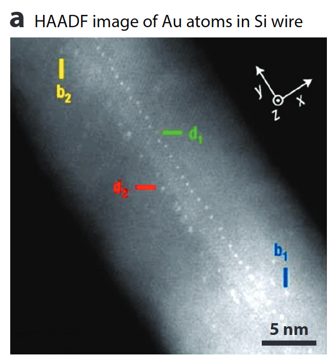
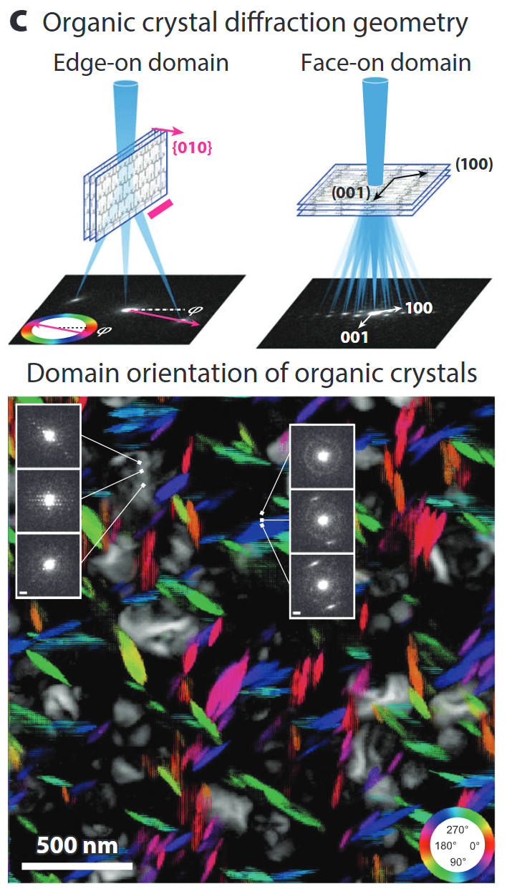
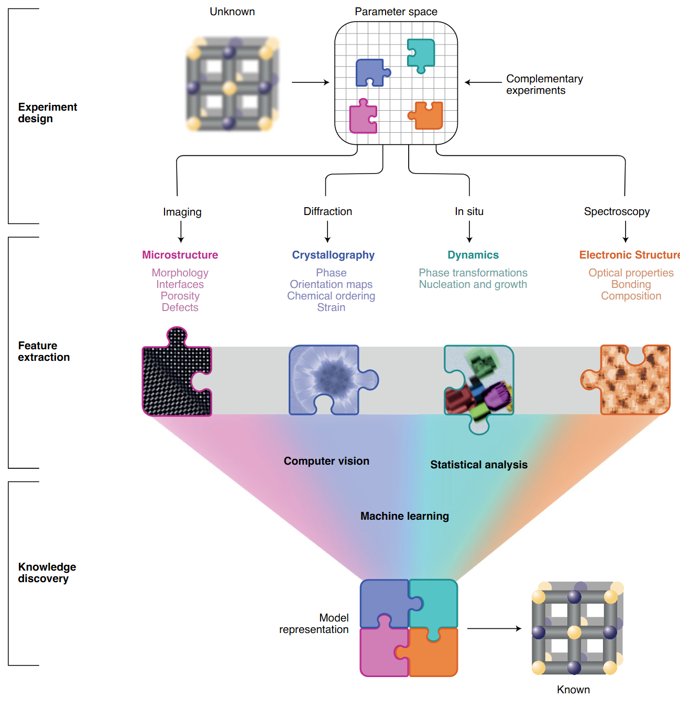
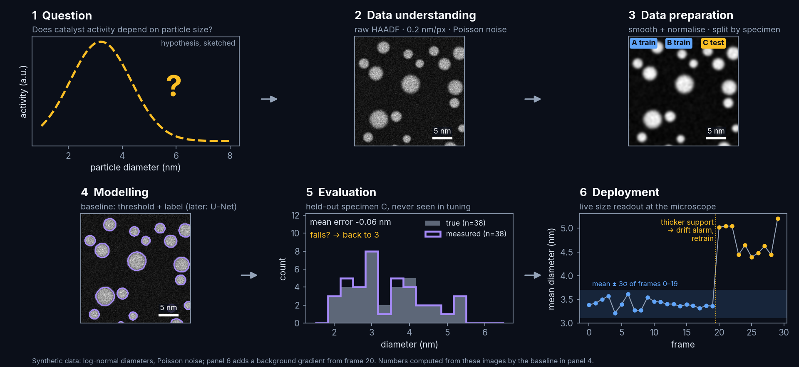

<!-- ===== §1. Course logistics & assessment ===== -->

## Welcome to Data Science for Electron Microscopy

:::: {.incremental}
- A 13-week course at the intersection of materials science, electron microscopy, and data-driven methods.
- You do **not** need to be a programmer — we start from zero Python today.
- By the end you will be able to build and evaluate a complete data-science pipeline on real EM data.
::::

:::: {.notes}
- Open by naming exactly what this course is NOT: it is not a programming course, not a pure ML course, and not a microscopy course — it is all three, woven together around the specific data types that EM produces. Say this loudly so students who panicked about "Python" can relax.
- The one point to land: data science is now as essential to EM as knowing how to focus the beam — the instrument is only half the story.
- Misconception to preempt: several students will assume they need a strong Python background. Correct this now and mean it. The notebook today is designed for absolute beginners; the first three weeks ramp slowly.
- Materials anchor: frame the course around a concrete provocation — a modern 4D-STEM session produces more data in one hour than a human analyst can manually inspect in a year. Python + NumPy is the minimal toolkit for even looking at that data.
- Forward link: Week 2 dives into what "learning from data" actually means, and how noise enters EM measurements.
- Transition: "Let's first do the paperwork — what exactly are you signing up for?"
::::

## Course logistics

:::: {.incremental}
- **Winter semester 2026/27:** 13 weekly lectures (≈ 90 min each), no separate exercise class.
- One scaffolded self-study notebook per week (≈ 75 h total workload).
- **Assessment:** one graded exam: oral if fewer than 5 students take it, written if 5 or more.
- **Time and room:** Fridays 08:15–09:45, room 0.68 (Seminarraum).
- **Course website:** [pelzlab.science/DataScienceForElectronMicroscopy](https://pelzlab.science/DataScienceForElectronMicroscopy/) — all slides and notebooks are public.
- **AI tools are allowed**, e.g. [GitHub Copilot](https://github.com/features/copilot) ([free for students](https://docs.github.com/en/education/about-github-education/github-education-for-students/apply-to-github-education-as-a-student)), [Cursor](https://www.cursor.com/) (paid), [molab](https://molab.marimo.io) (free hosted GPU notebooks via marimo).
::::

:::: {.notes}
- State the assessment once: one graded exam, oral for fewer than 5 students, written for 5 or more. Exam date, duration and allowed aids are announced later — if asked today, say exactly that and do not improvise.
- AI tools are allowed for learning and for the notebooks. Point out that the exam tests understanding without them, so the tools should explain, not replace, the work.
- The one point to land: the weekly self-study notebook is where the practice happens — there is no separate exercise class, so the notebooks are not optional.
- Transition: "Here is the arc of the 13 weeks —"
::::

## Book that covers many topics of the course

:::: {.columns}

::: {.column width="40%"}
](img/d2l.jpg){fig-align="center" width="80%"}
:::

::: {.column width="60%"}
- *Dive into Deep Learning* [@zhang2023dive]: an interactive book with code, maths and discussions.
- Implemented with PyTorch, NumPy/MXNet, JAX and TensorFlow.
- Adopted at 500 universities in 70 countries.
- **We use the PyTorch framework for our coding.**
:::

::::

:::: {.notes}
- The book is free online. Today's molab session follows its sections 2.1 (data manipulation) and 2.5 (automatic differentiation).
- Transition: "Here is the arc of the 13 weeks —"
::::

## Course map — WS 26/27

::: {style="font-size: 0.62em;"}
| Wk | Date | Topic | Wk | Date | Topic |
|---|---|---|---|---|---|
| 1 | 23.10.2026 | Python crash course & the EM data deluge | 8 | 11.12.2026 | Small data: augmentation, transfer & self-supervision |
| 2 | 30.10.2026 | Learning from EM data: signal formation, noise & loss | 9 | 18.12.2026 | Unsupervised learning, autoencoders & latent spaces |
| 3 | 06.11.2026 | Linear algebra, PCA & spectral unmixing | 10 | 08.01.2027 | Attention, transformers & graph networks for EM |
| 4 | 13.11.2026 | Regression, optimisation & honest validation | 11 | 15.01.2027 | Uncertainty, Gaussian processes & autonomous EM |
| 5 | 20.11.2026 | From images to features: descriptors & tree ensembles | 12 | 22.01.2027 | Inverse problems I: regularisation, tomography & sensor fusion |
| 6 | 27.11.2026 | Neural networks & backpropagation | 13 | 29.01.2027 | Inverse problems II: ptychography, generative priors & synthesis |
| 7 | 04.12.2026 | CNNs & U-Nets for microscopy | — | 05.02.2027 | Exam revision |
:::

**Threads through all weeks:** physics → loss/prior · honest validation · architecture as inductive bias · explainability taught with each model family.

:::: {.notes}
- Do not lecture the map — read it together with the students and flag the payoff points: (a) by Week 7 they will train a U-Net on microscopy images, (b) by Week 11 they will attach calibrated uncertainty to a prediction, and (c) by Week 13 they will be able to say whether a model should be trusted. Those are the deliverables of the course in plain language.
- Read the four threads aloud: the noise model decides the loss (Week 2), physics decides augmentation (Week 8), the forward model decides the inverse method (Weeks 12–13); validation must be honest from Week 4 onward; MLP → CNN → GNN/transformer is a progression of inductive biases (Weeks 6, 7, 10); explainability is not a separate week but appears with every model family.
- Materials anchor: map blocks to real EM questions — NMF/PCA for EELS spectrum images (Week 3), atom-column descriptors + random forests for defect classification (Week 5), U-Nets for particle/grain segmentation (Week 7), GP-driven autonomous acquisition (Week 11), tomography and ptychography (Weeks 12–13). Show the red thread early.
- Misconception to preempt: students may expect a monotone difficulty ramp. Flag that Weeks 9–11 (probabilistic latent models, attention, GPs) are a conceptual jump; encourage them to flag confusion immediately rather than letting it accumulate.
- Transition: "Before we go further, let me show you why this course exists at all — the data problem in modern electron microscopy."
- **Timing plan for this 90-min lecture** (minute marks are cumulative):
  - 00–04 Welcome, round of introductions (background: materials / physics / CS? who has used Python?) — 4 min
  - 04–10 Course logistics + first-lecture questions — 6 min
  - 10–13 Course map + four threads — 3 min
  - 13–31 Motivation block — 18 min: data deluge 3 · three-layer framework 3 · manual vs. augmented workflow 3 · EM modalities 2 · PSPP 2 · CRISP-DM 3 · PSPP × CRISP-DM 2
  - 31–33 Why Python — 2 min
  - 33–36 What is a tensor? (incl. 4D-STEM size estimate with the room) — 3 min
  - 36–38 Colab for the self-study notebook — 2 min
  - 38–85 **molab session:** tensors and autograd, run and discussed cell by cell, incl. the ROI crop exercise — 47 min
  - 85–90 Self-study notebooks, Week 2 preview, final questions — 5 min
  - **Total ≈ 90 min** without the STEM block and the book slide. With them (≈ 16 min), shorten the molab session: stop after Part 1 (data manipulation) and start Week 2 with Part 2 (autograd).
  - The Python/NumPy basics (variables, lists, functions, arrays, indexing, broadcasting, matplotlib) are no longer on slides: they are in the molab notebook and in the Colab self-study notebook.
::::

<!-- ===== §2. Why data-driven (S)TEM — the data deluge ===== -->

<!-- ===== §1b. What a modern STEM measures (from the SS25 Unit 1 deck) ===== -->

## STEM capabilities

- Imaging (Z–contrast, light-element, phase-contrast)  
- 4D-STEM diffraction & orientation mapping  
- Spectroscopies (EELS/XEDS, plasmonics)  
- Tomography down to every atom  
- Simulation & data-science backbone  


## STEM operating modes  

::: columns
::: {.column width="70%"}

:::
::: {.column width="30%"}
- A modern microscope can switch **on the fly** between  
  - incoherent imaging,  
  - diffraction/4D-STEM,  
  - EELS / XEDS spectroscopy, and  
  - tilt-series tomography   
- “A synchrotron in a microscope”: one tool covers Å-to-µm length-scales and meV-to-keV energy-scales.  
:::
:::

::: aside
@ophus2023quantitative
:::

## 4DSTEM - Diffraction from a crystalline sample

::: columns
::: {.column width="70%"}
```{=html}
<iframe
  src="widgets/stem4d-sim.html"
  title="Interactive 4DSTEM diffraction simulation (C. Ophus Lab)"
  style="width:100%; height:780px; border:0; border-radius:8px; background:#111;"
  loading="lazy"
  allow="fullscreen"
></iframe>
```
:::
::: {.column width="30%"}
- Drag the probe across the polycrystalline sample — each position yields a CBED pattern.
- Ideally, the diffracted signal is a 2D Fourier transform of the projected potential × probe intensity.
- Bragg-disk positions/intensities fingerprint local structure and orientation.
- Sliders: convergence semiangle (nanobeam ↔ ptychographic) and defocus.
- Interpretation is complicated by dynamical scattering, overlapping grains, background.
:::
:::

::: aside
Interactive app from [C. Ophus Lab, Stanford](https://colab.stanford.edu/interactive)
:::

## 4DSTEM - Diffraction from an amorphous sample

::: columns
::: {.column width="70%"}
```{=html}
<iframe
  src="widgets/amorphous-si.html"
  title="Interactive disordered silicon simulation (C. Ophus Lab)"
  style="width:100%; height:780px; border:0; border-radius:8px; background:#111;"
  loading="lazy"
  allow="fullscreen"
></iframe>
```
:::
::: {.column width="30%"}
- Disorder slider rotates random Si sub-volumes — destroys medium-/long-range order while keeping short-range tetrahedral bonding.
- Diffraction evolves from sharp Bragg spots → amorphous rings / structure-factor halos.
- Rotate the 3D structure; watch nearest-neighbour angular correlation update live.
- Interpretation is harder than crystal diffraction (dynamical scattering, overlapping grains).
:::
:::

::: aside
Interactive app from [C. Ophus Lab, Stanford](https://colab.stanford.edu/interactive)
:::

## 4DSTEM - Design of experiments

::: {layout="[[1]]"}
{fig-align="center" width="100%"}
:::

## Single-atom Z-contrast  

::: columns
::: {.column width="60%"}

:::
::: {.column width="40%"}
- **HAADF** collects high-angle incoherent scattering → intensity ∝ Z^1.6 – Z^1.9 
- Detects & counts **individual heavy atoms**, even inside a nanowire.  
- Sub-picometre column-position metrology enables strain & segregation studies.  
:::
:::

::: aside
@ophus2023quantitative
:::

## Calibrated composition imaging 

::: columns
::: {.column width="60%"}

:::
::: {.column width="40%"}
- Absolute detector-response calibration converts HAADF signal to **atomic areal density** .  
- Enables **nm-scale composition profiles** (here Al₀.₂Ga₀.₈N) & local thickness determination to ≈1 nm.  
:::
:::

::: aside
@ophus2023quantitative
:::

## Seeing light elements – ABF/BF 

::: columns
::: {.column width="60%"}

:::
::: {.column width="40%"}
- **Annular Bright-Field (ABF)** records low-angle transmitted beam: simultaneously heavy & **very light atoms (H, Li, O)**  .  
- Quantitative contrast modelling (multislice + frozen phonon) allows **thickness & defocus refinement**.  
:::
:::

::: aside
@ophus2023quantitative
:::

## Mapping internal fields – DPC  

::: columns
::: {.column width="60%"}

:::
::: {.column width="40%"}
- Segmented / pixelated detectors yield **differential phase-contrast (DPC)** images.  
- Linear to projected **electric-field**; with sample flip or advanced analysis → **magnetic induction** too .  
- Here: TiO₆ octahedra rotations and GB polarity resolved at the picometre level.  
:::
:::

::: aside
@ophus2023quantitative
:::

## 4D-STEM diffraction & orientation mapping  

::: columns
::: {.column width="60%"}
{fig-align="center" width="40%"}
:::
::: {.column width="40%"}
- Pixelated cameras record a **CBED pattern at every probe position** → 4D data cube.  
- From disks, extract local strain, orientation, thickness, even (via ptychography) phases beyond the probe NA.  
- Matching experiment to simulation (thermal + inelastic) achieves **quantitative thickness/chemistry**  
:::
:::

::: aside
@ophus2023quantitative
:::

## Spectroscopy – EELS/XEDS  

::: columns
::: {.column width="60%"}

:::
::: {.column width="40%"}
- **STEM-EELS** resolves plasmons (few eV), phonons (meV) & core-loss fine structure (bonding, oxidation).  
- Combined with modelling (BEM, DFT, multiplet) for **nanophotonic mode mapping** .  
- Parallel XEDS gives simultaneous **3-D elemental maps**.  
:::
:::

::: aside
@ophus2023quantitative
:::

## Atomic electron tomography  

::: columns
::: {.column width="60%"}

:::
::: {.column width="40%"}
- Tilt-series HAADF/ptychography + iterative reconstruction → **3-D coordinates of every atom** in ≤20 nm objects .  
- Enables full **strain tensors**, defect cores, compositional ordering.  
:::
:::

::: aside
@ophus2023quantitative
:::

## Simulation accelerators – PRISM  

::: columns
::: {.column width="60%"}
{fig-align="center" width="40%"}
:::
::: {.column width="40%"}
- Quantitative STEM hinges on **ab-initio accurate multislice simulations**.  
- **PRISM** re-uses plane-wave slices → orders-of-magnitude faster with <1 % error .  
- Powers real-time experiment steering & big-data 4D-STEM analysis.  
:::
:::

::: aside
@ophus2023quantitative
:::

## Take-aways: what a modern STEM measures

- Modern aberration-corrected STEM delivers **Å-resolution imaging, diffraction, spectroscopy & tomography** within one instrument.  
- **Quantification** (composition, fields, 3-D structure) now matches the resolution.  
- Open-source **simulation & Python toolchains** are key enablers for truly **quantitative materials science**.

:::: {.notes}
- This block (about 15 min) gives the EM vocabulary for the course. Do not go deep into the physics; each slide is one measurement and the kind of data it produces.
- The two widgets need a network connection only for the slide itself; they run in the browser.
- Transition: "These instruments produce data faster than anybody can look at it —"
::::

## The data deluge: detector rates over time

::: {.columns}
::: {.column width="55%"}
{width="100%"}
:::
::: {.column width="45%"}
:::: {.incremental}
- **Film era (1990s):** ≈ 1 GB h⁻¹
- **CCD/CMOS (2000s–2010s):** 1–10 GB h⁻¹
- **Direct-electron detectors (today):** up to 200 TB h⁻¹
- That is a **10⁸× increase in two decades**.
- No human can inspect petabyte-scale datasets by eye.
::::
:::
:::

::: {.aside}
@Spurgeon_2020
:::

:::: {.notes}
- This is the motivating fact of the entire course. Spend time on it. The y-axis spans eight orders of magnitude — ask students to guess before revealing the number.
- The one point to land: the bottleneck in modern EM is no longer the instrument — it is the analyst. Data science moves the bottleneck back to the physics.
- Misconception to preempt: "more data is always better." More data is only better if you have the tools to process it. Without a pipeline, 200 TB h⁻¹ is 200 TB h⁻¹ of noise on a hard drive.
- Materials anchor: a single 4D-STEM scan of a grain boundary might generate hundreds of thousands of diffraction patterns. A human analysing one per minute would need years. An automated pipeline can do it overnight.
- Forward link: Week 2 explains exactly where the noise in each pixel of those patterns comes from.
- Transition: "So how do we go from data to insight? The three-layer framework —"
::::

## From data to insight: the three-layer framework

::: {.columns}
::: {.column width="50%"}
{width="100%"}
:::
::: {.column width="50%"}
:::: {.incremental}
- **Layer 1 — Experiment design:** What to measure, at what dose, in what sequence.
- **Layer 2 — Feature extraction:** Turn raw pixel/spectrum data into structured descriptors.
- **Layer 3 — Knowledge discovery:** ML + simulation → structure, chemistry, dynamics.
- The layers form a **feedback loop**: discoveries suggest new experiments.
::::
:::
:::

::: {.aside}
@Spurgeon_2020
:::

:::: {.notes}
- Walk down the three layers with a single concrete example: a 4D-STEM grain-boundary study. Layer 1 = choosing probe size, step size, dose. Layer 2 = Bragg-disk detection, strain maps. Layer 3 = grain orientation classification, automated defect cataloguing.
- The one point to land: data science does not replace physics — it is embedded in the middle of a physically grounded workflow. You still need to know what a diffraction pattern means.
- Misconception to preempt: "ML is the magic black box at the end." Wrong — it sits in Layer 3 and depends entirely on the quality of Layers 1 and 2. Garbage in, garbage out.
- Materials anchor: the feedback arrow is the new thing — traditional EM workflow is open-loop (plan, measure, analyse, publish). The data-driven paradigm closes the loop in near real time.
- Detail per layer [@Spurgeon_2020], if asked: (1) GPU-accelerated simulations predict detection limits and dose budgets before the first electron hits the sample; ML can mine prior work to recommend imaging/spectroscopy modes — fewer trial-and-error sessions. (2) Record complete data streams (e.g. 4D-STEM cubes) for flexible post-processing; combine modalities to overcome projection and damage artefacts; needs automation and low-level microscope access for batch surveys and in-situ work. (3) AI/ML trained on physical models classifies multidimensional signals into structure, bonding and dynamics; FAIR data and open repositories enable meta-analysis and reproducibility; vision: adaptive microscopy in which the data choose the next step.
- Forward link: throughout the course each new method will be placed in one of these three layers, so this diagram is a map you will return to repeatedly.
- Transition: "Let's look at how the workflow itself has evolved —"
::::

## Manual vs. augmented EM workflow

::: {.columns}
::: {.column width="55%"}
{width="100%"}
:::
::: {.column width="45%"}
:::: {.incremental}
- **Manual:** Choose features by eye, collect one modality, iterate slowly.
- **Augmented:** Collect complete data streams, ML finds features automatically, simulation validates.
- **Goal:** Closed-loop, autonomous experiment steering.
::::
:::
:::

::: {.aside}
@Spurgeon_2020
:::

:::: {.notes}
- The key word is "augmented" — we are not replacing the microscopist. We are giving them a co-pilot. Keep this framing; it is less threatening and more accurate.
- The one point to land: the manual workflow scales linearly with analyst time; the augmented workflow scales sub-linearly because the bottleneck shifts to compute, which is cheap.
- Misconception to preempt: autonomous EM means pressing a button and walking away. Currently it means the system suggests the next beam position or acquisition parameter; a trained human is still in the loop for safety-critical decisions.
- Materials anchor: in-situ heating experiments are a canonical use case — at 5 frames/s you cannot watch and annotate every frame manually; an automated detector flags interesting events for the analyst to review.
- Transition: "Before we can write any analysis code, we need a mental model for how to structure a data project. Two frameworks in the next five slides."
::::

## EM modalities — the data landscape

:::: {.incremental}
- **HAADF-STEM:** intensity ∝ Z¹·⁶–Z¹·⁹ — heavy atoms appear bright; single-atom sensitivity.
- **4D-STEM:** a 2-D diffraction pattern at every probe position → 4-D data cube (x, y, kx, ky).
- **EELS/EDS:** energy-loss/X-ray spectra at each pixel → chemical identity at nm resolution.
- **Tomography:** tilt-series → 3-D atomic coordinates with pm precision.
- Each modality produces a **different tensor shape** — this course teaches you to handle all of them.
::::

:::: {.notes}
- Do not go deep on the physics — this is a single slide to give students vocabulary. They will encounter all these terms in the notebooks and need at least a one-line mental model for each.
- The one point to land: every modality maps neatly onto a NumPy array with a specific shape. HAADF is 2-D (rows × cols); 4D-STEM is 4-D (x, y, kx, ky); EELS is 3-D (x, y, energy). Learning array indexing today unlocks all of them.
- Misconception to preempt: "I only work with HAADF, so I can skip the 4D stuff." The course uses HAADF as the running example precisely because it is the simplest shape — but all concepts generalise to higher-dimensional modalities.
- Materials anchor: ask the room which modalities they have used. Usually there is a spread; use that diversity as a strength — pair students who have 4D-STEM experience with those who have only done HAADF.
- Forward link: Week 2 will explain where the Poisson and detector noise in each modality comes from.
- Transition: "Now the two mental-model frameworks that will structure everything we do."
::::

<!-- ===== §3. PSPP + CRISP-DM ===== -->

## The PSPP paradigm

:::: {.incremental}
- **P**rocessing → **S**tructure → **P**roperty → **P**erformance
- In EM: synthesis parameters → atomic structure (images/spectra) → material property → device behaviour.
- Each arrow is a potential ML task: regression, classification, inverse design.
- **Key insight:** structure *mediates* properties — you cannot skip it.
::::

:::: {.notes}
- Draw the chain on the board or annotate the slide live. Students from a pure materials background will immediately recognise PSPP from their intro courses; students from physics may not — bridge both.
- The one point to land: PSPP tells you *where in the causal chain your data lives*. If you have images (structure) but want to predict properties, the arrow between S and P is your ML task.
- Misconception to preempt: treating the chain as purely sequential. In reality the arrow from Performance back to Processing exists — that is inverse design / materials discovery. Flag it as an advanced topic (inverse problems, Weeks 12–13) without going further now.
- Materials anchor: grain size is a structure variable; yield strength is a property. A CNN that maps HAADF images → grain size is an S-stage model. A regression from grain size → yield strength is an S→P model. Composition and processing parameters live at the first P (Processing) stage; the model learns the arrows of the PSPP chain.
- Forward link: CRISP-DM (next slide) tells you *how* to execute any of those arrows systematically.
- Transition: "PSPP says what to model; CRISP-DM says how to execute the project."
::::

## The CRISP-DM workflow — one EM example

{width="100%" fig-alt="Six panels: question, raw HAADF image, smoothed image split by specimen, segmentation contours, size histogram on the held-out specimen, live size readout with a drift alarm."}

**The steps loop back:** a failed evaluation sends you back to data preparation, not to a bigger model.

:::: {.notes}
- Walk the six panels left to right, top to bottom. The phases: (1) business/scientific understanding, (2) data understanding, (3) data preparation, (4) modelling, (5) evaluation, (6) deployment and monitoring.
- The example: does catalyst activity depend on particle size? Panel 2 asks what the data is (dose, pixel size, how many specimens). Panel 3 splits by specimen, so test images come from a sample the model never saw (Week 4). Panel 4 is a threshold baseline; Week 7 replaces it by a U-Net. Panel 5 checks the size distribution on specimen C. Panel 6: a thicker support film from frame 20 breaks the global threshold, the readout leaves the mean ± 3σ band, and the alarm says retrain.
- All images are synthetic (script `img/make_crispdm_nanoparticles.py`); the numbers are computed from them.
- CRISP-DM was originally a business analytics framework but maps perfectly onto scientific lab workflows. The key addition for science is Phase 1: instead of "ROI," ask "what is the falsifiable hypothesis?"
- The one point to land: steps run in order *and* loop back. If evaluation fails, you return to data preparation, not to modelling. Most beginner errors happen by jumping to Phase 4 (modelling) before finishing Phase 2 (data understanding).
- Misconception to preempt: "data preparation is the boring part." In practice it takes 60–80% of project time and is where data leakage, unit errors, and class imbalance hide.
- Materials anchor: the classic failure story — a neural net achieving 99% accuracy on steel micrograph classification, which turned out to be learning microscope serial numbers correlated with steel grades. Phase 2 inspection would have caught this immediately.
- Forward link: every week's notebook follows CRISP-DM implicitly — you will always see EDA before any model code.
- Transition: "Now let us put PSPP and CRISP-DM together."
::::

## PSPP × CRISP-DM: putting it together

:::: {.incremental}
- **Phase 1 (understanding):** identify which PSPP arrow is your task.
- **Phase 2–3 (data):** understand the tensor shape and noise model of your EM modality.
- **Phase 4 (modelling):** choose a model appropriate for that tensor shape.
- **Phase 5 (evaluation):** measure generalisation — not training accuracy.
- **Principle:** domain knowledge is not optional; it goes into every phase.
::::

:::: {.notes}
- This synthesis slide is the conceptual keystone of the whole course. Do not rush it. Draw a 4×4 (simplified) grid on the board: PSPP columns (P, S, P, P) × CRISP-DM rows (understand, data, model, evaluate). Each cell of that matrix is a potential lecture topic.
- The one point to land: data science without domain knowledge produces confounded, fragile models. Domain knowledge without data science produces insights that do not scale. This course teaches the combination.
- Misconception to preempt: "if I follow CRISP-DM mechanically I will get a good result." CRISP-DM is a checklist, not a recipe. Judgement — knowing which PSPP arrow matters, which noise model applies, which baseline is appropriate — is what this course builds.
- Transition: "Enough framework. Why Python, and how we will code in this course."
::::

<!-- ===== §4. Python, tensors and the molab session ===== -->

## Python in one slide: why Python?

:::: {.incremental}
- **Free, open-source,** runs on any OS and in your browser (Google Colab).
- **Readable syntax** — code that reads close to pseudocode.
- **Massive ecosystem:** NumPy, SciPy, matplotlib, scikit-learn, PyTorch — all the tools this course uses.
- **Interactive:** Jupyter notebooks let you run one cell at a time and see results immediately.
- If you know MATLAB or any scripting language, Python will feel familiar within hours.
::::

:::: {.notes}
- Keep this brief — students will learn Python by doing, not by reading about it. The goal of this slide is to pre-answer the unspoken "why not MATLAB?" question without making it a debate.
- The one point to land: Python's power in data science comes almost entirely from its libraries. The language itself is modest; NumPy, matplotlib, and scikit-learn are where the action is.
- Misconception to preempt: "Python is too slow for real EM data." NumPy and PyTorch are implemented in C/Fortran/CUDA under the hood; vectorised operations run at near-C speed. The "slow Python" reputation applies to pure for-loops, which we will actively teach students to avoid.
- Materials anchor: essentially every open-source EM package (py4DSTEM, hyperspy, atomap, abTEM) is Python. Learning Python IS learning the EM software ecosystem.
- Transition: "We learn the code in molab, where we can run it. First one word you will hear all semester: tensor."
::::

## What is a tensor?

:::: {.incremental}
- A **tensor** is an n-dimensional array with a fixed numeric type.
- **0-D (scalar):** a single number — one pixel value.
- **1-D (vector):** a spectrum — 1024 energy channels.
- **2-D (matrix):** a HAADF image — shape (512, 512).
- **3-D tensor:** a spectral image (EELS map) — shape (256, 256, 1024).
- **4-D tensor:** a 4D-STEM scan — shape (256, 256, 128, 128).
::::

:::: {.notes}
- Tensors are central to every deep learning framework — PyTorch and TensorFlow both represent data as tensors. NumPy's ndarray IS a tensor (without GPU support or autograd).
- The one point to land: the word "tensor" should never be intimidating. It is just an ndarray with possibly more than two dimensions. Once students stop fearing the word they will read PyTorch documentation without anxiety.
- Misconception to preempt: "tensors are something advanced, only needed for deep learning." Wrong — a 4D-STEM dataset is a 4-D tensor regardless of whether you use deep learning. The concept is fundamental to how data is stored, not to any particular analysis method.
- Materials anchor: work through the 4D-STEM example slowly — 256 probe positions in x, 256 in y, 128 detector pixels in kx, 128 in ky. Ask the room to calculate total size: 256² × 128² × 4 bytes ≈ 4 GB for one scan. That is why dtype matters (float32 vs float64).
- Forward link: the molab session right after this uses PyTorch tensors, which add GPU support and automatic differentiation to this concept.
- Transition: "The tool we use to run code together: Google Colab."
::::

## Running code in Google Colab

:::: {.incremental}
- **Google Colab:** a free Jupyter notebook environment in your browser, GPU-enabled.
- Go to [colab.research.google.com](https://colab.research.google.com) — sign in with your Google account.
- Open or upload a `.ipynb` notebook file.
- **Shift+Enter** runs the current cell and moves to the next.
- Runtime → Change Runtime Type → **GPU** (for deep learning, Weeks 6+).
- All this week's code runs without a GPU — no special setup needed.
::::

:::: {.notes}
- Do a live demo if internet is available. Create a new notebook, type `1+1`, run it. The psychological barrier to "starting to code" is enormous; remove it in two minutes.
- The one point to land: Colab does **not** auto-save to Drive — the runtime file is lost on disconnect unless you File → Save a copy in Drive, or you opened the notebook from Drive. Tell students explicitly so they don't lose work.
- Misconception to preempt: "I need to install Python on my laptop." Not for this course — Colab runs everything in the cloud. Local Python installation (Anaconda) is useful but not required.
- Materials anchor: the week01_python_numpy notebook (handed out today) is Colab-compatible. Students can open it directly from the course repository link and run it without any setup.
- Forward link: Week 6 (neural networks) will first use the GPU runtime — remind them when the time comes.
- Transition: "Colab is for the self-study notebook. In the lecture we code together in molab."
::::

## Hands-on in molab: PyTorch tensors & automatic differentiation

:::: {.columns}
::: {.column width="58%"}
- **Open in molab:** [](https://molab.marimo.io/github/ECLIPSE-Lab/public_presentations/blob/main/data_science_for_em/notebooks/unit01_tensors_autograd.py)
- **To edit:** sign in to molab (free, Google or e-mail) → click **Fork** → your own copy, saved in your workspace. *Run it now* runs it without saving.
- Notebook file: `notebooks/unit01_tensors_autograd.py` (marimo, also on [GitHub](https://github.com/ECLIPSE-Lab/public_presentations/blob/main/data_science_for_em/notebooks/unit01_tensors_autograd.py)).
- **Part 1, data manipulation** [@zhang2023dive, sec. 2.1]: create, reshape, index, compute, broadcast, save memory, convert to NumPy.
- **Part 2, automatic differentiation** [@zhang2023dive, sec. 2.5]: `backward()`, gradient accumulation, non-scalar outputs, `detach()`, control flow.
- **Exercises with automatic checks:** ROI crop, 3-D broadcasting, $\frac{d}{dx}\sin x$ by autograd, the chain rule for $f(x) = (\log x^2)\sin x + x^{-1}$.
:::
::: {.column width="42%"}
- marimo is **reactive**: change a cell or a slider and every dependent cell runs again.
- Every section has an EM example: Poisson images, the log scale for diffraction, frame averaging, threshold masks, scan-stripe removal.
:::
::::

:::: {.notes}
- This replaces the SS25 tensor and autograd slides: the students do them in molab with the lecturer, section by section.
- Before the session, ask everyone to sign in to molab and click Fork; the shared link is a read-only preview. The link points to the notebook file on GitHub, so pushed fixes reach the students without a new link.
- Start with the "How this notebook works" box: students coming from Colab must know that each name is defined in one cell only.
- The exercises have hidden solutions in closed boxes; the check cells turn green when an answer is right.
::::

<!-- ===== Forward link & housekeeping ===== -->

## Self-study this week

:::: {.incremental}
- **Notebook:** `notebooks/week01_python_numpy.ipynb` — "Python & NumPy in 90 minutes."
  - Variables, lists, functions, NumPy arrays, broadcasting, matplotlib.
  - Final "your turn" exercise: crop and min-max-normalise a synthetic STEM-like image.
- **Open in Colab:** [](https://colab.research.google.com/github/ECLIPSE-Lab/public_presentations/blob/main/data_science_for_em/notebooks/week01_python_numpy.ipynb) — no local installation needed.
- **molab notebook:** [](https://molab.marimo.io/github/ECLIPSE-Lab/public_presentations/blob/main/data_science_for_em/notebooks/unit01_tensors_autograd.py) — sign in and click **Fork** to get your own editable copy, then finish the exercises that you did not complete in class.
- **Goal:** understand everything in both notebooks before Week 2.
- **If you are stuck:** the StudOn forum, or office hours (times announced on the website).
::::

:::: {.notes}
- Distribute the Colab link (or GitHub link) during or immediately after the lecture. Students who try to open the notebook the night before Week 2 will run out of time — say this explicitly.
- The one point to land: the notebook takes about 90 minutes for a complete beginner. If it takes longer, that is fine — the only deadline is "before Week 2." If it takes less than 60 minutes, they should explore further or try the same steps on one of their own EM images.
- Misconception to preempt: "I will do it later, I already know Python." Even experienced Python users should skim the EM sections — the STEM image loading and ROI examples are specific to this course and will appear in later notebooks.
- Materials anchor: the "your turn" exercise at the end — crop and normalise a STEM image — is the exact preprocessing step needed for every image analysis later in the course.
- Transition: "Next week we go deeper — what does it actually mean to learn from data, and where does the noise in your detector come from?"
::::

## Looking ahead — Week 2

:::: {.incremental}
- **Topic:** "Learning from EM data: signal formation, noise & loss"
- Learning vs. classical analysis; white-, grey- and black-box models.
- The data-formation chain: specimen → interaction → detector → digitisation → metadata.
- Detectors, dose, Nyquist sampling & aliasing; Poisson vs. Gaussian noise.
- **Noise model → likelihood → loss:** why MSE is the wrong loss for low-count EM data.
- **Prerequisite:** complete the Week 1 notebook; you will need NumPy array operations.
::::

:::: {.notes}
- Keep this slide light — the goal is to prime curiosity, not to lecture the next week's content.
- The one point to land: the Poisson noise simulation in today's notebook is not arbitrary — it is the correct physical noise model for EM detectors. Week 2 will derive this from first principles and show that it dictates the loss function. Students who understand why they used `np.random.poisson` in the notebook will find Week 2 much more satisfying.
- Misconception to preempt: "I will look at Week 2 materials before I finish the Week 1 notebook." Resist the urge — the notebook is designed as a prerequisite, and Week 2 assumes its contents.
- Transition: "See you next week — and please do open the notebook today."
::::

<!-- BEGIN prev-next -->

## Continue

- &rarr; Next: [Unit 02 &mdash; Learning from EM data: signal formation, noise & loss](../02_em_data_formation/01_intro.html)
- [All courses](../../index.html)

<!-- END prev-next -->

## References

::: {#refs}
:::
