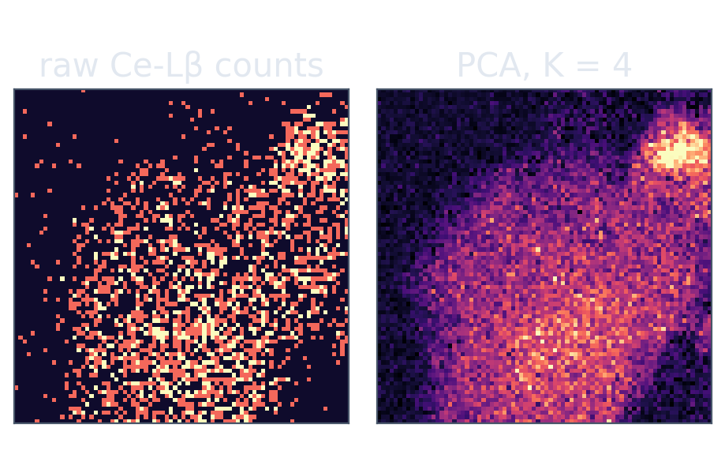
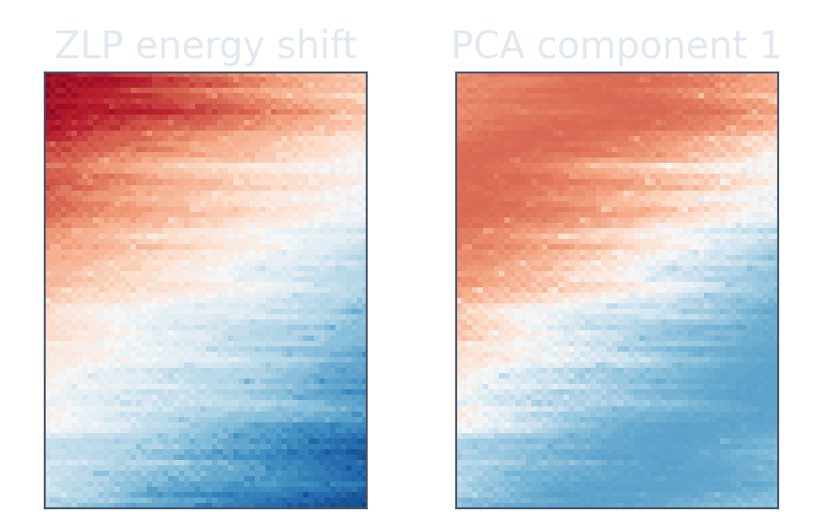
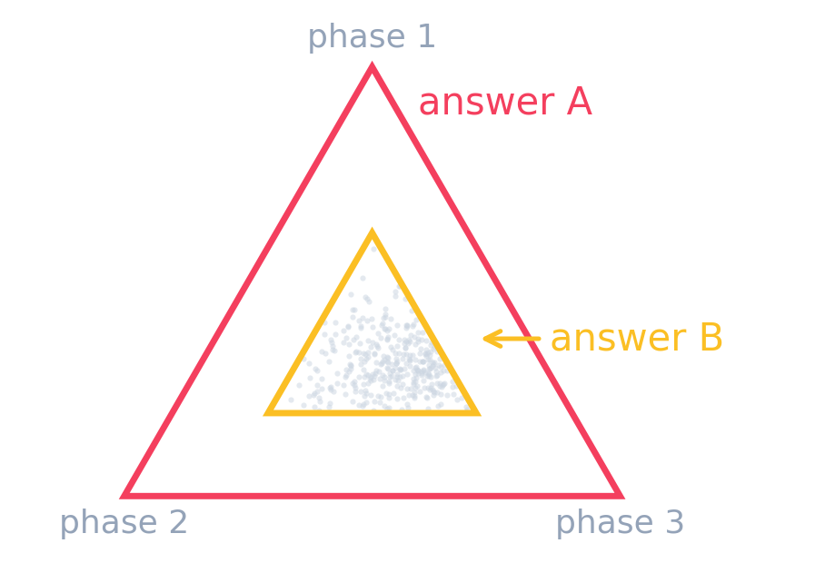
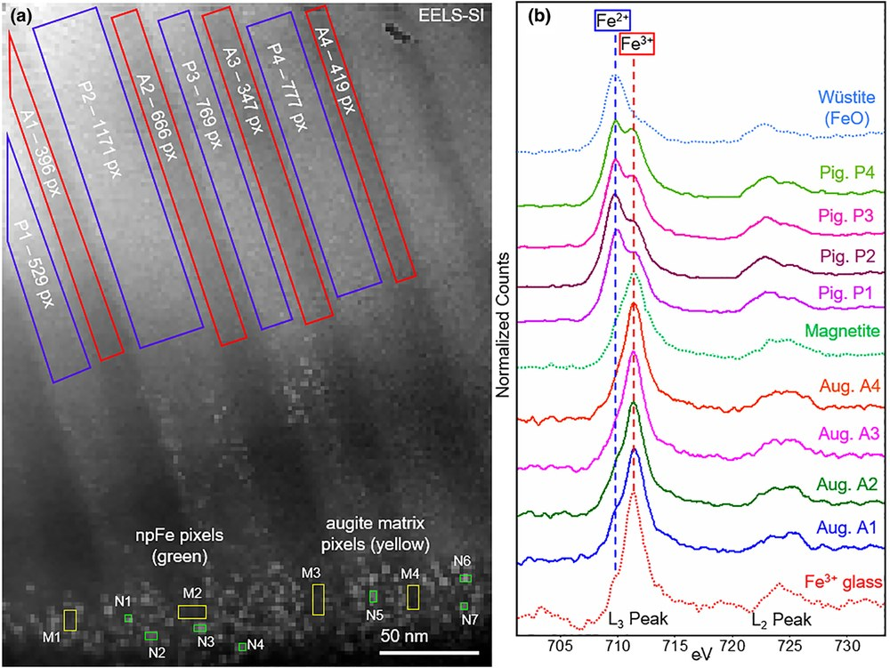
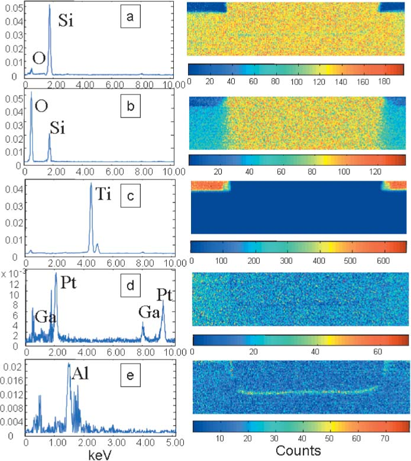
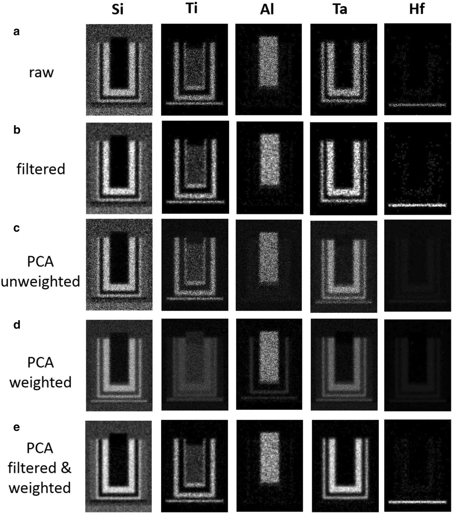
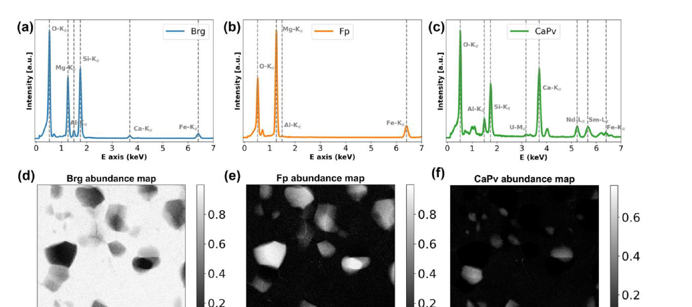

---
# How this deck works
# - Every <div class="xp" data-xp="NAME"> is an interactive explainer. xp/main.js mounts it when its slide shows.
# - The widget code is in xp/*.js (no external libraries; the deck runs offline). Test page: xp/dev.html?w=NAME.
# - All explainers use real, openly licensed EM data (xp/data/*.json). xp/prep/make_data.py builds them from the raw files.
# - `data-station="k"` on a slide draws the red-line rail (six stations, xp/redline.js) at the top right.
# - Timing plan (90 min): opening 0-4, Vector 4-13, Matrix 13-23, SVD 23-34, PCA 34-56, Unmix 56-72,
#   Trust 72-84, wrap-up 84-88, 2 min slack. Backup slides after "Continue".
title: |-
  Data Science for Electron Microscopy<br>
  Week 3: Linear algebra, PCA & spectral unmixing
author:
- name: Prof. Dr. Philipp Pelz
  affiliation:
  - FAU Erlangen-Nürnberg
  - Institute of Micro- and Nanostructure Research
bibliography: ref.bib
csl: custom.csl
resources:
  - xp/*.js
  - xp/*.css
  - xp/dev.html
  - xp/data/*.json
execute:
  eval: false
  echo: true
format:
  revealjs:
    chalkboard: true
    width: 1920
    height: 1080
    template-partials:
    - title-slide.html
    css:
    - custom.css
    - xp/xp.css
    theme: custom.scss
    slide-number: c/t
    logo: eclipse_logo_small.png
    background-transition: fade
    incremental: false
    menu:
      side: left
      loadIcons: true
    footer: ©Philipp Pelz - FAU Erlangen-Nürnberg - Data Science for Electron Microscopy
    include-after-body:
      text: |
        <script type="module" src="xp/main.js"></script>
---

## Three numbers you will understand today

::: {.claim}
Week 2: the noise model decides the loss. Today: the same rule decides how we *factorise* a spectrum image, and every example is real data.
:::

::: {.kpi-row}
::: {.kpi .fragment}
[58]{.big}

{.kpi-img fig-alt="Ce map from 0.4 counts per pixel: raw and PCA"}

[counts per pixel in a real EDS map: the Ce window gets only 0.4, yet PCA gives a clean map]{.lbl}

[→ Act 4 · PCA]{.act-tag}
:::
::: {.kpi .fragment}
[0.96]{.big}

{.kpi-img fig-alt="ZLP shift map and PCA component 1"}

[correlation of a PCA "component" with the energy drift of the spectrometer]{.lbl}

[→ Act 4 · PCA]{.act-tag}
:::
::: {.kpi .fragment}
[∞]{.big}

{.kpi-img fig-alt="two triangles that enclose the same pixels"}

[unmixings that fit the data *exactly equally well*: A and B are two of them]{.lbl}

[→ Act 6 · Trust]{.act-tag}
:::
:::

::: {.notes}
- Open with the link to Week 2: a loss is the negative log-likelihood of a noise model. PCA minimises a squared error, so it silently assumes Gaussian noise. NMF with the KL divergence minimises the Poisson NLL. Today we see what that means for real spectrum images.
- The pictures make the numbers concrete. Left: the Ce-Lβ window, raw counts vs weighted PCA with K = 4 (eds-pca explainer). Middle: the measured ZLP shift map next to the PCA component-1 score map; they look the same. Right: the 358 mixed pixels on the simplex; triangles A and B both enclose them and give the same fit error (simplex explainer, ambiguity mode). Built by xp/prep/make_kpi.py.
- Do not explain the three numbers now. Say: "By the end you can explain each of them." Come back to them on the summary slide.
- 58: the CeVO₃/Al₂O₃ EDS spectrum image of Act 4 has on average 58 counts per pixel, spread over 250 channels. Most channels in one pixel are 0 or 1. PCA pools the counts of 6 400 pixels.
- 0.96: in a real ZLP spectrum image, the first principal component is the derivative of the peak, and its score map matches the measured drift map with r = 0.96. A "component" is not always chemistry.
- ∞: NMF and MCR are not unique. A whole band of endmember spectra and abundance maps gives the same fit. Only constraints can choose.
- Data used today (all experimental, all CC BY 4.0): STEM-Bank-26 [@hollyer2026stembank] (CeVO₃ on Al₂O₃: EELS, EDS, ADF recorded together; SrFeOₓ/LaAlO₃ HAADF), the lunar pyroxene EELS data of Cymes et al. [@cymes2023ferric] (Fe-L standards, ZLP drift), and SPED of a twinned GaAs nanowire [@martineau2019sped].
:::

## Today's red line: from a datacube to a phase map you can trust

::: {.xp data-xp="redline"}
:::

::: {.notes}
- This is the map of the lecture. Six stations, each one question. The rail at the top right of every slide shows where we are.
- 1 Vector: a spectrum is a vector; the dot product measures similarity; projection says "how much of a reference is in it".
- 2 Matrix: a spectrum image is a matrix X (rows = pixels, columns = channels). Least squares is projection onto the column space.
- 3 SVD: every matrix is rotate · stretch · rotate. Truncating the SVD gives the best low-rank approximation.
- 4 PCA: SVD of the centred data. Signal is low-rank, noise is full-rank, so PCA denoises. Poisson counts need weighting first. Drift creates fake components.
- 5 Unmix: pixels are mixtures of phases. NMF and MCR find non-negative endmembers and abundances.
- 6 Trust: factorisations are not unique; truncation can hide rare phases; overlapping peaks are ill-conditioned. The dashed arrow: the residual sends you back to K, to the weighting, or to the constraints.
- Learning outcomes (one per station): (1) compute dot products, cos θ and projections of spectra; (2) reshape a spectrum image into X and back, and write a background fit as least squares; (3) explain the SVD geometrically and state Eckart–Young; (4) run PCA, read a scree plot, Poisson-weight counts and recognise a drift component; (5) formulate the linear mixing model, NMF and MCR-ALS, and run multiplicative updates; (6) diagnose rotational ambiguity, truncation bias and ill-conditioning with residuals, restarts and κ.
:::

<!-- ===== Act 1. Vector ===== -->

## {.act}

::: {.act-kicker}
Act 1 · Vector
:::
::: {.act-question}
When are two spectra alike?
:::
::: {.xp data-xp="redline" data-focus="1"}
:::

## A spectrum is a vector. Similarity is an angle. {data-station="1"}

::: {.xp data-xp="projection"}
:::

::: {.paper-fig .absolute top="668" left="1024" width="640"}
{fig-alt="Cymes et al. 2023, Fig. 10: HAADF image of a lunar pyroxene rim and Fe-L EELS spectra next to FeO, magnetite and Fe3+ glass standards"}

[Source study: Fe-L₂,₃ spectra of a lunar pyroxene and the Fe²⁺ / Fe³⁺ standards. Dashed lines: the two L₃ channels used here. Fig. 10 of [@cymes2023ferric], CC BY 4.0.]{.paper-cap}
:::

::: {.notes}
- Setup: keep only two channels of a real Fe-L₂,₃ EELS spectrum, 708.8 eV (the L₃ maximum of Fe²⁺) and 710.2 eV (the L₃ maximum of Fe³⁺). Then a spectrum is a vector in the plane: a point, drawn as an arrow from the origin. Blue: the FeO (Fe²⁺) standard. Red: magnetite (Fe²⁺ + 2 Fe³⁺). Data: Cymes et al. [@cymes2023ferric].
- Show the paper figure (bottom right) first: this is where the data come from. Fe-L₃ spectra of a space-weathered lunar pyroxene, stacked with the FeO, magnetite and Fe³⁺ glass standards. The two dashed lines are the Fe²⁺ and Fe³⁺ L₃ maxima: the two channels of our plot. The question of the paper is "how much Fe³⁺ is in each spectrum?". Our energy axis is shifted by about 1 eV against the published figure (different calibration of the data files).
- Dot product aᵀb = ‖a‖‖b‖ cos θ. cos θ = 1: same shape (only the thickness differs). cos θ = 0: nothing in common. For spectra, cos θ is the standard "spectral angle" similarity.
- Projection onto the unit vector â: score c = âᵀb; projection c â (green); residual r = b − c â (orange, dashed). The residual is perpendicular to a: rᵀa = 0 (readout).
- Demo: switch b between the standards. Fe metal and FeO have almost the same direction in these two channels. Fe³⁺ glass points more towards channel 2. Drag the tips: the right angle stays.
- The one point to land: "How much of reference a is in spectrum b?" is a projection. The closest point to b on the line through a is c â, and the error is perpendicular to the line.
- Misconception: "a spectrum is just a list of numbers." It is, but the list is also a point in ℝᴰ, and geometry (angles, lengths, projections) works in any dimension. Here D = 2; the real spectrum has D = 301 channels; the formulas do not change.
- Transition: "Now use all 301 channels and two references at once."
:::

## Projection onto references: how much Fe³⁺? {data-station="1"}

::: {.xp data-xp="fe-match"}
:::

::: {.notes}
- Model: y ≈ w₂·m(Fe²⁺) + w₃·m(Fe³⁺). The references are the columns of X (301 × 2). Least squares = orthogonal projection of y onto the plane spanned by the two references. The residual r is perpendicular to both columns: Xᵀr = 0 (readout). Fe³⁺/ΣFe = w₃ / (w₂ + w₃).
- Demo 1 (planted truth): "planted mix" builds y from the two real standards with a known Fe³⁺ fraction plus noise. Move the fraction slider: the projection recovers it. Increase the noise: still unbiased, only noisier. Always test a method on a case where you know the answer.
- Demo 2 (real): switch to "real magnetite". Stoichiometry says Fe³⁺/ΣFe = 2/3. The projection says 0.43, and the residual has structure near the L₃ peak. The fit is the best point in the span of the references, but magnetite is not in that span: half of its Fe³⁺ sits on tetrahedral sites, and the glass standard has a different Fe³⁺ environment. A structured residual means a missing reference, not noise.
- cos θ bars: all three references have cos θ ≈ 0.9 with every unknown. One global similarity number cannot separate valence states; the projection onto a subspace can.
- EM application: Cymes et al. used exactly this kind of reference fitting of Fe-L₃ edges to detect Fe³⁺ in exsolved lunar pyroxene (space weathering, redox conditions on the Moon) [@cymes2023ferric]. Commercial "MLLS fitting" in DigitalMicrograph and HyperSpy model fits are the same projection.
- Misconception: "a good fit means the right answer." The projection always returns *some* fractions. Check the residual before you trust them. This idea comes back in Act 6.
- Transition: "One spectrum is a vector. A spectrum image is many vectors: a matrix."
:::

<!-- ===== Act 2. Matrix ===== -->

## {.act}

::: {.act-kicker}
Act 2 · Matrix
:::
::: {.act-question}
How does a datacube become a matrix?
:::
::: {.xp data-xp="redline" data-focus="2"}
:::

## A spectrum image is a matrix: rows are pixels, columns are channels {data-station="2"}

::: {.claim}
`X = cube.reshape(ny * nx, ne)` — every method today factorises this X ≈ (maps) × (spectra).
:::

::: {.xp data-xp="datacube"}
:::

::: {.notes}
- Data: a real STEM-EELS spectrum image of CeVO₃ particles on an Al₂O₃ support, from STEM-Bank-26 [@hollyer2026stembank]. Recorded 80 × 80 pixels × 2048 channels (463–975 eV); shown here 2 × 2 binned (1.25 nm pixels) with 1 eV channels: X is 1 600 × 512.
- Click a pixel: its spectrum is one row of X (white line in the matrix sketch). Pick an edge: the energy window is a block of columns; summing it per row and reshaping to 40 × 40 gives a map.
- Demo: switch the map between "raw window sum" and "background removed". The raw Ce-M window sum mostly shows thickness, because the window sits on a large background. After a power-law background is removed per pixel (next slide), the Ce-rich particle at the top right appears. The V-L map shows the CeVOₓ particle.
- The one point to land: the reshape changes only the indexing, not the data. Row i is the spectrum at pixel (i // nx, i % nx). After PCA or NMF, the per-pixel results (N × K) reshape back to K maps.
- Convention in this course: observations (pixels) in rows, features (channels) in columns. sklearn and HyperSpy use the same layout internally. Always check X.shape: a transposed matrix gives meaningless PCA.
- Naming trap: HyperSpy calls the per-pixel maps "loadings" and the spectra "factors". Many statistics texts use the opposite words. Check shapes, not names.
- Transition: "The background removal on this slide is the first least-squares fit of the day."
:::

## Least squares is a projection: the power-law background {data-station="2"}

::: {.xp data-xp="bg-fit"}
:::

::: {.notes}
- Physics: below an ionisation edge, the EELS background falls as a power law, I(E) = A·E⁻ʳ, with r ≈ 2–6 [@egerton2011eels]. In log-log space this is a straight line: log I = log A − r log E. Linear in the unknowns (log A, r).
- Least squares: X = [1, log E] (one row per channel in the fit window), y = log I. The best ŵ is the projection of y onto the column space of X. The residual is perpendicular to both columns: Xᵀ(y − Xŵ) = 0. Rearranged, these are the normal equations XᵀX ŵ = Xᵀy [@bishop2006pattern]. "Normal" means perpendicular, not Gaussian. The readout shows Xᵀr ≈ 10⁻¹³: zero to machine precision.
- Demo: move the window start towards the edge onset; the extrapolated background bends, and the edge signal changes by tens of percent. Make the window very narrow: the fit becomes noisy. Switch to Ce-M₄,₅ and to the Al₂O₃ support region: no Ce edge, only noise around zero. That is the correct answer.
- The one point to land: every least-squares fit you will meet (background, MLLS, regression in Week 4) is a projection onto the span of the model columns.
- Misconception: "the background fit is a detail." For a weak edge, a 2 % background error can be larger than the edge. At low dose the fit window must be wide and close to the onset; Cueva et al. discuss better background models for noisy maps [@cueva2012eels].
- Note (Week 2 link): an unweighted fit in log space treats every channel as equally noisy. For counts, weights ∝ counts are better. Week 4 formalises weighted least squares.
- Transition: "Projection onto given columns is easy. What if we must *find* the best columns? That is the SVD."
:::

<!-- ===== Act 3. SVD ===== -->

## {.act}

::: {.act-kicker}
Act 3 · SVD
:::
::: {.act-question}
What does any matrix do to space?
:::
::: {.xp data-xp="redline" data-focus="3"}
:::

## Every matrix rotates, stretches, rotates: A = UΣVᵀ {data-station="3"}

::: {.xp data-xp="svd-2x2"}
:::

::: {.notes}
- Any real matrix A has a singular value decomposition A = UΣVᵀ: Vᵀ rotates (or reflects), Σ stretches along the axes by the singular values σ₁ ≥ σ₂ ≥ 0, U rotates again. The unit circle becomes an ellipse with semi-axes σ₁ and σ₂.
- EM application: in 4D-STEM strain mapping, A maps the reference lattice vectors onto the measured ones. Its SVD separates the lattice rotation (U Vᵀ, the polar decomposition) from the principal stretches σ₁, σ₂; σ − 1 are the principal strains. The same 2 × 2 analysis corrects scan distortion and magnification calibration.
- Demo: press play for each preset. "strain + rotation": the readout recovers 6 % tension, 3 % compression and 6° rotation. "scan shear": a shear is not a stretch, but SVD still writes it as rotate · stretch · rotate. "magnification error": σ₁ = σ₂, every direction is singular. "nearly singular": σ₂ ≈ 0, κ is large, the lattice collapses towards a line. "rank 1": σ₂ = 0, the map loses one dimension and cannot be inverted.
- The one point to land: the singular values say how much the matrix stretches each direction. Large σ = important direction; σ ≈ 0 = a direction that the matrix (almost) destroys.
- For a data matrix X (N × D): the columns of V are directions in channel space (spectra), the columns of U are directions in pixel space (maps), and X = Σₖ σₖ uₖ vₖᵀ is a sum of rank-1 "map × spectrum" layers.
- Misconception: "SVD is the eigendecomposition." SVD works for any rectangular matrix. Link: the right singular vectors of X are the eigenvectors of XᵀX, and σₖ² are its eigenvalues (backup slide "covariance matrix").
- Transition: "If X is a sum of rank-1 layers, what happens when we keep only the first few?"
:::

## The best rank-k image: Eckart–Young {data-station="3"}

::: {.xp data-xp="lowrank-image"}
:::

::: {.notes}
- Data: a real HAADF image of a SrFeOₓ / LaAlO₃ interface (200 kV), 256 × 256 pixels, from STEM-Bank-26 [@hollyer2026stembank]. The image is a matrix.
- Truncated SVD: Xₖ = Σⱼ≤ₖ σⱼ uⱼ vⱼᵀ. Eckart–Young theorem [@eckart1936approximation]: no rank-k matrix is closer to X in the Frobenius norm, and the error is known exactly: ‖X − Xₖ‖_F = √(σ²ₖ₊₁ + σ²ₖ₊₂ + …). The readout computes both sides; they agree to all digits.
- Demo: press play. At k ≈ 8 the lattice is already there (89 % of the variance). The residual X − Xₖ is mostly noise. The fourth panel shows one rank-1 term σₖuₖvₖᵀ: an outer product of a column profile and a row profile, i.e. a pattern of horizontal and vertical stripes.
- Why so few terms? The crystal is periodic and aligned with the scan axes, so its rows are nearly copies of each other: the image is nearly low rank. The interface and the noise need the high-rank terms. Rotate the crystal by 30° and the rank grows: SVD truncation is not a general image denoiser.
- Storage: k(2n + 1) numbers instead of n². Compression is a side effect; the important point is the exact error formula.
- The one point to land: truncation = keep the directions with large σ, drop the rest, and you know exactly what you dropped.
- Misconception: "truncation removes only noise." It removes small-σ directions. A rare feature (a dopant column, a small precipitate) also has a small σ. Act 6 comes back to this.
- Transition: "For a spectrum image, the same truncation applied to centred data is PCA."
:::

<!-- ===== Act 4. PCA ===== -->

## {.act}

::: {.act-kicker}
Act 4 · PCA
:::
::: {.act-question}
How many things vary?
:::
::: {.xp data-xp="redline" data-focus="4"}
:::

## PCA turns the direction v until the variance is largest {data-station="4"}

::: {.xp data-xp="pca-cloud"}
:::

::: {.notes}
- Data: for each pixel of the CeVO₃ EELS spectrum image, two numbers: the background-subtracted V-L₂,₃ signal and Ce-M₄,₅ signal. One point = one pixel (vacuum masked).
- Projection onto a unit vector v gives one number per pixel, vᵀx. Its variance depends on the direction: Var(vᵀx) = vᵀSv, with S the covariance matrix. Turn the slider: the blue curve over the angle has its maximum at PC1 and its minimum at PC2, which is perpendicular to PC1.
- PCA definition: PC1 maximises vᵀSv subject to ‖v‖ = 1. The solution is the top eigenvector of S, and the maximum variance is its eigenvalue λ₁. The dashed ellipse is the covariance ellipse; PC1 is its long axis.
- The score map (bottom) is the projection vᵀx of every pixel, reshaped to an image. At the PC1 angle it separates the Ce-rich particle from the CeVOₓ region best.
- Demo: switch to "raw units". The V-L and Ce-M signals have different magnitudes, and PCA follows the larger axis. Variance depends on units. Standardise features with different units before PCA (or weight counts, see "Weight the counts").
- The one point to land: PCA is a rotation of the coordinate system to the axes of the data ellipsoid. In D = 512 channels the picture is the same, only with 512 axes.
- Transition: "How do we get all axes at once? SVD of the centred data."
:::

## PCA = SVD of the centred data matrix {data-station="4"}

::: {.deriv}
::: {.dstep}
[Centre]{.dlabel}

$\tilde{\mathbf X}=\mathbf X-\mathbf 1\bar{\mathbf x}^{T}$

[remove the mean spectrum]{.muted}
:::
::: {.dstep}
[Decompose]{.dlabel}

$\tilde{\mathbf X}=\mathbf U\boldsymbol\Sigma\mathbf V^{T}$

$\lambda_k=\dfrac{\sigma_k^2}{N-1}$
:::
::: {.dstep}
[Read off]{.dlabel}

loadings $\mathbf v_k$ (spectra)

scores $\mathbf t_k=\tilde{\mathbf X}\mathbf v_k$ (maps)

$\hat{\mathbf X}_K=\bar{\mathbf x}+\textstyle\sum_{k\le K}\mathbf t_k\mathbf v_k^{T}$
:::
:::

```python
mu = X.mean(0);  U, s, Vt = np.linalg.svd(X - mu, full_matrices=False)
T = (X - mu) @ Vt[:K].T;  X_hat = T @ Vt[:K] + mu;  maps = T.reshape(ny, nx, K)
```

::: {.notes}
- The covariance S = X̃ᵀX̃/(N − 1) is D × D. Its eigenvectors are the right singular vectors of X̃, and λₖ = σₖ²/(N − 1). SVD gives all of them without forming S, which is more accurate numerically.
- Loadings vₖ (eigenspectra): D-vectors, rows of Vt. Scores tₖ: N-vectors, reshape to maps. Reconstruction with K components: add the mean back.
- The one point to land: three lines of NumPy. Centre, SVD, project. Each line is one geometric operation from Acts 1–3.
- Common bug: forgetting to add the mean back in the reconstruction (or adding the mean of the centred data, which is zero). Always store mu from the uncentred X.
- Without centring, the first singular vector points to the mean spectrum, not to the largest variation.
- HyperSpy: `s.decomposition()` does exactly this (with `normalize_poissonian_noise=True` for the weighting on the next slides); `s.get_decomposition_model(K)` returns X̂_K.
- Transition: "What do loadings and scores look like on a real EDS map?"
:::

## Eigenspectra and score maps are signed {data-station="4"}

::: {.xp data-xp="eds-pca" data-mode="components"}
:::

::: {.notes}
- Data: the STEM-EDS spectrum image of the same CeVO₃ / Al₂O₃ area (recorded together with the EELS data), 80 × 80 pixels, 250 channels of 40 eV, 0.2–10.2 keV, ≈ 58 counts per pixel [@hollyer2026stembank].
- Demo: step through the components. PC1 (raw counts): positive at C-K and Cu-K, negative at O-K, Al-K and V/Ce: "carbon film versus oxide". The score map is red on the carbon film and blue on the particles. PC2 separates Al₂O₃ from CeVOₓ. From PC5 on, the loadings are noise and the score maps are speckle.
- The one point to land: loadings and scores are signed. A PCA component is a *difference* from the mean spectrum, not a phase spectrum, and a score map is not a concentration map. PCA answers "how many independent things vary?", not "what are the things?". Act 5 answers the second question.
- Read the scree plot: a steep head (signal) and a flat tail (noise). The elbow is the first estimate of K.
- Misconception: "PC1 is the most important phase." PC1 is the direction of largest variance. Here it is the carbon film versus everything else, mostly a thickness and support effect.
- Transition: "If only ~4 directions carry signal, we can drop the rest. What does that do to the noise?"
:::

## 58 counts per pixel, yet a clean map: PCA pools the pixels {data-station="4"}

::: {.xp data-xp="eds-pca" data-mode="denoise"}
:::

::: {.notes}
- One pixel has ≈ 58 counts in 250 channels (grey bars): most channels are 0 or 1. The raw Ce-Lβ map is almost binary noise.
- PCA reconstruction with K components (red line) projects each pixel onto the K-dimensional signal subspace. The subspace is estimated from all 6 400 pixels, so each pixel borrows statistics from all the others. The reconstructed Ce-Lβ map shows the particles.
- Why it works: the signal is low-rank (a few phases), the noise is full-rank (it spreads over all 250 directions). Projecting onto K directions keeps the signal and about K/250 of the noise.
- Demo: K = 1 misses the Al₂O₃/CeVOₓ contrast (bias). K = 4 looks good. K = 12 adds noise back. The error is U-shaped in K, with the minimum near the scree elbow.
- Switch to "Poisson-weighted": the maps change a little, and the next slide shows why the weighting matters for choosing K.
- The one point to land: denoising by truncation is projection onto the signal subspace. It needs the signal to be low-rank. The Map uses Ce-Lβ, not Ce-Lα, because Ce-Lα overlaps V-Kα (Act 6, conditioning).
- Caution (Lichtert & Verbeeck): PCA-filtered maps can be precise and biased at once; quantify from the raw data where possible [@lichtert2013pca].
- Transition: "How do we choose K? The scree plot, but only after weighting."
:::

## Weight the counts before PCA {data-station="4"}

::: {.xp data-xp="eds-pca" data-mode="weight"}
:::

::: {.notes}
- Week 2 again: PCA minimises ‖X − X̂‖²_F, the Gaussian NLL with one variance for all entries. Counts are Poisson: Var = mean. Bright channels (C-K, O-K, Cu-K) and thick pixels have the largest variance, and unweighted PCA spends its components on them.
- Keenan–Kotula weighting [@keenan2004poisson]: divide each entry by √(pixel total) · √(mean spectrum): X̃ = G^(−1/2) X H^(−1/2). If the mean is approximately rank one (pixel total × mean spectrum), every entry then has about unit variance.
- Demo: compare the two scree curves. Raw counts (blue): no flat tail; the eigenvalues fall slowly, and no elbow is visible. Weighted (orange): four components above a flat noise floor (dotted line), then a clear elbow. Same data, same algorithm, different noise model.
- Step through the weighted components: PC1 = carbon film vs oxide; PC2 = Al₂O₃ (Al-K) vs CeVOₓ (V-K, Ce-L); PC3 = thin carbon areas vs the Cu-grid signal; PC4 = a V / Cu-L contrast that marks the Ce-rich particle. From PC5 on: noise. Note how each PC is still a signed contrast, not a phase.
- The one point to land: weighting decides *which* subspace is the top K. It is not cosmetic. HyperSpy: `s.decomposition(normalize_poissonian_noise=True)`. Un-weight the reconstruction afterwards.
- Alternatives: the Anscombe transform (Week 2) per entry; or a Poisson loss directly (KL-NMF, Act 5). Potapov & Lubk derive the optimal truncation for weighted EDS data (backup slide) [@potapov2019pca].
- Transition: "Weighting fixes the noise model. One more preprocessing trap: the energy axis itself moves."
:::

## A derivative-shaped component means drift, not chemistry {data-station="4"}

::: {.xp data-xp="drift"}
:::

::: {.notes}
- Data: the zero-loss peak (ZLP) spectrum image of the lunar pyroxene of Cymes et al., as recorded (not aligned) [@cymes2023ferric]. The spectrometer drifts during the scan: the ZLP moves by about ±0.5 eV from top to bottom (left map).
- Taylor expansion: I(E − δ) ≈ I(E) − δ·I′(E). A shift adds a multiple of the derivative, with a pixel-dependent weight δ. That is exactly a rank-1 term "map × spectrum" — PCA finds it.
- Demo, as recorded: PC1 (red) is a positive/negative lobe pair, the derivative of the ZLP (green dashed): cos = 0.96. The PC1 score map is the drift map: r = 0.96. PC1 carries 65 % of the variance, more than anything physical.
- Demo, aligned: shift each spectrum so that its ZLP centroid sits at 0 eV. The total variance falls about 330-fold (scree, same scale). What remains is small: the new PC1 still looks partly like a derivative (sub-channel interpolation error and real changes of the ZLP width), but its map no longer follows the drift (r ≈ 0). The large "component" was the drift.
- The one point to land: if a loading looks like a derivative (a positive and a negative lobe around a peak), suspect a shift before chemistry. Align first (ZLP, or an edge onset), then decompose.
- EM context: the same happens for core-loss edges when the energy offset drifts, and in 4D-STEM when the diffraction pattern moves (descan): PCA then finds the derivative of the direct beam. Real chemical shifts (valence) also look like derivatives; they need an aligned reference to tell apart.
- HyperSpy: `s.align_zero_loss_peak(also_align=[core_loss])` uses the low-loss SI to align a simultaneously recorded core-loss SI.
- Transition: "PCA gives us a clean subspace and K. But its components are signed differences. How do we get phases?"
:::

<!-- ===== Act 5. Unmix ===== -->

## {.act}

::: {.act-kicker}
Act 5 · Unmix
:::
::: {.act-question}
What are the things?
:::
::: {.xp data-xp="redline" data-focus="5"}
:::

## Every pixel is a mixture: the simplex {data-station="5"}

::: {.claim}
$\mathbf x_i \approx \sum_k a_{ik}\,\mathbf m_k$, &nbsp; $a_{ik}\ge 0$, &nbsp; $\sum_k a_{ik}=1$ &nbsp; → &nbsp; $\mathbf X\approx\mathbf A\,\mathbf M$, both $\ge 0$
:::

::: {.xp data-xp="simplex" data-mode="mixing"}
:::

::: {.notes}
- Linear mixing model: each pixel spectrum (normalised to unit sum) is a convex combination of K endmember spectra mₖ. The abundances aᵢₖ are barycentric coordinates: the pixel is a point in a triangle (K = 3) whose corners are the pure phases [@dobigeon2012unmixing].
- Data: the same EDS map, 2 × 2 binned (40 × 40). The three endmembers come from KL-NMF (next slides): carbon film + Cu grid, Al₂O₃, CeVOₓ. Every grey point is a real pixel, placed by least squares with Σaₖ = 1.
- Demo: drag the white point. Near a corner, the mixture spectrum (white) equals that endmember. In the middle, all three phases contribute. The yellow bars are the nearest real pixel: noisy, but the same shape.
- Read the cloud: many pixels lie along the edge between carbon film and CeVOₓ (particles on the film), others between Al₂O₃ and CeVOₓ. Points outside the triangle have a small negative abundance: noise, or a fourth component.
- Same shape as PCA: X ≈ A M is again maps × spectra. The difference is only the constraint: PCA asks for orthogonal, variance-ordered components; unmixing asks for spectra and abundances that can exist physically (≥ 0, sum to one).
- Known endmembers (reference spectra): this is the Act 1 projection with constraints, NNLS or fully constrained least squares. Unknown endmembers: NMF / MCR.
- When linear mixing fails: thick specimens (plural scattering in EELS, absorption and fluorescence in EDS), channelling. Then the cloud is curved, not a flat triangle (Week 9: autoencoders).
- Transition: "If we do not know the corners, we have to find them: NMF."
:::

## NMF: a factorisation with only non-negative parts {data-station="5"}

::: {.deriv}
::: {.dstep}
[Model]{.dlabel}

$\mathbf X\approx\mathbf W\mathbf H$

$\mathbf W\in\mathbb R_{\ge0}^{N\times K}$ maps, $\mathbf H\in\mathbb R_{\ge0}^{K\times D}$ spectra
:::
::: {.dstep}
[Loss = noise model]{.dlabel}

Gauss: $\lVert\mathbf X-\mathbf{WH}\rVert_F^2$

Poisson: $\sum x\log\frac{x}{(\mathbf{WH})}-x+(\mathbf{WH})$
:::
::: {.dstep}
[Multiplicative update (KL)]{.dlabel}

$\mathbf H\leftarrow\mathbf H\odot\dfrac{\mathbf W^{T}(\mathbf X/\mathbf{WH})}{\mathbf W^{T}\mathbf 1}$

$\mathbf W\leftarrow\mathbf W\odot\dfrac{(\mathbf X/\mathbf{WH})\,\mathbf H^{T}}{\mathbf 1\,\mathbf H^{T}}$
:::
:::

::: {.takeaway}
No subtraction is possible, so the components can only add up: parts, peaks, phases [@lee1999learning]. KL-NMF is maximum-likelihood unmixing of counts.
:::

::: {.notes}
- NMF [@lee1999learning; @lee2001nmf]: find non-negative W (abundance maps) and H (endmember spectra) with X ≈ WH. Lee & Seung's famous result: on face images NMF finds parts (noses, eyes), PCA finds holistic eigenfaces. Without subtraction, no component can cancel another.
- Loss: the Frobenius norm is the Gaussian NLL. The generalised KL divergence is, up to terms that do not depend on the model, the Poisson NLL of X given the mean WH. For counts, KL is the principled choice — Week 2's rule again.
- Multiplicative updates: a gradient step with a per-element step size. Because every factor is non-negative, the update multiplies by a non-negative ratio: non-negativity is kept automatically. The loss never increases, but convergence is slow and ends in a local minimum. Derivation sketch for the board: ∂L/∂H = Wᵀ1 − Wᵀ(X/WH) (positive part minus negative part); take the step η = H / Wᵀ1.
- Practical rules: K comes from the weighted PCA scree (NMF error always falls with K). Initialise strictly positive (a zero stays zero forever); NNDSVDa is a good default. sklearn: `NMF(K, beta_loss="kullback-leibler", solver="mu", init="nndsvda")`.
- NMF components are not nested and not ordered: NMF with K = 3 is not NMF with K = 2 plus one component.
- Transition: "Watch it run on the real counts."
:::

## Watch NMF learn the phases {data-station="5"}

::: {.xp data-xp="nmf-live"}
:::

::: {.notes}
- Data: the real EDS counts, 1 600 pixels (2 × 2 binned) × 250 channels. The multiplicative updates run in the browser, two iterations per frame.
- Demo 1: K = 3, KL loss. Within ~100 iterations the loss drops and three maps appear: CeVOₓ particle, Al₂O₃ support, carbon film. The spectra show the expected lines: V-K and Ce-L; Al-K and O-K; C-K and Cu-K (the grid).
- Demo 2: press "new random start" a few times. The previous result stays as thin grey lines. Here the starts mostly agree, because every phase has nearly pure pixels and the spectra have zero regions. That makes the factorisation close to unique. Act 6 shows when it is not.
- Demo 3: switch to the Frobenius loss. The bright low-energy channels (C-K, O-K) dominate the fit; the weak V and Ce lines get less weight. Same lesson as weighting PCA.
- Demo 4: K = 4 or 5. NMF splits the CeVOₓ region further (the Ce-rich particle) or starts to model thickness differences. More components always reduce the loss; whether they are physical is a materials decision.
- The one point to land: unlike PCA, every component is a non-negative spectrum and a non-negative map — something you can interpret as a phase. The price: no uniqueness guarantee (Act 6).
- Transition: "The method does not know that these are X-ray spectra. It works on any non-negative data."
:::

## Same factorisation, other data: 4D-STEM diffraction {data-station="5"}

::: {.xp data-xp="sped-nmf"}
:::

::: {.notes}
- Data: scanning precession electron diffraction (SPED) of a twinned GaAs nanowire, 100 × 30 probe positions, one diffraction pattern each [@martineau2019sped] (pyxem demo data, CC BY 4.0). Here each row of X is a diffraction pattern (64 × 64 = 4 096 "channels"), not a spectrum.
- NMF with K = 4 on √(counts) (to compress the direct beam): two components are the diffraction patterns of the two twin orientations, and their maps show the twin domains along the wire. The other two describe the vacuum / carbon background and the thickness.
- Martineau et al. compared PCA, ICA, NMF and clustering on exactly this kind of data: NMF gives physically interpretable component patterns because diffraction intensities are non-negative and add up where twins overlap through the thickness.
- The one point to land: the data matrix does not care about the modality. Spectra, diffraction patterns, image patches: X ≈ (maps) × (patterns) with constraints that match the physics.
- Transition: "NMF has one constraint. Chemometrics adds more: MCR-ALS."
:::

## MCR-ALS: the constraints are the science {data-station="5"}

::: {.columns}
::: {.column width="52%"}
::: {.claim}
$\mathbf X=\mathbf C\mathbf S^{T}+\mathbf E$: alternate two constrained least-squares problems.
:::

1. Fix $\mathbf S$, solve for $\mathbf C\ge 0$ (+ closure).
2. Fix $\mathbf C$, solve for $\mathbf S\ge 0$ (+ known spectra).
3. Repeat until the residual stops falling.

::: {.takeaway}
NMF = MCR with non-negativity only. Each extra *true* constraint shrinks the set of valid answers.
:::
:::
::: {.column width="48%"}
{height="760px"}
:::
:::

::: {.notes}
- MCR-ALS comes from analytical chemistry (de Juan & Tauler) [@dejuan2014mcr]. Kotula & Keenan brought it to STEM-EDS [@kotula2006mcr]; it was the production method in EDS labs long before deep learning.
- Each half-step is an ordinary constrained least-squares problem, i.e. a projection (Act 2). The simplest non-negativity step is "least squares, then clip negatives" (crude, common); proper NNLS per pixel is more accurate.
- Constraint toolbox: non-negativity; closure (fractions sum to one); unimodality (a diffusion profile has one maximum); known spectra (a reference phase); selectivity / local rank (a region where only one phase exists). Each is a physical statement.
- Figure: the Ga/Pt component is FIB-implanted Ga and the Pt protection cap. MCR puts the contamination into its own component instead of letting it leak into the chemistry. Read every component, also the boring ones.
- Misconception: "MCR-ALS is just NMF with extra steps." Mathematically yes, and that is the point: the extra steps carry the physics.
- Case study (backup): NMF-aided unmixing of deep-mantle STEM-EDS [@chen_2024_nmf], and physics-guided NMF with endmembers built from X-ray emission theory (espm) [@teurtrie_2024_espmnmf].
- Transition: "Constraints matter because without them the answer is not unique."
:::

<!-- ===== Act 6. Trust ===== -->

## {.act}

::: {.act-kicker}
Act 6 · Trust
:::
::: {.act-question}
When is the phase map lying?
:::
::: {.xp data-xp="redline" data-focus="6"}
:::

## The same fit, many answers: rotational ambiguity {data-station="6"}

::: {.xp data-xp="simplex" data-mode="ambiguity"}
:::

::: {.notes}
- Algebra: for any invertible T, X = WH = (WT)(T⁻¹H). Same product, same fit, different maps and spectra. Non-negativity rules out some T, but not all: a feasible band of solutions remains.
- Geometry: any triangle that contains the data cloud and has non-negative corners is a valid NMF answer. The slider scales the triangle about its centre: corners c + s(mₖ − c), abundances (aₖ − 1/3)/s + 1/3. The fit error in the readout does not change at all.
- Demo 1, all pixels: s < 1 (smaller triangle) gives many pixels a negative abundance — not allowed. s > 1 (larger triangle) makes the corner spectra "true spectrum minus a bit of the others", and already at s ≈ 1.05 some channels become negative (red) — not allowed either. The feasible band (green ring) is s ∈ [1.00, 1.03]: for this real data set the KL-NMF answer is practically unique. Two facts pin it: nearly pure pixels near every corner, and spectra with zero regions (no V or Ce lines in the Al₂O₃ endmember, no Al line in CeVOₓ).
- Demo 2, "no pure pixels": hide every pixel with an abundance below 0.2 (as if the particles always sat on the film and never filled a pixel alone). Now the data cloud no longer reaches the corners, and the band opens to s ∈ [0.3, 1.03] (358 of 1 600 pixels remain). Every triangle in the green ring fits the data exactly as well and is non-negative. A smaller triangle gives "endmembers" that are mixtures of the true phases and abundance maps with exaggerated contrast. Nothing in the data can tell you which one is right.
- In practice NMF then lands somewhere in the band, often the same place for every restart. Consistency is not correctness. This is the experiment of notebook Part D.
- PCA is unique (up to sign) only because it *imposes* orthogonality and variance ordering — a mathematical choice, not physics.
- Remedies: closure, known reference spectra, pure-pixel / selectivity regions, physics-guided endmembers [@teurtrie_2024_espmnmf]. Always report the constraints. Run several starts and report the range.
- Exam: state rotational ambiguity, and name two constraints that reduce it.
- Transition: "The second trap is in PCA itself: what does truncation throw away?"
:::

## The scree plot hides a rare phase; the residual map shows it {data-station="6"}

::: {.xp data-xp="eds-pca" data-mode="residual"}
:::

::: {.notes}
- Planted truth: we add a small "catalyst" signal to the *real* EDS data: three 2 × 2 pixel Pt particles (12 pixels, 0.2 % of the map), each pixel with on average 10 extra Pt counts (Pt-M at 2.05 keV, Pt-L at 9.44 keV), Poisson-sampled. Then we run the same weighted PCA. Because we planted it, we know the right answer.
- Scree: after K = 4 the eigenvalues sit on the noise floor. Nothing suggests a fifth phase. The denoised maps at K = 4 look clean — and contain no Pt.
- Residual map at K = 4: Pearson residual Σ(x − x̂)²/x̂ per pixel, divided by D. For pure Poisson noise it is ≈ 1 at high counts (lower at very low counts). The planted pixels stand out: 1.7 against a median of 0.73. Press "reveal": circles mark the truth, and the mean residual spectrum of these pixels shows the Pt lines.
- Increase K: at K = 5 the Pt signal is absorbed into a component (planted-pixel residual 1.7 → 1.0); every further component mostly adds noise. Adding components until a rare phase appears is not the right workflow: detect it in the residual, then analyse that region with the raw data.
- The residual map also shows real structure: the thick Ce-rich particle at the top right. The linear model does not fit it perfectly (absorption in a thick particle changes the spectrum shape). A structured residual always means "the model misses something", not only "rare phase".
- The one point to land: truncation keeps variance, not importance. A dopant, a precipitate or a segregation layer has little variance. Always look at the residual map before you trust a truncated model [@lichtert2013pca].
- Transition: "The last trap is in the least-squares fits themselves: overlapping peaks."
:::

## Overlapping peaks: κ amplifies the noise {data-station="6"}

::: {.xp data-xp="conditioning"}
:::

::: {.notes}
- Model: the counts y in an energy window are a·f_A + b·f_B + background, with f_A, f_B the peak shapes of two elements. A linear least-squares problem whose columns are the two peak shapes. Line energies are tabulated values; the detector resolution follows the usual FWHM(E) law.
- Condition number κ = σ_max/σ_min of the design matrix (unit columns). When two columns are almost parallel, σ_min is small, κ is large, and the Poisson noise of the counts is amplified into large, anti-correlated errors of a and b (the yellow cloud is a thin diagonal line).
- Demo (numbers at 130 eV FWHM, 20 000 counts): MoS₂ with the α lines only: S-Kα and Mo-Lα are 15 eV apart; cos θ = 0.96, κ ≈ 8, the yellow cloud is a thin diagonal (ρ ≈ −0.94), and the S error is about 3× its Poisson limit (green: the same fit with Mo known). Switch to "full family": the separate Mo-Lβ line pins the Mo amount, κ drops, the errors approach the Poisson limit. BaTiO₃ (Ba-Lα / Ti-Kα, 45 eV): κ ≈ 3, 1.5× amplification — a moderate overlap. CeVO₃: today's own data have a Ce-Lα / V-Kα overlap (112 eV); that is why the maps used Ce-Lβ. FeNi: κ ≈ 1.
- Lower the FWHM slider (a better detector, or WDS): the columns separate, κ falls.
- The one point to land: ill-conditioning is not a wrong model, it is an unstable computation. Good predictions with wildly uncertain coefficients. Cures: more independent information (more lines, better resolution), constraints, or regularisation (ridge, Week 4).
- Link to SVD: κ is the σ₁/σ₂ of the svd-2x2 "nearly singular" preset. A design matrix that nearly collapses a direction cannot be inverted stably.
- Transition: "Let us put the methods side by side."
:::

## Choosing the decomposition {data-station="6"}

| Question | Method | Constraint | Unique? | Check |
|---|---|---|---|---|
| How many things vary? Denoise | **PCA / SVD**, Poisson-weighted | orthogonal, variance-ordered | yes (± sign) | scree after weighting, residual map |
| Which phases, references known | **NNLS / FCLS** (projection) | $\mathbf a\ge 0$, $\sum a=1$ | yes | structured residual → missing reference |
| Which phases, spectra unknown | **NMF** (KL for counts) | $\mathbf W,\mathbf H\ge 0$ | no | restarts, pure pixels, feasible band |
| + physical knowledge | **MCR-ALS**, physics-guided NMF | + closure, known spectra, selectivity | ≈, if enough | the constraints must be *true* |
| Overlapping signals | any least-squares fit | — | yes, but unstable | condition number κ |
| Discrete phases / curved data | clustering, autoencoders (Week 9) | labels / learned non-linear | no | mixed pixels, validation |

::: {.notes}
- The standard pipeline: align and preprocess → Poisson-weighted PCA to denoise and choose K → NMF / MCR with that K for interpretation → residual maps and restarts to check what was lost.
- PCA and unmixing are not competitors. PCA answers "how many?", unmixing answers "what?".
- Clustering (K-means, GMM) gives phase maps only if every pixel is pure. At every boundary pixel it is wrong; unmixing is the right model for mixtures.
- Forward link: Week 9 covers the last row. A linear autoencoder with MSE loss recovers the PCA subspace; with a softmax bottleneck and a non-negative linear decoder it becomes an unmixing model.
:::

<!-- ===== Wrap-up ===== -->

## The red line, complete

::: {.xp data-xp="redline" data-mode="summary"}
:::

::: {.notes}
- Walk the line once more, one sentence per station. Then return to the three numbers: 58 counts per pixel (PCA pools 6 400 pixels; weighting first), 0.96 (a drift component, not chemistry), ∞ (rotational ambiguity: constraints choose).
- The thread "physics → loss / constraint" continues: Week 4 (weighted least squares, ridge for ill-conditioning), Week 8 (physics decides augmentation), Weeks 12/13 (the forward model decides the inverse method).
:::

## Must-know for the exam

::: {.mustknow}
::: {.mk}
[1]{.mk-n} Projection onto â: c = âᵀb. Least squares = projection: Xᵀ(y − Xŵ) = 0.
:::
::: {.mk}
[2]{.mk-n} SVD: A = UΣVᵀ (rotate, stretch, rotate). ‖X − Xₖ‖²_F = Σⱼ>ₖ σⱼ² (Eckart–Young).
:::
::: {.mk}
[3]{.mk-n} PCA = SVD of the centred data; λₖ = σₖ²/(N−1). Scores and loadings are signed.
:::
::: {.mk}
[4]{.mk-n} PCA denoises: signal low-rank, noise full-rank. Poisson-weight counts before PCA.
:::
::: {.mk}
[5]{.mk-n} A derivative-shaped loading signals an energy shift. Align before you decompose.
:::
::: {.mk}
[6]{.mk-n} NMF: X ≈ WH, W, H ≥ 0. KL-NMF = Poisson maximum likelihood.
:::
::: {.mk}
[7]{.mk-n} NMF / MCR are not unique: WH = (WT)(T⁻¹H). Constraints reduce the ambiguity.
:::
::: {.mk}
[8]{.mk-n} Truncation removes low variance, not unimportant signal: read the residual map. κ = σ_max/σ_min.
:::
:::

::: {.notes}
- These statements are in the exam must-know list (`_shared/exam_mustknow.md`, Week 3). Ask students to cover the slide and reproduce 4, 7 and 8: they are the ones most often wrong.
:::

## Self-study this week

::: {.columns}
::: {.column width="60%"}
**Notebook (molab):** `notebooks/unit03_pca_unmixing.py` — "PCA and spectral unmixing on real EM data"

1. Parts 1–3: cos θ and Fe³⁺ fractions from real Fe-L standards; power-law backgrounds for 1 600 pixels at once; strain and Eckart–Young with the SVD.
2. Parts 4–5: write PCA and the Poisson weighting yourself on the real EDS map; find and remove a drift component.
3. Parts 6–7: write KL-NMF; test the feasible band of an unmixing; find a hidden phase in the residual map.

[Ten exercises with automatic checks; CPU only, NumPy and Matplotlib. Sign in to molab → **Fork** → your own copy.]{.muted}
:::
::: {.column width="40%"}
[{width="420" fig-alt="Open in molab"}](https://molab.marimo.io/github/ECLIPSE-Lab/public_presentations/blob/main/data_science_for_em/notebooks/unit03_pca_unmixing.py)

- **Data sets** (CC BY 4.0): STEM-Bank-26 [@hollyer2026stembank]; Cymes et al. [@cymes2023ferric]; pyxem SPED demo data [@martineau2019sped].
- **Must-know review:** [exam_mustknow.md](https://github.com/ECLIPSE-Lab/public_presentations/blob/main/data_science_for_em/_shared/exam_mustknow.md), Week 3.
- **Miniproject:** teams with spectral data use the pipeline preprocess → weighted PCA → NMF → residual check.
:::
:::

::: {.notes}
- Share the molab link now; the shared link is a read-only preview, so students must sign in and click Fork.
- About two hours; exercises 7 (alignment) and 9 (feasible band) are optional (⭐). The notebook uses the same real data as the explainers, so students can reproduce every number of the lecture.
- Exercise 9 is the important one: students see that the same fit allows a whole band of unmixings once the pure pixels are gone. Exercise 10 shows that the scree plot hides a rare phase that the residual map reveals.
- Encourage students to download one STEM-Bank-26 spectrum image for their miniproject; the metadata database lets them pick a small file.
- The older synthetic notebook `notebooks/week03_pca_nmf_eels.ipynb` (ground truth known, Colab) stays available as extra practice.
:::

## Next week: regression, optimisation & honest validation

::: {.claim}
Least squares was a projection today. Next week it becomes *learning*: gradient descent, ridge for ill-conditioning, and validation that does not leak.
:::

- Linear regression as projection; gradient descent, SGD, Adam on the same loss.
- Ridge and lasso: the cure for today's large κ, and their geometry.
- Honest validation: train / validation / test, GroupKFold by specimen; fit every preprocessing step (scaling, PCA) inside the training fold.

::: {.notes}
- The multiplicative NMF update was a gradient step with a clever step size. Week 4 makes gradient descent the central algorithm, and today's condition number decides how hard its landscape is.
:::

<!-- BEGIN prev-next -->

## Continue

- &larr; Previous: [Unit 02 &mdash; Learning from EM data: signal formation, noise & loss](../02_em_data_formation/01_intro.html)
- &rarr; Next: [Unit 04 &mdash; Regression, optimisation & honest validation](../04_regression_validation/01_intro.html)
- [All courses](../../index.html)

<!-- END prev-next -->

## Backup slides {visibility="uncounted"}

Material outside the 90-minute path, for questions and self-study.

## Weighting and truncation in practice {visibility="uncounted"}

::: {.columns}
::: {.column width="45%"}
{width="100%"}
:::
::: {.column width="55%"}
- EDS counts are sparse (often < 1 count per channel per pixel). Without weighting, PCA mainly models the bremsstrahlung and the bright lines.
- Potapov & Lubk derive the optimal truncation rank from the noise statistics [@potapov2019pca].
- Recipe: weight → PCA → K where the eigenvalues leave the flat floor → reconstruct → un-weight.
- Record weighting, K and software version (Week 2, FAIR).
:::
:::

::: {.notes}
- The unweighted row still shows noise texture in the minority elements; the weighted row is clean. The algorithm is the same; only the scaling differs.
- A facility-wide fixed K can discard a dilute dopant in one sample and keep noise in another. K is a per-data-set decision.
:::

## PCA vs NMF with a known ground truth {visibility="uncounted"}

{width="78%" fig-align="center"}

::: {.notes}
- Use this when students ask "how do we know NMF is right?" With a planted ground truth we can measure it: spectral correlation and abundance RMSE after matching components (the notebook does this).
- Small dips at 710 and 855 eV in the NMF spectra are ambiguity artefacts where edges overlap.
:::

## Case study: NMF-aided phase unmixing of STEM-EDXS {visibility="uncounted"}

::: {.columns}
::: {.column width="42%"}
- Lower-mantle assemblage from a diamond-anvil cell: bridgmanite, ferropericlase, Ca-perovskite, with trace Nd/Sm/U [@chen_2024_nmf].
- Phases share X-ray lines and mix below the pixel scale.
- NMF (K = 3) → phase spectra + maps → constrained least squares → quantification. Trace Sm detected at tens of ppm.
- Next step: physics-guided NMF with Poisson loss [@teurtrie_2024_espmnmf].
:::
::: {.column width="58%"}
{width="100%"}
:::
:::

::: {.notes}
- The benefit of unmixing is statistical: an endmember spectrum is estimated from thousands of pixels, so its SNR is far higher than that of one pixel. That is how a noisy per-pixel measurement becomes a trace-element measurement.
:::

## The covariance matrix: where geometry meets statistics {visibility="uncounted"}

- $\mathbf S=\frac{1}{N-1}\tilde{\mathbf X}^{T}\tilde{\mathbf X}\in\mathbb R^{D\times D}$: $S_{jj}$ = variance of channel $j$, $S_{jk}$ = covariance of channels $j$ and $k$.
- The level set $\mathbf x^{T}\mathbf S^{-1}\mathbf x=1$ is an ellipsoid; its axes are the eigenvectors of $\mathbf S$, its semi-axes $\sqrt{\lambda_k}$.
- $\tilde{\mathbf X}=\mathbf U\boldsymbol\Sigma\mathbf V^{T}\Rightarrow\mathbf S=\mathbf V\frac{\boldsymbol\Sigma^2}{N-1}\mathbf V^{T}$: PCA directions = right singular vectors.
- $\mathbf S$ is $D\times D$ (512 × 512 for today's EELS), not $N\times N$; SVD never forms it.

::: {.notes}
- In EELS, channels inside one edge are strongly correlated (they rise and fall together), so S has a block structure, one block per edge.
:::

## Ill-conditioning: a quick diagnostic {visibility="uncounted"}

1. Compute `np.linalg.cond(X)` on the standardised design matrix. Above ~10³, coefficients are unstable.
2. Standardise features with different units first; otherwise κ is artificial.
3. Add independent information: more lines, better resolution, a known component.
4. Regularise (ridge, Week 4) or project onto the top singular vectors.

::: {.notes}
- Correct predictions with wrong coefficients is a real failure mode. If coefficients are used as physical quantities (element fractions), the design matrix must be well-conditioned.
:::

## References

::: {#refs}
:::
