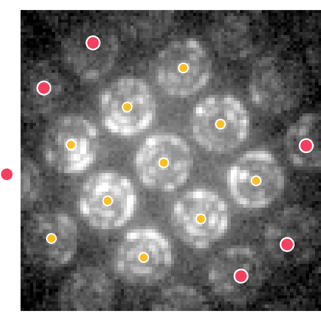
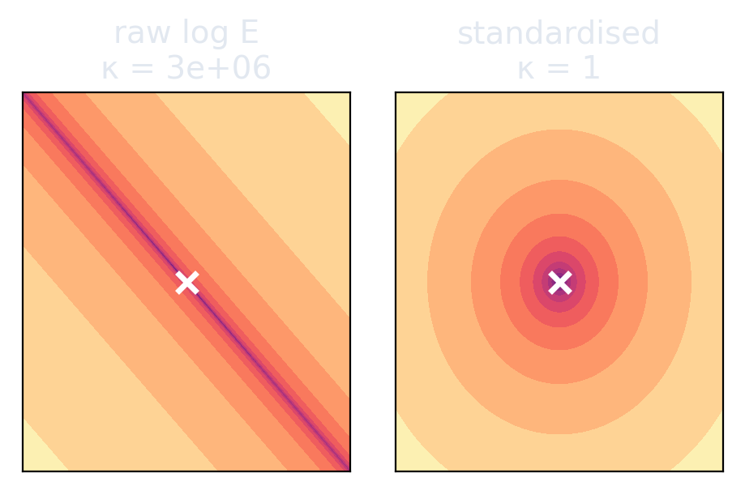
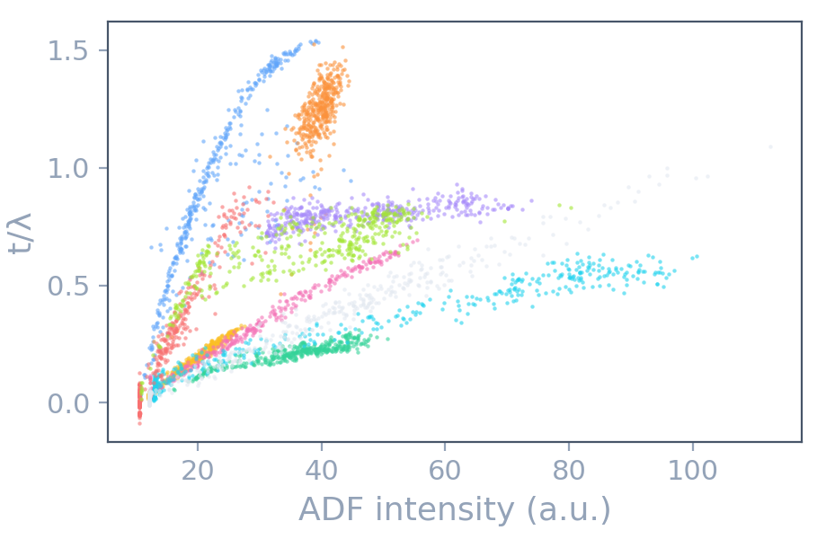
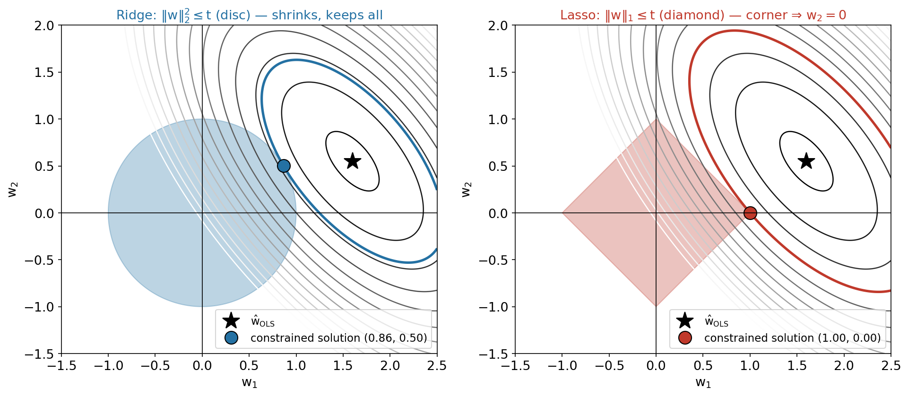
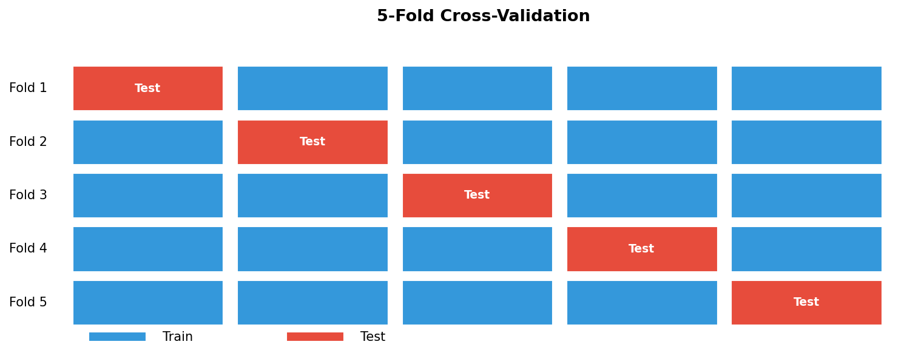
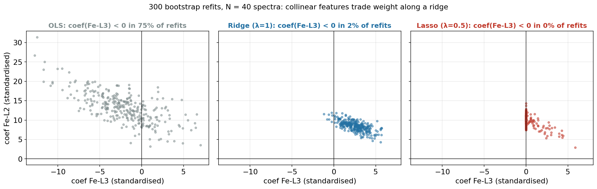

---
# How this deck works
# - Every <div class="xp" data-xp="NAME"> is an interactive explainer. xp/main.js mounts it when its slide shows.
# - The widget code is in xp/*.js (no external libraries; the deck runs offline). Test page: xp/dev.html?w=NAME.
# - All explainers use real, openly licensed EM data (xp/data/*.json). xp/prep/*.py build them from the raw files.
# - `data-station="k"` on a slide draws the red-line rail (six stations, xp/redline.js) at the top right.
# - Timing plan (90 min): opening 0-4, Loss 4-14, Descend 14-26, Step 26-33, Generalise 33-45,
#   Regularise 45-58, Validate 58-82, wrap-up 82-88, 2 min slack. Backup slides after "Continue".
title: |-
  Data Science for Electron Microscopy<br>
  Week 4: Regression, optimisation & honest validation
author:
- name: Prof. Dr. Philipp Pelz
  affiliation:
  - FAU Erlangen-Nürnberg
  - Institute of Micro- and Nanostructure Research
bibliography: ref.bib
csl: custom.csl
resources:
  - xp/*.js
  - xp/*.css
  - xp/dev.html
  - xp/data/*.json
execute:
  eval: false
  echo: true
format:
  revealjs:
    chalkboard: true
    width: 1920
    height: 1080
    template-partials:
    - title-slide.html
    css:
    - custom.css
    - xp/xp.css
    theme: custom.scss
    slide-number: c/t
    logo: eclipse_logo_small.png
    background-transition: fade
    incremental: false
    menu:
      side: left
      loadIcons: true
    footer: ©Philipp Pelz - FAU Erlangen-Nürnberg - Data Science for Electron Microscopy
    include-after-body:
      text: |
        <script type="module" src="xp/main.js"></script>
---

## Three numbers you will understand today

::: {.claim}
Week 3: least squares is a projection. Today: what "best fit" means, how a computer finds it, and when you may *trust* it. Every example is real data.
:::

::: {.kpi-row}
::: {.kpi .fragment}
[0.47 %]{.big}

{.kpi-img fig-alt="A 4D-STEM diffraction pattern with detected disks; six misdetections are red"}

[fake strain from 6 misdetected disks (red) when the lattice fit uses the squared error]{.lbl}

[→ Act 1 · Loss]{.act-tag}
:::
::: {.kpi .fragment}
[3·10⁶]{.big}

{.kpi-img fig-alt="The loss surface of a background fit: a thin valley for raw features, a round bowl for standardised features"}

[condition number of a background fit with raw log E. Gradient descent does not arrive.]{.lbl}

[→ Act 2 · Descend]{.act-tag}
:::
::: {.kpi .fragment}
[0.50 → −0.12]{.big}

{.kpi-img fig-alt="ADF intensity against thickness for ten specimens: ten different curves"}

[R² of the same model: random pixels versus new specimens]{.lbl}

[→ Act 6 · Validate]{.act-tag}
:::
:::

::: {.notes}
- Open with the link to Week 3: least squares was a projection with a closed-form answer. Today asks three questions that the closed form hides. Which loss? How do we find the minimum when there is no closed form? Is the score honest?
- Do not explain the numbers now. Say: "By the end you can explain each of them." Come back to them on the summary slide.
- 0.47 %: a real 4D-STEM frame of ion-irradiated Al. The disk finder reports 16 disks, 6 of them in places where there is no disk. The squared-error lattice fit turns them into 0.47 % strain; the noise level of the map is about 0.17 %.
- 3·10⁶: the power-law background fit of Week 3, log I = w₀ + w₁ log E, with the raw feature log E ≈ 6.2. The loss surface is a thin valley; gradient descent needs millions of steps. Standardise the feature and it needs 21.
- 0.50 → −0.12: predict the thickness t/λ from the ADF intensity, ten real specimens. Random pixel splits say R² = 0.50. Holding out whole specimens says −0.12, which is worse than predicting the mean.
- The images are made by xp/prep/make_kpi.py from the same data as the explainers.
:::

## Today's red line: from a fit to a prediction you can trust

::: {.xp data-xp="redline"}
:::

::: {.notes}
- This is the map of the lecture. Six stations, each one question. The rail at the top right of every slide shows where we are.
- 1 Loss: a fit minimises a loss; the loss is the negative log-likelihood of the noise model. Outliers need a robust loss.
- 2 Descend: without a closed form, follow the gradient. The shape of the bowl (κ) decides the speed. Scale the features. Non-convex losses have false minima.
- 3 Step: stochastic gradients, momentum and Adam are better steps on the same bowl.
- 4 Generalise: the best training fit is not the best prediction. Error = bias² + variance.
- 5 Regularise: ridge shrinks unstable weights, lasso selects features. λ is a prior.
- 6 Validate: the split must match the deployment claim. Every learned step goes inside the fold. The dashed arrow: the validation score chooses λ and the model; the test set is used once.
- Learning outcomes (one per station): (1) derive MSE / MAE / Huber from a noise model and fit with IRLS; (2) write the GD update, state the stability limit η < 2/λ_max, explain why standardising helps, recognise non-convexity; (3) explain SGD, momentum and Adam; (4) decompose the expected error into bias² and variance and read train/validation curves; (5) state ridge and lasso, their geometry and when to use them; (6) choose random / grouped / chronological splits, name the four leakage types and avoid preprocessing leakage with a Pipeline.
:::

<!-- ===== Act 1. Loss ===== -->

## {.act}

::: {.act-kicker}
Act 1 · Loss
:::
::: {.act-question}
What does "best fit" mean?
:::
::: {.xp data-xp="redline" data-focus="1"}
:::

## One wrong disk, fake strain: the loss decides {data-station="1"}

::: {.xp data-xp="robust-fit"}
:::

::: {.notes}
- Data: the 4D-STEM scan of Week 3 (ion-irradiated Al, [001], 40 × 40 positions) [@mills2023pointdefect]. The disk finder searches every predicted disk position and keeps maxima above 5 % of the brightest disk. Weak or absent disks then give misdetections: maxima in the noise.
- The model: every disk p with index (h, k) gives p = c + h g₁ + k g₂ (Week 3, least squares). The loss decides how much each disk counts.
- MSE: each disk pulls with a force proportional to its residual. A disk 13 px off pulls 40× harder than a good disk 0.3 px off. Frame #60: 6 of 16 disks are misdetections; the MSE lattice gives 0.47 % fake strain (blue dashed circles), about three times the noise of the strain map (0.17 %).
- Huber: quadratic inside |r| < δ, linear outside. A far disk pulls with a constant force, not a growing one. The disk colours show the final weights: the red disks have almost no weight. MAE: linear everywhere; robust, but it also down-weights the good disks.
- Demo: (1) frame #60, switch MSE → Huber: the fake strain vanishes. (2) Frame "clean": all three losses agree. (3) Drag one good disk 10 px away: MSE moves, Huber does not. (4) Huber δ: large δ → MSE, small δ → MAE.
- How Huber is fitted: iteratively reweighted least squares (IRLS). Fit, compute weights wᵢ = min(1, δ/|rᵢ|), refit with weights, repeat. Every robust fit is a sequence of weighted projections.
- The one point to land: "best fit" is not defined until you choose a loss. MSE is the right loss only if the errors are Gaussian.
- Misconception: "remove outliers by hand, then use MSE." That works for 6 disks, not for 1 600 frames × 16 disks. A robust loss is outlier removal written as mathematics, and it is reproducible.
:::

## The loss is a noise model: real residuals have heavy tails {data-station="1"}

::: {.xp data-xp="resid-hist"}
:::

::: {.notes}
- Data: residuals of all lattice fits of the scan, 21 080 coordinates (Huber fits, so that one bad disk does not spread its error into the others).
- Linear y axis: the histogram looks Gaussian with σ = 0.28 px (σ from the median absolute deviation, which outliers do not affect). Switch to the log axis: the tails are far above the Gaussian. 8.0 % of the residuals are beyond 3σ (Gaussian: 0.27 %), 5.0 % beyond 5σ (Gaussian: 6·10⁻⁵ %).
- Right panel: −log p(r) of each noise model is its loss. Gaussian → r²/2σ² = MSE. Laplace → |r|/b = MAE. Huber is the negative log-likelihood of a Gaussian core with exponential tails [@huber1964robust].
- Week 2 link: the loss is the negative log-likelihood of the noise model. Week 2 derived MSE from Gaussian noise and the Poisson NLL from counts. Here the noise is a mixture: precise disk positions plus occasional misdetections. The data choose the loss.
- Switch to "MSE fit": the residuals of the plain least-squares fits are wider. One outlier spreads its error into all other disks of the frame. You cannot find outliers reliably from the residuals of a non-robust fit.
- The one point to land: plot the residuals on a log axis before you choose the loss. A straight Gaussian core with heavy tails is the signature for Huber.
:::

## Fitting = minimising the empirical risk {data-station="1"}

::: {.deriv}
::: {.dstep .fragment}
[1]{.dnum} **Empirical risk:** $\hat{\mathbf w}=\arg\min_{\mathbf w}\;\hat R(\mathbf w)=\frac1n\sum_{i=1}^n\rho\big(y_i-f(\mathbf x_i;\mathbf w)\big)$
:::
::: {.dstep .fragment}
[2]{.dnum} **Noise model → loss:** $\rho(r)=-\log p(r)$. Gaussian: $\rho=r^2/2\sigma^2$ (MSE). Laplace: $\rho=|r|/b$ (MAE).
:::
::: {.dstep .fragment}
[3]{.dnum} **Huber:** $\rho_\delta(r)=\tfrac12 r^2$ for $|r|\le\delta$, $\;\delta\,(|r|-\tfrac{\delta}{2})$ otherwise. Quadratic core, linear tails.
:::
::: {.dstep .fragment}
[4]{.dnum} **IRLS:** fit with weights $w_i=\min(1,\delta/|r_i|)$, update the residuals, repeat. Each step is a weighted least-squares projection.
:::
:::

```python
from sklearn.linear_model import HuberRegressor, LinearRegression
ols   = LinearRegression().fit(X, y)              # MSE: Gaussian noise
huber = HuberRegressor(epsilon=1.35).fit(X, y)     # robust: Gaussian core + outliers
```

::: {.notes}
- Write the four lines on the board while the fragments appear. Step 2 is the key: choose the noise model, and the loss follows. That is the Week 2 principle, now for regression.
- HuberRegressor in scikit-learn scales δ with a robust estimate of σ; epsilon = 1.35 gives 95 % efficiency for purely Gaussian data. You lose only 5 % precision when there are no outliers, and you are protected when there are.
- For the lattice fit of the explainer, δ = 1 px is about 3.5σ of the good disks.
- Forward link: neural networks (Week 6) use the same choice. nn.MSELoss, nn.L1Loss and nn.HuberLoss are these three ρ functions.
:::

<!-- ===== Act 2. Descend ===== -->

## {.act}

::: {.act-kicker}
Act 2 · Descend
:::
::: {.act-question}
How do we find the minimum?
:::
::: {.xp data-xp="redline" data-focus="2"}
:::

## Gradient descent: the shape of the bowl decides the speed {data-station="2"}

::: {.xp data-xp="gd-bowl" data-mode="gd"}
:::

::: {.notes}
- Data: the power-law background fit of Week 3 (the least-squares slide), real CeVOₓ pre-edge, 470–508 eV. Model: log I = w₀ + w₁·f(log E). Loss: MSE. The colour is the loss; the × is the minimum.
- The algorithm: start somewhere, compute the gradient ∇L = −Xᵀr/n, step downhill: w ← w − η∇L. No matrix inversion, so it works for any differentiable loss, also for neural networks.
- Demo 1, "raw log E" (f = log E ≈ 6.2): the two features 1 and log E are almost parallel. The bowl is a valley 1 700× longer than wide (κ = λ_max/λ_min = 3·10⁶). GD drops to the valley floor in 10 steps and then crawls. The loss curve flattens at 10⁻³: not converged after 3 000 steps.
- Demo 2, "centred" (f = log E − mean): the valley is no longer tilted, but still 45× longer than wide (κ ≈ 2 000).
- Demo 3, "standardised" (f = (log E − mean)/sd): κ = 1, a round bowl; GD needs 21 steps. Same data, same model, same minimum: only the parametrisation changed.
- Demo 4, learning rate: GD is stable only for η < 2/λ_max. Move the slider above 1: the path oscillates and diverges. Small η: stable but slow.
- Theory in the readout: per step the error in each eigen-direction shrinks by |1 − ηλ|. The slow direction (λ_min) decides: about κ steps. This is the Week 3 condition number again; now it sets the run time, not only the noise amplification.
- The one point to land: standardise the features before gradient descent. In scikit-learn: StandardScaler inside a Pipeline (Act 6).
- Click into the bowl to start from another point.
:::

## The update rule and its speed limit {data-station="2"}

::: {.deriv}
::: {.dstep .fragment}
[1]{.dnum} **Step:** $\mathbf w_{t+1}=\mathbf w_t-\eta\,\nabla\hat R(\mathbf w_t)$, for MSE $\nabla\hat R=-\tfrac1n\mathbf X^{T}(\mathbf y-\mathbf X\mathbf w_t)$
:::
::: {.dstep .fragment}
[2]{.dnum} **Near the minimum:** $\mathbf w_{t+1}-\hat{\mathbf w}=(\mathbf I-\eta\mathbf H)(\mathbf w_t-\hat{\mathbf w})$, Hessian $\mathbf H=\tfrac1n\mathbf X^{T}\mathbf X$
:::
::: {.dstep .fragment}
[3]{.dnum} **Stable** if $|1-\eta\lambda_k|<1$ for all eigenvalues: $\;\eta<2/\lambda_{\max}$
:::
::: {.dstep .fragment}
[4]{.dnum} **Slowest direction:** factor $1-\eta\lambda_{\min}\approx 1-2/\kappa$ per step → about $\kappa$ steps. **Standardise** to make $\kappa$ small.
:::
:::

```python
from sklearn.pipeline import make_pipeline
from sklearn.preprocessing import StandardScaler
from sklearn.linear_model import SGDRegressor
model = make_pipeline(StandardScaler(), SGDRegressor(learning_rate="adaptive", eta0=0.01))
```

::: {.notes}
- Step 2 is the whole theory of GD on a quadratic: each eigen-direction of the Hessian is an independent 1-D problem with its own curvature λ.
- Step 3: η is limited by the steepest direction. Step 4: the flattest direction then moves by only ηλ_min ≈ 2/κ per step. Large κ = slow, whatever η you choose.
- For MSE the Hessian is XᵀX/n, the Gram matrix of Week 3. Its condition number is the square of κ(X). Collinear or unscaled features → huge κ.
- Standardising makes the diagonal of H equal to 1; centring removes the coupling to the intercept. Exactly what the explainer showed: 3·10⁶ → 2 000 → 1.
- Non-quadratic losses (Huber, neural networks): the same analysis holds near the minimum, with the local Hessian.
:::

## Convex or not: aligning two spectra has false minima {data-station="2"}

::: {.xp data-xp="align"}
:::

::: {.notes}
- Data: the mean Fe-L spectrum of the lunar pyroxene and the FeO standard, each on its own energy axis [@cymes2023ferric]. Task: find the energy shift s that aligns them. Loss: L(s) = Σ (y − a·ref(E − s))², with the best scale a for each s.
- The loss is not convex. Global minimum at s = +1.6 eV (the standard and the image were calibrated differently, see Week 3). Side minima at −11 eV and +14 eV: there the L₂ peak of one spectrum lies on the L₃ peak of the other (L₃–L₂ spin-orbit splitting ≈ 13 eV). Flat plateaus far away: no peaks overlap, so the gradient is zero.
- Demo: start at −9 eV, press descend: GD stops at −11 eV ("stuck"). Start at −3 eV: it finds +1.6 eV. Start at +17 eV: it rolls into +14 eV.
- Convex: the chord between any two points lies above the curve; then every local minimum is global. Linear models with MSE, MAE, Huber, ridge or lasso are convex in w. Non-linear parameters (a shift, a peak width, the weights of a neural network) usually make the loss non-convex.
- Practical cures: (1) a good start (cross-correlation for the shift, or the ZLP position); (2) a grid search for 1–2 parameters; (3) many random starts; (4) coarse-to-fine (smooth the spectra first, which removes the side minima).
- Forward link: neural-network losses are non-convex in millions of dimensions. There, saddle points and plateaus dominate more than bad local minima; the noise of SGD helps to leave them (next act).
:::

<!-- ===== Act 3. Step ===== -->

## {.act}

::: {.act-kicker}
Act 3 · Step
:::
::: {.act-question}
Which step to take?
:::
::: {.xp data-xp="redline" data-focus="3"}
:::

## SGD, momentum, Adam: four walkers in the same valley {data-station="3"}

::: {.xp data-xp="gd-bowl" data-mode="race"}
:::

::: {.notes}
- Same real background fit, "centred" features: κ ≈ 2 000. All four start from the same point with the same η (SGD with 0.3 η). Press run.
- GD (blue): the steep direction (the level) converges at once; the flat direction (the slope) crawls. Not converged after 3 000 steps.
- Momentum (yellow): v ← 0.9 v + ∇L, w ← w − ηv. Steps in a consistent direction add up (up to 10× in the flat direction); steps that change sign cancel. Converges in 368 steps.
- Adam (green): a separate step size for each parameter, scaled by the running root-mean-square of its gradient. In this bowl the two directions are the two parameter axes (centred features), so Adam sees the flat direction and makes it steep. Converges in 242 steps.
- SGD (pink): the gradient of 4 random channels instead of all 39. Each step is 10× cheaper, but noisy. It moves fast at first, then rattles around the minimum: the noise floor. It needs a decreasing step size to converge.
- Switch to "raw log E": the valley is tilted (the two parameters are coupled). Adam helps much less, because its per-parameter scaling cannot rotate the valley. Standardising the features is still step one.
- Switch to "standardised": everyone converges fast; the optimiser hardly matters.
- The one point to land: a good optimiser is a fix for a bad bowl. Fix the bowl first (scaling), then use Adam as the default.
:::

## Three update rules {data-station="3"}

::: {.deriv}
::: {.dstep .fragment}
[1]{.dnum} **SGD:** $\mathbf w\leftarrow\mathbf w-\eta\,\nabla\hat R_B(\mathbf w)$ with a random minibatch $B$. Unbiased, cheap, noisy.
:::
::: {.dstep .fragment}
[2]{.dnum} **Momentum:** $\mathbf v\leftarrow\beta\mathbf v+\nabla\hat R_B$, $\;\mathbf w\leftarrow\mathbf w-\eta\mathbf v$ ($\beta\approx0.9$). Averages the gradient: damps zigzags.
:::
::: {.dstep .fragment}
[3]{.dnum} **Adam:** $\mathbf m\leftarrow\beta_1\mathbf m+(1-\beta_1)\mathbf g$, $\;\mathbf s\leftarrow\beta_2\mathbf s+(1-\beta_2)\mathbf g^{2}$, $\;\mathbf w\leftarrow\mathbf w-\alpha\,\hat{\mathbf m}/(\sqrt{\hat{\mathbf s}}+\epsilon)$
:::
:::

```python
import torch
opt = torch.optim.Adam(model.parameters(), lr=1e-3)   # the default to start with
for xb, yb in loader:                                  # minibatches: stochastic gradients
    opt.zero_grad(); loss = loss_fn(model(xb), yb); loss.backward(); opt.step()
```

::: {.notes}
- SGD: the minibatch gradient is an unbiased estimate of the full gradient. With N = 10⁶ training patches, one full gradient costs 10⁶ forward passes; a minibatch of 64 costs 64. Many noisy steps beat few exact ones.
- Momentum: physics picture, a heavy ball on the loss surface. It keeps its velocity through flat regions and does not follow every bump.
- Adam [@kingma2014adam]: momentum (m) plus a per-parameter scale (s). The hats are bias corrections for the first steps. Defaults β₁ = 0.9, β₂ = 0.999, α = 10⁻³ work for most problems. The explainer uses α = 0.02 because the problem is tiny.
- The code is the PyTorch training loop of Weeks 6–13. Every line maps to the deriv steps: minibatch → step 1, Adam → step 3.
- Backup slide "Optimiser comparison" has a table for questions.
:::

<!-- ===== Act 4. Generalise ===== -->

## {.act}

::: {.act-kicker}
Act 4 · Generalise
:::
::: {.act-question}
Why does the best fit predict badly?
:::
::: {.xp data-xp="redline" data-focus="4"}
:::

## More parameters always fit better, and predict worse {data-station="4"}

::: {.xp data-xp="poly-bg"}
:::

::: {.notes}
- Data: the real pre-edge spectrum below the V-L₂,₃ edge (CeVOₓ region). The background under the edge is never measured; it is always extrapolated. That makes this the honest test of a background model.
- Model: log I = polynomial of degree d in standardised log E (Act 2). Degree 1 is the power law A·E⁻ʳ. Train: 470–496 eV (green). Validation: 497–508 eV (yellow), the channels next to the edge, where the extrapolation matters.
- Demo: move the degree from 0 to 8. The training error (green) falls with every degree: more parameters can always follow the data more closely, including its noise. The validation error (yellow) is lowest at degree 1, then rises by orders of magnitude. At degree 4 the background curls up in front of the edge: the edge signal would be wrong by tens of percent.
- Switch "one pixel" ↔ "mean of 30 pixels": with 30× more signal per channel the degrees 2–3 become almost as good as 1. The best complexity depends on the amount and the noise of the data.
- The one point to land: the training error cannot choose the model. Hold data out and choose on the held-out error. Physics (the power law) is a strong, correct prior: it wins with one parameter less.
- Misconception: "more flexible models are safer." They are safer against bias and more dangerous for variance.
:::

## Bias² + variance, measured on 30 real pixels {data-station="4"}

::: {.xp data-xp="bias-var"}
:::

::: {.notes}
- Data: 30 pixels of the same CeVOₓ region. Each pixel is a separate, noisy measurement of nearly the same background. That is exactly the "many training sets" of the bias–variance theory, here with real data. The reference ("truth") is the mean spectrum of the 30 pixels, about 5× less noisy than one pixel.
- Each thin blue line is the fit to one pixel. Variance = how much these lines scatter at the validation channels. Bias = how far their mean (red dashed) is from the truth (white).
- Degree 0: all fits agree (low variance) but are all wrong (bias² ≈ 10⁻²). Degree 1: bias² ≈ 2·10⁻⁵, variance ≈ 10⁻³, best total. Degree 3: bias² still tiny, variance ≈ 2·10⁻². Degree 8: variance ≈ 10³: the fits explode in front of the edge.
- Decomposition: E[(y − ŷ)²] = bias² + variance + irreducible noise. Bias falls and variance grows with complexity; the sum has a minimum.
- The one point to land: overfitting is variance. You see it only across repeated measurements, never in one training fit. Cross-validation (Act 6) estimates the sum without repeated measurements.
- Forward link: regularisation (next act) reduces the variance at the cost of a little bias, without changing the model class.
:::

<!-- ===== Act 5. Regularise ===== -->

## {.act}

::: {.act-kicker}
Act 5 · Regularise
:::
::: {.act-question}
How do we tame the variance?
:::
::: {.xp data-xp="redline" data-focus="5"}
:::

## Ridge: collinear standards make the coefficients lie {data-station="5"}

::: {.xp data-xp="ridge-fe"}
:::

::: {.notes}
- Data: the Fe-L₂,₃ spectrum image of the space-weathered rim of a lunar pyroxene (3 × 3 binned, about 13 000 Fe-L counts per pixel) and three standards: Fe metal, FeO (Fe²⁺), Fe³⁺ glass [@cymes2023ferric]. Per pixel: y ≈ w₀·Fe⁰ + w₂·Fe²⁺ + w₃·Fe³⁺ (least squares, Week 3). The image was shifted by −1.2 eV to the calibration of the standards.
- The Fe⁰ and Fe²⁺ edges have nearly the same shape: κ(R) = 15. The scatter plot shows the consequence: over all pixels, the two weights lie on a line with correlation −0.92. The data fix their sum, not the split. The Fe⁰ weight has a spread of 12 700 and a negative mean (−1 700): physically impossible.
- Ridge: minimise ‖y − Rw‖² + λ‖w‖², solution (RᵀR + λI)⁻¹Rᵀy. The λI adds curvature to the flat direction (Week 3: it lifts the small eigenvalue).
- Demo: increase λ. At λ = 0.03 × tr(RᵀR)/3 the spread of the Fe⁰ weight falls from 12 700 to 3 600, the correlation from −0.92 to −0.43, and the fit residual rises only from 0.610 to 0.615. Variance down 10×, fit almost the same.
- Honest part: the mean Fe⁰ weight moves from −1 700 to +4 200. Ridge pulls all weights towards 0, which here moves weight from Fe²⁺ to Fe⁰. That is bias, and it comes from the prior "small weights", not from the data. At this signal level the data cannot separate Fe⁰ from Fe²⁺. Choose λ by validation, and report it.
- The Fe³⁺ share is stable (0.19–0.21): the Fe³⁺ shape differs, so its direction is well conditioned.
- Reading coefficients: a weight is a statement "with the other references fixed". For collinear features the single weights are not meaningful; their sum is. Report the sum, merge the references, or collect more signal.
- Click a pixel: its spectrum and its fit.
:::

## Lasso: which elements are in this spectrum? {data-station="5"}

::: {.xp data-xp="lasso-eds"}
:::

::: {.notes}
- Data: the real EDS spectrum of the CeVO₃ / Al₂O₃ sample (STEM-Bank-26) [@hollyer2026stembank]. Library: the line patterns of 78 elements (Z = 5–83), from tabulated line energies and weights and the detector resolution. The model: spectrum = Σ wₖ·patternₖ + smooth background, wₖ ≥ 0. Rows weighted by 1/√counts (Poisson, Week 2); every library column standardised (otherwise λ hits large and small columns differently).
- Lasso: minimise ‖y − Xw‖² + λ‖w‖₁. The L1 penalty sets weights exactly to zero. Large λ: no element. Decreasing λ: elements enter one by one.
- Demo, "all 6 400 pixels": C (carbon film), V, Cu (grid), O, Al enter first: the chemistry of the sample plus the expected extras. Then Br, then Ce, Si. Br Lα (1.480 keV) lies 6 eV from Al Kα (1.487 keV): the two library columns are almost collinear, and lasso takes both in to fit the Al peak a little better. Lasso keeps one or both of a collinear pair arbitrarily; physics must decide.
- At small λ, 20+ elements are selected: with 371 000 counts, every small error of the line model (calibration, line shape) is "explained" by another element. Small λ = overfitting.
- Switch to "5 × 5 pixels" on a CeVOₓ particle (1 600 counts): V, Cu, C, O, Ce enter. Al is not selected, which is correct: there is no Al₂O₃ under that particle.
- The one point to land: lasso = feature selection by an optimisation. It needs standardised features, it fails for collinear pairs, and λ must be chosen by validation (or physics).
:::

## The geometry: ridge shrinks, lasso selects {data-station="5"}

::: {.columns}
::: {.column width="58%"}
{width="100%" fig-alt="Ridge disc and lasso diamond with loss contours"}
:::
::: {.column width="42%"}
**Ridge:** $\min_{\mathbf w}\|\mathbf y-\mathbf X\mathbf w\|^2+\lambda\|\mathbf w\|_2^2$

$\Rightarrow\;\hat{\mathbf w}=(\mathbf X^T\mathbf X+\lambda\mathbf I)^{-1}\mathbf X^T\mathbf y$: shrinks every weight.

**Lasso:** $\min_{\mathbf w}\|\mathbf y-\mathbf X\mathbf w\|^2+\lambda\|\mathbf w\|_1$

No closed form; exact zeros: selects features.

**λ:** standardise first; choose λ by (grouped) cross-validation, never on the test set.
:::
:::

::: {.notes}
- Ridge = Gaussian prior on w, lasso = Laplace prior (MAP estimates). The same loss/noise-model logic as Act 1, now applied to the parameters.
- Ridge: the smallest eigenvalues of XᵀX are lifted by λ; κ falls from λ_max/λ_min to (λ_max + λ)/(λ_min + λ). That is the cure for the ill-conditioning of Week 3.
- Lasso: the diamond has corners on the axes, so the constrained minimum often sits on a corner (exact zero). Elastic net (L1 + L2) keeps groups of correlated features together.
- Both are convex: a unique minimum, found by closed form (ridge) or coordinate descent (lasso).
- scikit-learn: RidgeCV / LassoCV choose λ (called alpha) by cross-validation. Use them inside a Pipeline with StandardScaler and a grouped splitter (Act 6).
:::

<!-- ===== Act 6. Validate ===== -->

## {.act}

::: {.act-kicker}
Act 6 · Validate
:::
::: {.act-question}
Is the score honest?
:::
::: {.xp data-xp="redline" data-focus="6"}
:::

## Train, validate, test: and what kind of *new*? {data-station="6"}

::: {.columns}
::: {.column width="50%"}
{width="100%" fig-alt="Five folds, each with one test block"}
:::
::: {.column width="50%"}
| Deployment claim | Split |
|---|---|
| new pixel of a known image | random K-fold |
| new image / crop region | GroupKFold by image |
| **new specimen** | **GroupKFold by specimen** |
| later session / drift | chronological split |
| other microscope | leave-one-instrument-out |

[Train: fit the weights. Validation (or CV): choose λ, degree, model. Test: report once.]{.muted}
:::
:::

::: {.notes}
- Three roles: training data fit w; validation data choose hyperparameters (λ, the degree d, the model class); the test set gives the final number and is touched once. Every decision made on the test set turns it into validation data.
- K-fold CV uses all data for validation, each point once, and gives a spread over the folds.
- The table is the most important idea of the second half: the split must match the claim. "My model predicts thickness" means nothing until you say for what kind of new data. A random split tests interpolation between near-copies.
- EM data are grouped: pixels of one image, crops of one micrograph, frames of one series, spectra of one specimen are correlated. Randomly split, near-copies land in train and test.
- Transition: "Let us measure how much this matters, on ten real specimens."
:::

## Random pixels or new specimens: the same model, R² 0.50 or −0.12 {data-station="6"}

::: {.xp data-xp="split-leak"}
:::

::: {.notes}
- Data: ten spectrum images from ten different sessions of STEM-Bank-26 (Li salts under cryo, a polymer film, MgO cubes, oxide powders, CeVO₃ on Al₂O₃, CuMn₂O₄, a Co catalyst), 400 pixels each [@hollyer2026stembank]. Target: t/λ by the log-ratio method from the low-loss spectrum, ln(I_total/I_ZLP) [@egerton2011eels]. Features: the ADF intensity recorded at the same time, and the plasmon energy E_p.
- Left: inside each specimen, ADF and t/λ correlate strongly (r = 0.63–0.99). But every specimen has its own curve: the ADF signal scales with Z and with the detector gain of that session.
- Demo 1: k-NN, random pixel split: R² = 0.50. A test pixel has neighbours from the same specimen in the training set with nearly the same ADF and E_p. The model recognises the specimen.
- Demo 2: switch to GroupKFold by specimen: R² = −0.12, worse than predicting the mean. On a new specimen the ADF units are different; nothing transfers.
- Demo 3: linear model: 0.30 (random) vs 0.05 (grouped). A simpler model memorises less, so the gap is smaller, but it is also useless on new specimens.
- Demo 4: k = 1: random-split R² falls (noisy neighbours), grouped stays bad.
- The scaler is fitted inside each training fold, as a Pipeline does.
- What would make it work? A physical normalisation (ADF divided by the incident beam intensity or by a vacuum reference), or a few labelled pixels of each new specimen (calibration). That is a different, honest deployment claim: "new pixels of a calibrated specimen".
- Leakage reference: Kapoor & Narayanan found leakage in hundreds of published ML-based studies across 17 fields [@kapoor2023leakage].
:::

## Preprocessing leakage: R² = 0.4 on pure noise {data-station="6"}

::: {.xp data-xp="prep-leak"}
:::

::: {.notes}
- Data: the real t/λ of 80 pixels. Features: 1 000 columns of Gaussian noise. No feature can predict the thickness.
- Leaky pipeline: (1) select the 10 features with the largest correlation to t/λ, using all 80 pixels; (2) then 5-fold cross-validation of a linear regression. Result: R² ≈ 0.35–0.47 (press "new noise" a few times). With 1 000 noise columns, some correlate with t/λ by chance, and the selection saw the test pixels.
- Honest pipeline: select inside each training fold. R² ≈ −0.2 to −0.3: correct, noise does not predict.
- The rule: every step that learns from data is part of the model. Scaler, PCA, feature selection, imputation, λ: fit them on the training fold only. In scikit-learn, put them into a Pipeline and cross-validate the Pipeline.
- EM versions: choosing energy windows "where the signal correlates best" on all spectra; fitting PCA (Week 3) on all images before the split; normalising intensities with statistics from the full data set.
- Increase k: the leak grows (more chances to fit noise).
:::

## Four kinds of leakage, one cure {data-station="6"}

| Leakage | EM example | Cure |
|---|---|---|
| **Duplicate** | overlapping crops, repeated frames, augmented copies in both sets | split before cropping or augmenting |
| **Group** | pixels / crops of one specimen in train and test | `GroupKFold(groups=specimen_id)` |
| **Temporal** | random split of a drift series or in-situ movie | chronological split, gap between sets |
| **Preprocessing** | scaler, PCA, feature selection fitted on all data | every learned step inside a `Pipeline` |

```python
from sklearn.model_selection import GroupKFold, cross_val_score
pipe = make_pipeline(StandardScaler(), SelectKBest(k=10), RidgeCV(alphas=np.logspace(-3, 3, 13)))
scores = cross_val_score(pipe, X, y, groups=specimen_id, cv=GroupKFold(5), scoring="r2")
```

::: {.notes}
- These four are the taxonomy for the exam (with target leakage as a fifth, rarer one: a feature that contains the label, for example a filename with the class).
- The code is the template for the miniproject: Pipeline (preprocessing inside) + grouped splitter (the right "new") + cross_val_score. It prevents most leakage by construction.
- Record specimen_id, session and time for every measurement at acquisition (Week 2, metadata). Without them you cannot split honestly afterwards.
- Spot-the-leak exercise (2 minutes, pairs): (1) 512 crops from 8 micrographs, random 80/20 split. (2) PCA on all EELS spectra, then 5-fold CV of a classifier. (3) An in-situ series, frames shuffled into 5 folds. Answers: group, preprocessing, temporal.
:::

## Report honestly: metrics and coefficients {data-station="6"}

::: {.columns}
::: {.column width="50%"}
**Regression:** MAE (in units of y), RMSE (penalises large errors), R² (1 − MSE/variance; < 0 = worse than the mean). On held-out data, with the spread over folds.

**Classification / segmentation:** precision, recall, F1 = Dice, IoU. Not accuracy on imbalanced data.

**Coefficients:** conditional ("others fixed"), unit-dependent, unstable for collinear features. Compare standardised weights with their bootstrap spread.
:::
::: {.column width="50%"}
![Explainability ladder E1–E6 [@neuer2024machine]. Today: E1 (data, splits) and E2 (process, units).](img/neuer_explainability_levels_e1_e6.png){width="100%" fig-alt="Six levels of explainability"}
:::
:::

::: {.notes}
- R² can be negative: the split-leak explainer showed −0.12. That is information, not an error: the model is worse than the mean.
- Imbalance: 98 % background → "always background" has 98 % accuracy. Precision = TP/(TP+FP), recall = TP/(TP+FN). Defect detection: recall first.
- Coefficients: the ridge explainer showed it on real data. Single weights of collinear references are not meaningful; their sum is.
- Explainability ladder: E1 data (which specimens, which split), E2 process (what the feature measures, units). A coefficient is interpretable only when E1 and E2 are documented. Course thread: Week 5 permutation importance, Week 7 saliency, Week 10 attention, Week 13 the full ladder.
:::

<!-- ===== Wrap-up ===== -->

## The red line, complete

::: {.xp data-xp="redline" data-mode="summary"}
:::

::: {.notes}
- Walk the line once more, one sentence per station. Then return to the three numbers: 0.47 % (MSE treats misdetections as data: use Huber), 3·10⁶ (unscaled features make the bowl a valley: standardise), 0.50 → −0.12 (the random split measured memorisation of the specimen).
- The thread "physics → loss / constraint" continues: Week 5 (descriptors from physics), Week 6 (the same losses and optimisers for neural networks), Week 8 (physics decides augmentation), Weeks 12/13 (regularisation for inverse problems).
:::

## Must-know for the exam

::: {.mustknow}
::: {.mk}
[1]{.mk-n} Loss = −log p(noise): MSE ↔ Gaussian, MAE ↔ Laplace, Huber = Gaussian core + outliers (IRLS).
:::
::: {.mk}
[2]{.mk-n} GD: w ← w − η∇R. Stable for η < 2/λ_max; about κ steps. Standardise the features.
:::
::: {.mk}
[3]{.mk-n} Convex ⇒ every local minimum is global. Linear model + MSE/MAE/Huber/ridge/lasso: convex.
:::
::: {.mk}
[4]{.mk-n} SGD: cheap, noisy, unbiased. Momentum averages gradients; Adam scales each parameter.
:::
::: {.mk}
[5]{.mk-n} Expected error = bias² + variance + noise. Training error always falls with complexity.
:::
::: {.mk}
[6]{.mk-n} Ridge (L2 disc) shrinks and fixes ill-conditioning; lasso (L1 diamond) gives exact zeros.
:::
::: {.mk}
[7]{.mk-n} The split must match the claim: GroupKFold by specimen; chronological for time series.
:::
::: {.mk}
[8]{.mk-n} Leakage: duplicate, group, temporal, preprocessing. Every learned step goes inside the fold.
:::
:::

::: {.notes}
- These statements are in the exam must-know list (`_shared/exam_mustknow.md`, Week 4). Ask students to cover the slide and reproduce 2, 5 and 8: they are the ones most often wrong.
:::

## Self-study this week

::: {.columns}
::: {.column width="60%"}
**Notebook (molab):** `notebooks/unit04_regression_validation.py`: "Regression, optimisation and honest validation on real EM data"

1. Parts 1–3: a Huber lattice fit by IRLS on real 4D-STEM disks; the noise model of 21 000 residuals; gradient descent, κ, momentum and Adam on the real background fit.
2. Parts 4–5: train versus validation and bias² + variance on 30 real pixels; ridge on collinear Fe standards; lasso selects EDS elements (⭐).
3. Part 6: random versus grouped CV on ten specimens; preprocessing leakage on pure noise; name the split.

[Ten exercises with automatic checks; CPU only, NumPy and Matplotlib. Sign in to molab → **Fork** → your own copy.]{.muted}
:::
::: {.column width="40%"}
[{width="420" fig-alt="Open in molab"}](https://molab.marimo.io/github/ECLIPSE-Lab/public_presentations/blob/main/data_science_for_em/notebooks/unit04_regression_validation.py)

- **Data sets** (CC BY 4.0): STEM-Bank-26 [@hollyer2026stembank]; Cymes et al. [@cymes2023ferric]; Mills et al. 4D-STEM [@mills2023pointdefect].
- **Extra:** `week04_leakage_demo.ipynb` (synthetic).
- **Must-know review:** [exam_mustknow.md](https://github.com/ECLIPSE-Lab/public_presentations/blob/main/data_science_for_em/_shared/exam_mustknow.md), Week 4.
- **Miniproject:** Pipeline + GroupKFold template.
:::
:::

::: {.notes}
- Share the molab link now; the shared link is a read-only preview, so students must sign in and click Fork.
- About two hours; exercise 7 (lasso) is optional (⭐). The notebook uses the same real data as the explainers, so students reproduce every number of the lecture: 0.47 % fake strain, κ = 3·10⁶, R² 0.50 versus −0.12.
- Exercises 8 and 9 are the exam-relevant ones: students measure the leakage gap themselves and see R² > 0 on pure noise when the selection leaks.
:::

## Next week: from images to features: descriptors & tree ensembles

::: {.claim}
Today's linear model becomes the *baseline*. Next week: descriptors from EM images, and trees that must beat the baseline under the same grouped validation.
:::

- From images to tabular descriptors: particle and grain properties, atom-column environments.
- Decision trees, random forests, gradient boosting: non-linear models for tabular data.
- Explainability, next rung: permutation importance and SHAP, and why today's collinearity warning applies to them too.

::: {.notes}
- Everything from today is reused: the loss, the optimisers (for boosting: gradient steps in function space), the bias–variance trade-off (tree depth), and the validation (GroupKFold, Pipeline).
:::

<!-- BEGIN prev-next -->

## Continue

- &larr; Previous: [Unit 03 &mdash; Linear algebra, PCA & spectral unmixing](../03_linear_algebra_spectral/01_intro.html)
- &rarr; Next: [Unit 05 &mdash; From images to features: descriptors & tree ensembles](../05_features_trees/01_intro.html)
- [All courses](../../index.html)

<!-- END prev-next -->

## Backup slides {visibility="uncounted"}

Material outside the 90-minute path, for questions and self-study.

## Optimiser comparison {visibility="uncounted"}

| Optimiser | Cost per step | Adaptive η? | Momentum? | Typical use |
|---|---|---|---|---|
| Full-batch GD | $\mathcal O(N)$ | no | no | small convex problems |
| Minibatch SGD | $\mathcal O(b)$ | no | optional | large data |
| SGD + momentum | $\mathcal O(b)$ | no | yes ($\beta\approx0.9$) | vision models, fine-tuning |
| Adam | $\mathcal O(b)$ | per parameter | yes | default for most EM projects |

::: {.notes}
- A reference card, not exam material in detail. The exam asks what each one fixes, not the value of β₂.
- AdamW (decoupled weight decay = ridge for neural networks) is the common variant in current code.
:::

## Confusion matrix {visibility="uncounted"}

|  | Predicted: no defect | Predicted: defect |
|---|---|---|
| **True: no defect** | TN | FP (false alarm) |
| **True: defect** | FN (missed) | TP |

- Precision = TP/(TP+FP): how clean are the detections? Recall = TP/(TP+FN): how complete?
- F1 = Dice = 2PR/(P+R). IoU = |A∩B|/|A∪B| ≤ Dice.

::: {.notes}
- With K classes the matrix is K × K; the off-diagonal entries are the confusions. Report it for every classifier in the miniproject.
:::

## Collinearity: a synthetic bootstrap {visibility="uncounted"}

{width="78%" fig-alt="Bootstrap clouds of OLS, ridge and lasso coefficients"}

::: {.notes}
- Synthetic companion to the real ridge explainer (Act 5). Same message: the data constrain the sum of collinear weights, not each one.
:::

## References

::: {#refs}
:::
