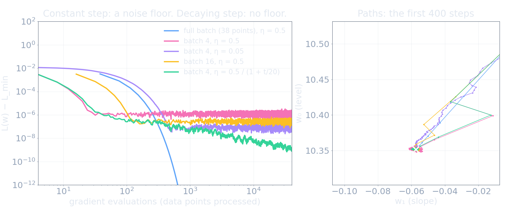
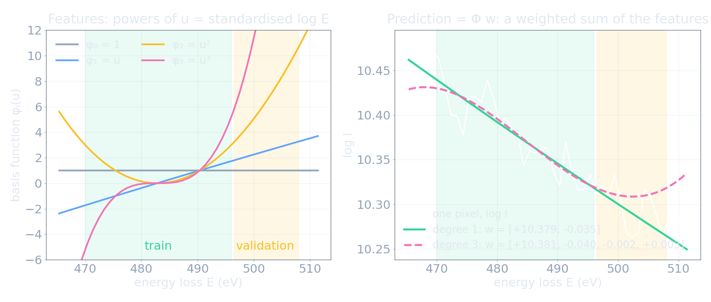
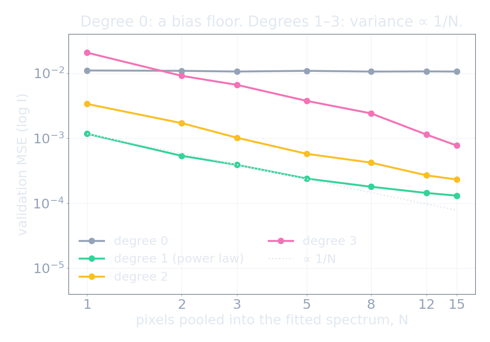
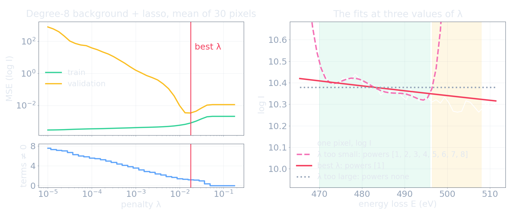
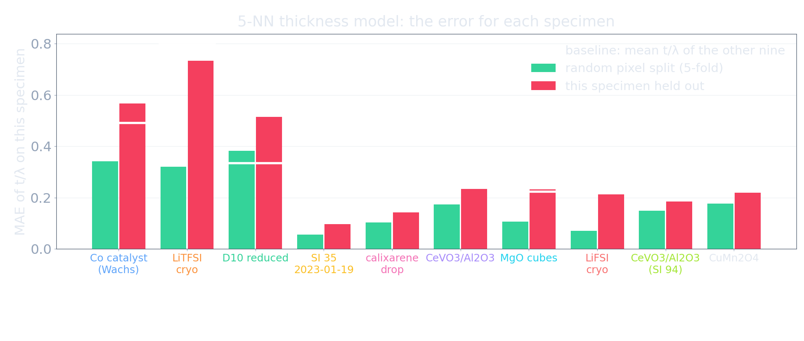
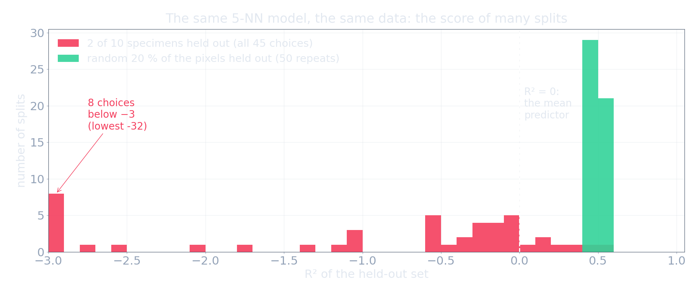
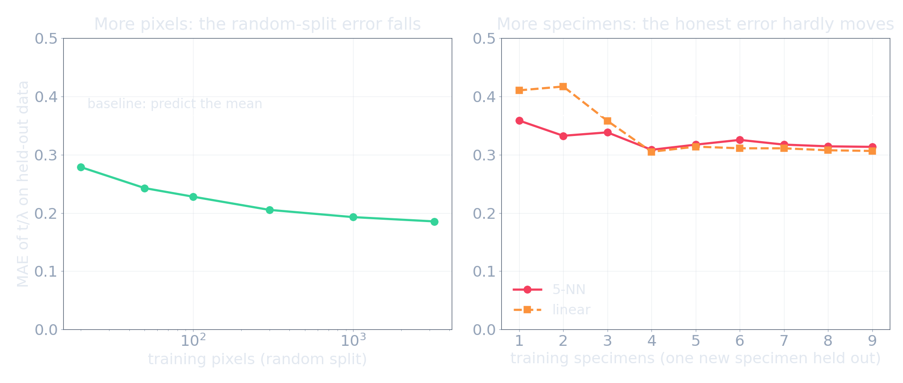
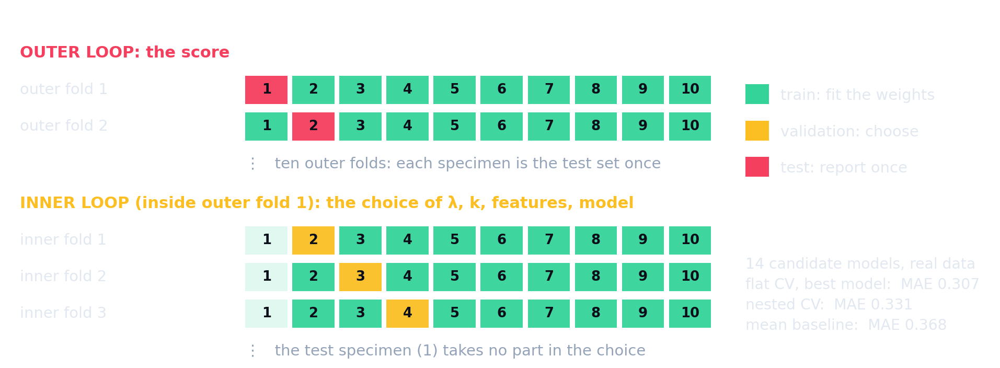
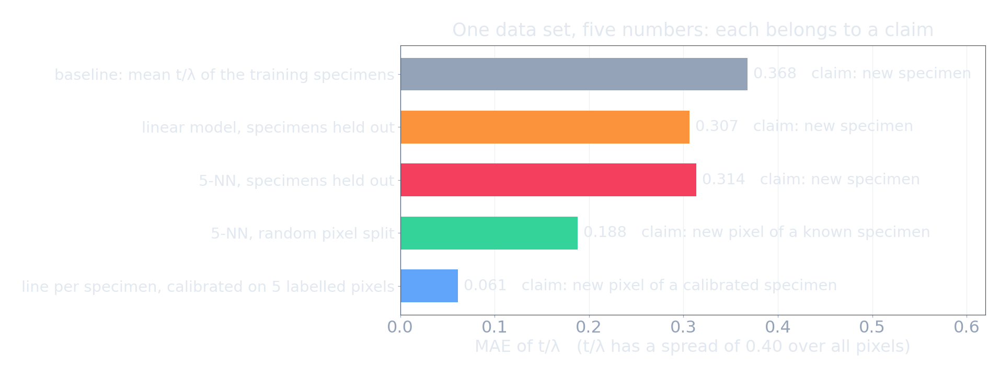

---
# How this deck works
# - Every <div class="xp" data-xp="NAME"> is an interactive explainer. xp/main.js mounts it when its slide shows.
# - The widget code is in xp/*.js (no external libraries; the deck runs offline). Test page: xp/dev.html?w=NAME.
# - All explainers use real, openly licensed EM data (xp/data/*.json). xp/prep/*.py build them from the raw files.
# - `data-station="k"` on a slide draws the red-line rail (six stations, xp/redline.js) at the top right.
# - Timing plan (90 min, 53 slides on the main path): opening 0-5 (3 slides), Loss 5-17 (6), Descend 17-30 (6),
#   Step 30-39 (5), Generalise 39-50 (6), Regularise 50-62 (7), Validate 62-85 (15), wrap-up 85-89 (5).
#   Guide: an explainer slide 3 min, a derivation 2 min, a figure or table 1.5 min, a checkpoint 2-3 min.
# - If you are late, skip (each is self-contained and its notes say so): "Second-order methods you already use",
#   "Regularisation is more than a penalty", "Learning curves: more pixels, or more specimens?",
#   "Classification and segmentation metrics". That saves about 6 min. Backup slides after "Continue".
# - The static figures img/fig_*.png come from xp/prep/make_figs.py (real data). The notes quote its printed numbers.
title: |-
  Data Science for Electron Microscopy<br>
  Week 4: Regression, optimisation & honest validation
author:
- name: Prof. Dr. Philipp Pelz
  affiliation:
  - FAU Erlangen-Nürnberg
  - Institute of Micro- and Nanostructure Research
bibliography: ref.bib
csl: custom.csl
resources:
  - xp/*.js
  - xp/*.css
  - xp/dev.html
  - xp/data/*.json
execute:
  eval: false
  echo: true
format:
  revealjs:
    chalkboard: true
    width: 1920
    height: 1080
    template-partials:
    - title-slide.html
    css:
    - custom.css
    - xp/xp.css
    theme: custom.scss
    slide-number: c/t
    logo: eclipse_logo_small.png
    background-transition: fade
    incremental: false
    menu:
      side: left
      loadIcons: true
    footer: ©Philipp Pelz - FAU Erlangen-Nürnberg - Data Science for Electron Microscopy
    include-after-body:
      text: |
        <script type="module" src="xp/main.js"></script>
---

## Three numbers you will understand today

::: {.claim}
Week 3: least squares is a projection. Today: what "best fit" means, how a computer finds it, and when you may *trust* it. Every example is real data.
:::

::: {.kpi-row}
::: {.kpi .fragment}
[0.47 %]{.big}

{.kpi-img fig-alt="A 4D-STEM diffraction pattern with detected disks; six misdetections are red"}

[fake strain from 6 misdetected disks (red) when the lattice fit uses the squared error]{.lbl}

[→ Act 1 · Loss]{.act-tag}
:::
::: {.kpi .fragment}
[3·10⁶]{.big}

{.kpi-img fig-alt="The loss surface of a background fit: a thin valley for raw features, a round bowl for standardised features"}

[condition number of a background fit with raw log E. Gradient descent does not arrive.]{.lbl}

[→ Act 2 · Descend]{.act-tag}
:::
::: {.kpi .fragment}
[0.50 → −0.12]{.big}

{.kpi-img fig-alt="ADF intensity against thickness for ten specimens: ten different curves"}

[R² of the same model: random pixels versus new specimens]{.lbl}

[→ Act 6 · Validate]{.act-tag}
:::
:::

::: {.notes}
- Open with the link to Week 3: least squares was a projection with a closed-form answer. Today asks three questions that the closed form hides. Which loss? How do we find the minimum when there is no closed form? Is the score honest?
- Do not explain the numbers now. Say: "By the end you can explain each of them." Come back to them on the summary slide.
- 0.47 %: a real 4D-STEM frame of ion-irradiated Al. The disk finder reports 16 disks, 6 of them in places where there is no disk. The squared-error lattice fit turns them into 0.47 % strain; the noise level of the map is about 0.17 %.
- 3·10⁶: the power-law background fit of Week 3, log I = w₀ + w₁ log E, with the raw feature log E ≈ 6.2. The loss surface is a thin valley; gradient descent needs millions of steps. Standardise the feature and it needs 21.
- 0.50 → −0.12: predict the thickness t/λ from the ADF intensity, ten real specimens. Random pixel splits say R² = 0.50. Holding out whole specimens says −0.12, which is worse than predicting the mean.
- The images are made by xp/prep/make_kpi.py from the same data as the explainers.
:::

## Today's red line: from a fit to a prediction you can trust

::: {.xp data-xp="redline"}
:::

::: {.notes}
- This is the map of the lecture. Six stations, each one question. The rail at the top right of every slide shows where we are.
- 1 Loss: a fit minimises a loss; the loss is the negative log-likelihood of the noise model. Outliers need a robust loss.
- 2 Descend: without a closed form, follow the gradient. The shape of the bowl (κ) decides the speed. Scale the features. Non-convex losses have false minima.
- 3 Step: stochastic gradients, momentum and Adam are better steps on the same bowl.
- 4 Generalise: the best training fit is not the best prediction. Error = bias² + variance.
- 5 Regularise: ridge shrinks unstable weights, lasso selects features. λ is a prior.
- 6 Validate: the split must match the deployment claim. Every learned step goes inside the fold. The dashed arrow: the validation score chooses λ and the model; the test set is used once.
- Learning outcomes (one per station): (1) derive MSE / MAE / Huber from a noise model and fit with IRLS; (2) write the GD update, state the stability limit η < 2/λ_max, explain why standardising helps, recognise non-convexity; (3) explain SGD, momentum and Adam; (4) decompose the expected error into bias² and variance and read train/validation curves; (5) state ridge and lasso, their geometry and when to use them; (6) choose random / grouped / chronological splits, name the four leakage types and avoid preprocessing leakage with a Pipeline.
:::

## Every regression is five choices

| EM task | Input $\mathbf x$ | Target $y$ | Model $f(\mathbf x;\mathbf w)$ |
|---|---|---|---|
| EELS background | energy loss $E$ | counts $I(E)$ | power law $A\,E^{-r}$ |
| Strain from 4D-STEM | disk index $(h,k)$ | disk position | lattice $\mathbf c+h\,\mathbf g_1+k\,\mathbf g_2$ |
| Fe oxidation state | three reference spectra | pixel spectrum | $\sum_k w_k\,\mathrm{ref}_k$ |
| Element identification | 78 line patterns | EDS spectrum | sparse $\sum_k w_k\,\mathrm{pattern}_k$ |
| Thickness from ADF | ADF intensity, $E_p$ | $t/\lambda$ | a line, or $k$ nearest neighbours |

::: {.claim}
Data → model → *loss* → *optimiser* → *validation*. Weeks 2 and 3 gave the data and the model. Today: the last three.
:::

::: {.notes}
- Purpose: one vocabulary for the whole lecture. Regression = predict a continuous target y from an input x with a model f(x; w). Supervised learning: we have pairs (xᵢ, yᵢ), and we fit the weights w.
- Read the table by rows. These five tasks are the five real data sets of today. Students know rows 1 to 3 from Week 3; rows 4 and 5 are new.
- Row 1, EELS background: Acts 2, 3 and 4. Row 2, strain: Act 1. Row 3, Fe oxidation state: Act 5 (ridge). Row 4, elements in an EDS spectrum: Act 5 (lasso). Row 5, thickness: Act 6.
- The five choices. (1) Data: which pairs, from which specimens. (2) Model: which function class. (3) Loss: what "close" means. (4) Optimiser: how to find the minimum of the loss. (5) Validation: how to test the prediction on new data.
- Week 3 used one fixed combination: a linear model, the squared error, the closed-form solution, no validation. Today we open choices 3, 4 and 5.
- Ask: "Which of the five choices did you make consciously in your last fit?" Usual answer: only the model. The defaults of the software made the other choices.
- Regression against classification: the target is continuous (a thickness) and not a class (a phase label). The validation rules of Act 6 are the same for both.
- The one point to land: a fit is not one decision. It is five, and each one can make the result wrong.
:::

<!-- ===== Act 1. Loss ===== -->

## {.act}

::: {.act-kicker}
Act 1 · Loss
:::
::: {.act-question}
What does "best fit" mean?
:::
::: {.xp data-xp="redline" data-focus="1"}
:::

## One wrong disk, fake strain: the loss decides {data-station="1"}

::: {.xp data-xp="robust-fit"}
:::

::: {.notes}
- Data: the 4D-STEM scan of Week 3 (ion-irradiated Al, [001], 40 × 40 positions) [@mills2023pointdefect]. The disk finder searches every predicted disk position and keeps maxima above 5 % of the brightest disk. Weak or absent disks then give misdetections: maxima in the noise.
- The model: every disk p with index (h, k) gives p = c + h g₁ + k g₂ (Week 3, least squares). The loss decides how much each disk counts.
- MSE: each disk pulls with a force proportional to its residual. A disk 13 px off pulls 40× harder than a good disk 0.3 px off. Frame #60: 6 of 16 disks are misdetections; the MSE lattice gives 0.47 % fake strain (blue dashed circles), about three times the noise of the strain map (0.17 %).
- Huber: quadratic inside |r| < δ, linear outside. A far disk pulls with a constant force, not a growing one. The disk colours show the final weights: the red disks have almost no weight. MAE: linear everywhere; robust, but it also down-weights the good disks.
- Demo: (1) frame #60, switch MSE → Huber: the fake strain vanishes. (2) Frame "clean": all three losses agree. (3) Drag one good disk 10 px away: MSE moves, Huber does not. (4) Huber δ: large δ → MSE, small δ → MAE.
- How Huber is fitted: iteratively reweighted least squares (IRLS). Fit, compute weights wᵢ = min(1, δ/|rᵢ|), refit with weights, repeat. Every robust fit is a sequence of weighted projections.
- The one point to land: "best fit" is not defined until you choose a loss. MSE is the right loss only if the errors are Gaussian.
- Misconception: "remove outliers by hand, then use MSE." That works for 6 disks, not for 1 600 frames × 16 disks. A robust loss is outlier removal written as mathematics, and it is reproducible.
:::

## The loss is a noise model: real residuals have heavy tails {data-station="1"}

::: {.xp data-xp="resid-hist"}
:::

::: {.notes}
- Data: residuals of all lattice fits of the scan, 21 080 coordinates (Huber fits, so that one bad disk does not spread its error into the others).
- Linear y axis: the histogram looks Gaussian with σ = 0.28 px (σ from the median absolute deviation, which outliers do not affect). Switch to the log axis: the tails are far above the Gaussian. 8.0 % of the residuals are beyond 3σ (Gaussian: 0.27 %), 5.0 % beyond 5σ (Gaussian: 6·10⁻⁵ %).
- Right panel: −log p(r) of each noise model is its loss. Gaussian → r²/2σ² = MSE. Laplace → |r|/b = MAE. Huber is the negative log-likelihood of a Gaussian core with exponential tails [@huber1964robust].
- Week 2 link: the loss is the negative log-likelihood of the noise model. Week 2 derived MSE from Gaussian noise and the Poisson NLL from counts. Here the noise is a mixture: precise disk positions plus occasional misdetections. The data choose the loss.
- Switch to "MSE fit": the residuals of the plain least-squares fits are wider. One outlier spreads its error into all other disks of the frame. You cannot find outliers reliably from the residuals of a non-robust fit.
- The one point to land: plot the residuals on a log axis before you choose the loss. A straight Gaussian core with heavy tails is the signature for Huber.
:::

## Fitting = minimising the empirical risk {data-station="1"}

::: {.deriv}
::: {.dstep .fragment}
[1]{.dnum} **Empirical risk:** $\hat{\mathbf w}=\arg\min_{\mathbf w}\;\hat R(\mathbf w)=\frac1n\sum_{i=1}^n\rho\big(y_i-f(\mathbf x_i;\mathbf w)\big)$
:::
::: {.dstep .fragment}
[2]{.dnum} **Noise model → loss:** $\rho(r)=-\log p(r)$. Gaussian: $\rho=r^2/2\sigma^2$ (MSE). Laplace: $\rho=|r|/b$ (MAE).
:::
::: {.dstep .fragment}
[3]{.dnum} **Huber:** $\rho_\delta(r)=\tfrac12 r^2$ for $|r|\le\delta$, $\;\delta\,(|r|-\tfrac{\delta}{2})$ otherwise. Quadratic core, linear tails.
:::
::: {.dstep .fragment}
[4]{.dnum} **IRLS:** fit with weights $w_i=\min(1,\delta/|r_i|)$, update the residuals, repeat. Each step is a weighted least-squares projection.
:::
:::

```python
from sklearn.linear_model import HuberRegressor, LinearRegression
ols   = LinearRegression().fit(X, y)              # MSE: Gaussian noise
huber = HuberRegressor(epsilon=1.35).fit(X, y)     # robust: Gaussian core + outliers
```

::: {.notes}
- Write the four lines on the board while the fragments appear. Step 2 is the key: choose the noise model, and the loss follows. That is the Week 2 principle, now for regression.
- HuberRegressor in scikit-learn scales δ with a robust estimate of σ; epsilon = 1.35 gives 95 % efficiency for purely Gaussian data. You lose only 5 % precision when there are no outliers, and you are protected when there are.
- For the lattice fit of the explainer, δ = 1 px is about 3.5σ of the good disks.
- Forward link: neural networks (Week 6) use the same choice. nn.MSELoss, nn.L1Loss and nn.HuberLoss are these three ρ functions.
:::

## Which noise, which loss? {data-station="1"}

| Noise of the measurement | Loss $\rho$ | Name | EM example |
|---|---|---|---|
| Gaussian, one $\sigma$ | $r^2$ | least squares (MSE) | disk positions; log of a high-count spectrum |
| Gaussian, known $\sigma_i$ | $r^2/\sigma_i^2$ | weighted least squares, $\chi^2$ | spectrum with $\sigma_i=\sqrt{\text{counts}_i}$ |
| Poisson counts | $f-y\log f$ | Poisson NLL | low-dose EELS, EDS, 4D-STEM |
| Laplace | $\lvert r\rvert$ | MAE: fits the median | a drift track with jumps |
| Gaussian core + outliers | Huber $\rho_\delta$ | robust regression | misdetected disks, X-ray spikes |

::: {.claim}
Know the detector, then choose the loss. At 30 000 counts per channel, least squares in $\log I$ and the Poisson fit agree. At 3 counts they do *not*.
:::

::: {.notes}
- This table is the result of Act 1. Each row is the rule ρ(r) = −log p(r) for one noise model. Rows 1, 4 and 5 are the last slide; rows 2 and 3 are new.
- Row 2, weighted least squares: if each point has its own known σᵢ, divide each residual by σᵢ. Precise points count more. This is the χ² fit of every physics lab course. In code: `curve_fit(..., sigma=sigma)` or `sample_weight=1/sigma**2` in scikit-learn.
- Row 3, Poisson: for counts, the variance equals the mean (Week 2). The loss is f − y log f, where f is the model and y the count. It is not a function of the residual y − f alone. For many counts it becomes weighted least squares with σᵢ² = fᵢ.
- Measured on the real pre-edge spectrum (xp/prep/make_figs.py, "poisson"): the background under the validation window, fit divided by reference. At 32 000 counts per channel both fits give 1.000 ± 0.032. I thinned the real counts to simulate a lower dose. At 32 counts per channel: least squares in log I gives 0.995, Poisson 1.011. At 3 counts per channel: least squares in log I is 5 % too low (0.951), and it must drop every channel with zero counts.
- Consequence: for core-loss EELS at normal dose, the log-linear fit of Week 3 is fine. For EDS maps, low-dose 4D-STEM and single-frame cryo data, use the Poisson loss.
- Row 4: the MAE solution passes through the median of the data. One jump in a drift track does not move it.
- MAE and Huber have no closed-form solution. That is the reason for Act 2: we need an optimiser.
- Misconception: "least squares has no assumptions." It assumes Gaussian errors with one σ and no outliers.
- The one point to land: the loss is a statement about the detector and the failure modes of the measurement. It is not a matter of taste.
:::

## Checkpoint: choose the loss {data-station="1"}

::: {.claim}
Two minutes, in pairs. Name the noise model first, then the loss.
:::

1. An EDS map with 3 counts per channel and pixel. [→ **Poisson NLL.** Counts this low are not Gaussian.]{.fragment}
2. Atom-column positions from a HAADF image. About 2 % of the columns lie on a contamination spot. [→ **Huber.** Gaussian core, a few outliers.]{.fragment}
3. A core-loss spectrum with 30 000 counts per channel, fitted in $\log I$. [→ **Least squares.** The noise in $\log I$ is Gaussian with nearly one $\sigma$.]{.fragment}
4. Diffraction intensities over four decades; the error is 5 % of each value. [→ **Least squares in** $\log I$, or weights $1/\sigma_i^2$ with $\sigma_i=0.05\,I_i$.]{.fragment}
5. The same as 2, but 40 % of the columns are wrong. [→ **No loss rescues this.** Repair the column finder.]{.fragment}

::: {.notes}
- Procedure: show the five cases, give two minutes, then reveal the answers one by one. Ask one pair for each case, and ask for the noise model before the loss.
- Case 1: Poisson. With 3 counts the distribution is skewed, and many channels are zero. The squared error treats a zero like any other value.
- Case 2: Huber, the same situation as the misdetected disks. MSE lets the 2 % decide the fit. MAE also works, but it loses precision on the 98 % good columns.
- Case 3: least squares. For N counts, the standard deviation of log N is about 1/√N. From 470 to 508 eV the counts change by only about 20 %, so σ is nearly constant. This is the reason why the Week 3 fit was correct.
- Case 4: a relative error becomes a constant error after the logarithm. Alternative: weighted least squares with σᵢ proportional to the value. Without weights, the strongest reflections decide the fit alone.
- Case 5 is the trap. A robust loss tolerates a minority of outliers. Huber and MAE break down when about half of the data are wrong. A loss does not repair a broken measurement.
- Timing: 3 minutes in total. If you are late, do cases 1, 2 and 5 only.
:::

<!-- ===== Act 2. Descend ===== -->

## {.act}

::: {.act-kicker}
Act 2 · Descend
:::
::: {.act-question}
How do we find the minimum?
:::
::: {.xp data-xp="redline" data-focus="2"}
:::

## Gradient descent: the shape of the bowl decides the speed {data-station="2"}

::: {.xp data-xp="gd-bowl" data-mode="gd"}
:::

::: {.notes}
- Data: the power-law background fit of Week 3 (the least-squares slide), real CeVOₓ pre-edge, 470–508 eV. Model: log I = w₀ + w₁·f(log E). Loss: MSE. The colour is the loss; the × is the minimum.
- The algorithm: start somewhere, compute the gradient ∇L = −Xᵀr/n, step downhill: w ← w − η∇L. No matrix inversion, so it works for any differentiable loss, also for neural networks.
- Demo 1, "raw log E" (f = log E ≈ 6.2): the two features 1 and log E are almost parallel. The bowl is a valley 1 700× longer than wide (κ = λ_max/λ_min = 3·10⁶). GD drops to the valley floor in 10 steps and then crawls. The loss curve flattens at 10⁻³: not converged after 3 000 steps.
- Demo 2, "centred" (f = log E − mean): the valley is no longer tilted, but still 45× longer than wide (κ ≈ 2 000).
- Demo 3, "standardised" (f = (log E − mean)/sd): κ = 1, a round bowl; GD needs 21 steps. Same data, same model, same minimum: only the parametrisation changed.
- Demo 4, learning rate: GD is stable only for η < 2/λ_max. Move the slider above 1: the path oscillates and diverges. Small η: stable but slow.
- Theory in the readout: per step the error in each eigen-direction shrinks by |1 − ηλ|. The slow direction (λ_min) decides: about κ steps. This is the Week 3 condition number again; now it sets the run time, not only the noise amplification.
- The one point to land: standardise the features before gradient descent. In scikit-learn: StandardScaler inside a Pipeline (Act 6).
- Click into the bowl to start from another point.
:::

## The update rule and its speed limit {data-station="2"}

::: {.deriv}
::: {.dstep .fragment}
[1]{.dnum} **Step:** $\mathbf w_{t+1}=\mathbf w_t-\eta\,\nabla\hat R(\mathbf w_t)$, for MSE $\nabla\hat R=-\tfrac1n\mathbf X^{T}(\mathbf y-\mathbf X\mathbf w_t)$
:::
::: {.dstep .fragment}
[2]{.dnum} **Near the minimum:** $\mathbf w_{t+1}-\hat{\mathbf w}=(\mathbf I-\eta\mathbf H)(\mathbf w_t-\hat{\mathbf w})$, Hessian $\mathbf H=\tfrac1n\mathbf X^{T}\mathbf X$
:::
::: {.dstep .fragment}
[3]{.dnum} **Stable** if $|1-\eta\lambda_k|<1$ for all eigenvalues: $\;\eta<2/\lambda_{\max}$
:::
::: {.dstep .fragment}
[4]{.dnum} **Slowest direction:** factor $1-\eta\lambda_{\min}\approx 1-2/\kappa$ per step → about $\kappa$ steps. **Standardise** to make $\kappa$ small.
:::
:::

```python
from sklearn.pipeline import make_pipeline
from sklearn.preprocessing import StandardScaler
from sklearn.linear_model import SGDRegressor
model = make_pipeline(StandardScaler(), SGDRegressor(learning_rate="adaptive", eta0=0.01))
```

::: {.notes}
- Step 2 is the whole theory of GD on a quadratic: each eigen-direction of the Hessian is an independent 1-D problem with its own curvature λ.
- Step 3: η is limited by the steepest direction. Step 4: the flattest direction then moves by only ηλ_min ≈ 2/κ per step. Large κ = slow, whatever η you choose.
- For MSE the Hessian is XᵀX/n, the Gram matrix of Week 3. Its condition number is the square of κ(X). Collinear or unscaled features → huge κ.
- Standardising makes the diagonal of H equal to 1; centring removes the coupling to the intercept. Exactly what the explainer showed: 3·10⁶ → 2 000 → 1.
- Non-quadratic losses (Huber, neural networks): the same analysis holds near the minimum, with the local Hessian.
:::

## Newton's method: divide the gradient by the curvature {data-station="2"}

::: {.xp data-xp="gd-bowl" data-mode="newton"}
:::

::: {.notes}
- The same real background fit and the same bowl as two slides before. Blue: gradient descent. Violet: Newton's method.
- The idea: GD uses only the slope. Newton also uses the curvature, the Hessian H. Update: w ← w − H⁻¹∇L. In one dimension: step = slope / curvature. In a flat direction the step is long, in a steep direction it is short.
- Demo 1, "raw log E" (κ = 3·10⁶): press run. Newton reaches the minimum in one step. GD is not there after 3 000 steps.
- Demo 2: click other start points in the bowl. Newton needs one step from every start. Change the features to "centred" and "standardised": still one step. Newton does not see the condition number.
- Demo 3: move the η slider. Only GD changes. Newton has no learning rate.
- Why one step: this loss is exactly quadratic. For a quadratic loss the Newton step is w − (XᵀX)⁻¹Xᵀ(Xw − y) = (XᵀX)⁻¹Xᵀy. That is the normal equation of Week 3. The closed-form least-squares solution is one Newton step.
- For a loss that is not quadratic (Huber, Poisson, a peak fit), Newton needs several steps, typically 5 to 20. Each step solves a local quadratic model of the loss.
- The price: H has d × d entries, and the solution of the linear system costs about d³ operations. For d = 10 parameters this is nothing. For a neural network with d = 10⁷ weights, H has 10¹⁴ entries. That is the reason why deep learning uses first-order methods (Act 3).
- Second weakness: far from the minimum of a non-convex loss, H can have negative eigenvalues. Then the Newton step goes uphill, towards a maximum or a saddle point. Practical codes add damping (next slide).
- The one point to land: with few parameters, use the curvature. With millions of parameters, you cannot.
:::

## Second-order methods you already use {data-station="2"}

| Method | Curvature | Cost per step | Where you meet it |
|---|---|---|---|
| Gradient descent | none | $\mathcal O(d)$ | neural networks (with momentum, Adam) |
| Newton | full Hessian $\mathbf H$ | $\mathcal O(d^3)$ | small fits; IRLS of Act 1 is of this type |
| Gauss–Newton, Levenberg–Marquardt | $\mathbf J^{T}\mathbf J$ + damping | $\mathcal O(n\,d^2)$ | `curve_fit`: peak fits, EELS and EDS models |
| L-BFGS | from the last ~10 gradients | $\mathcal O(d)$ | `scipy.optimize.minimize`: large smooth problems |

```python
from scipy.optimize import curve_fit
peak = lambda E, A, E0, s, b: A * np.exp(-(E - E0)**2 / (2 * s**2)) + b   # non-linear in E0, s
p, cov = curve_fit(peak, E, I, p0=[I.max(), E[I.argmax()], 1.0, I.min()], sigma=np.sqrt(I))
err = np.sqrt(np.diag(cov))                                                # error bars
```

::: {.notes}
- Purpose: connect the theory to the functions that students call each week. Most of them have used `curve_fit` and do not know that it is a damped Newton method.
- Gauss–Newton: for a sum of squares, the Hessian is approximately JᵀJ, where J is the Jacobian of the residuals (one row for each data point, one column for each parameter). For a linear model J = X: again the normal equations.
- Levenberg–Marquardt adds a damping term: (JᵀJ + μI) step = −Jᵀr. Large μ: a short gradient step, safe far from the minimum. Small μ: a Gauss–Newton step, fast near the minimum. The algorithm changes μ automatically. Note that the damping term is the same λI as in ridge regression (Act 5).
- `curve_fit` uses Levenberg–Marquardt when there are no bounds. `sigma=np.sqrt(I)` gives the weighted least squares of the table "Which noise, which loss?". `cov` is the covariance of the parameters, from the inverse of JᵀJ: the curvature gives the error bars. A flat direction of the loss means a large uncertainty (Week 3: the condition number).
- `p0` is the start. A peak fit is non-linear in the position and the width, so the loss is not convex. A bad start gives a wrong answer without a warning. That is the next slide.
- L-BFGS: builds an approximation of H⁻¹ from the last gradients. Memory and cost grow only linearly with d. It is the standard for smooth problems with 10³ to 10⁷ parameters when the full gradient is affordable, for example in tomography and ptychography reconstructions.
- IRLS (Act 1) solves a weighted least-squares problem in each step. It belongs to the same family: each step uses a quadratic model of the loss.
- If you are late: show the table for 30 seconds, say "curve_fit is a damped Newton method, and p0 matters", and go on.
:::

## Convex or not: aligning two spectra has false minima {data-station="2"}

::: {.xp data-xp="align"}
:::

::: {.notes}
- Data: the mean Fe-L spectrum of the lunar pyroxene and the FeO standard, each on its own energy axis [@cymes2023ferric]. Task: find the energy shift s that aligns them. Loss: L(s) = Σ (y − a·ref(E − s))², with the best scale a for each s.
- The loss is not convex. Global minimum at s = +1.6 eV (the standard and the image were calibrated differently, see Week 3). Side minima at −11 eV and +14 eV: there the L₂ peak of one spectrum lies on the L₃ peak of the other (L₃–L₂ spin-orbit splitting ≈ 13 eV). Flat plateaus far away: no peaks overlap, so the gradient is zero.
- Demo: start at −9 eV, press descend: GD stops at −11 eV ("stuck"). Start at −3 eV: it finds +1.6 eV. Start at +17 eV: it rolls into +14 eV.
- Convex: the chord between any two points lies above the curve; then every local minimum is global. Linear models with MSE, MAE, Huber, ridge or lasso are convex in w. Non-linear parameters (a shift, a peak width, the weights of a neural network) usually make the loss non-convex.
- Practical cures: (1) a good start (cross-correlation for the shift, or the ZLP position); (2) a grid search for 1–2 parameters; (3) many random starts; (4) coarse-to-fine (smooth the spectra first, which removes the side minima).
- Forward link: neural-network losses are non-convex in millions of dimensions. There, saddle points and plateaus dominate more than bad local minima; the noise of SGD helps to leave them (next act).
:::

<!-- ===== Act 3. Step ===== -->

## {.act}

::: {.act-kicker}
Act 3 · Step
:::
::: {.act-question}
Which step to take?
:::
::: {.xp data-xp="redline" data-focus="3"}
:::

## SGD, momentum, Adam: four walkers in the same valley {data-station="3"}

::: {.xp data-xp="gd-bowl" data-mode="race"}
:::

::: {.notes}
- Same real background fit, "centred" features: κ ≈ 2 000. All four start from the same point with the same η (SGD with 0.3 η). Press run.
- GD (blue): the steep direction (the level) converges at once; the flat direction (the slope) crawls. Not converged after 3 000 steps.
- Momentum (yellow): v ← 0.9 v + ∇L, w ← w − ηv. Steps in a consistent direction add up (up to 10× in the flat direction); steps that change sign cancel. Converges in 368 steps.
- Adam (green): a separate step size for each parameter, scaled by the running root-mean-square of its gradient. In this bowl the two directions are the two parameter axes (centred features), so Adam sees the flat direction and makes it steep. Converges in 242 steps.
- SGD (pink): the gradient of 4 random channels instead of all 38. Each step is 10× cheaper, but noisy. It moves fast at first, then rattles around the minimum: the noise floor. It needs a decreasing step size to converge.
- Switch to "raw log E": the valley is tilted (the two parameters are coupled). Adam helps much less, because its per-parameter scaling cannot rotate the valley. Standardising the features is still step one.
- Switch to "standardised": everyone converges fast; the optimiser hardly matters.
- The one point to land: a good optimiser is a fix for a bad bowl. Fix the bowl first (scaling), then use Adam as the default.
:::

## Three update rules {data-station="3"}

::: {.deriv}
::: {.dstep .fragment}
[1]{.dnum} **SGD:** $\mathbf w\leftarrow\mathbf w-\eta\,\nabla\hat R_B(\mathbf w)$ with a random minibatch $B$. Unbiased, cheap, noisy.
:::
::: {.dstep .fragment}
[2]{.dnum} **Momentum:** $\mathbf v\leftarrow\beta\mathbf v+\nabla\hat R_B$, $\;\mathbf w\leftarrow\mathbf w-\eta\mathbf v$ ($\beta\approx0.9$). Averages the gradient: damps zigzags.
:::
::: {.dstep .fragment}
[3]{.dnum} **Adam:** $\mathbf m\leftarrow\beta_1\mathbf m+(1-\beta_1)\mathbf g$, $\;\mathbf s\leftarrow\beta_2\mathbf s+(1-\beta_2)\mathbf g^{2}$, $\;\mathbf w\leftarrow\mathbf w-\alpha\,\hat{\mathbf m}/(\sqrt{\hat{\mathbf s}}+\epsilon)$
:::
:::

```python
import torch
opt = torch.optim.Adam(model.parameters(), lr=1e-3)   # the default to start with
for xb, yb in loader:                                  # minibatches: stochastic gradients
    opt.zero_grad(); loss = loss_fn(model(xb), yb); loss.backward(); opt.step()
```

::: {.notes}
- SGD: the minibatch gradient is an unbiased estimate of the full gradient. With N = 10⁶ training patches, one full gradient costs 10⁶ forward passes; a minibatch of 64 costs 64. Many noisy steps beat few exact ones.
- Momentum: physics picture, a heavy ball on the loss surface. It keeps its velocity through flat regions and does not follow every bump.
- Adam [@kingma2014adam]: momentum (m) plus a per-parameter scale (s). The hats are bias corrections for the first steps. Defaults β₁ = 0.9, β₂ = 0.999, α = 10⁻³ work for most problems. The explainer uses α = 0.02 because the problem is tiny.
- The code is the PyTorch training loop of Weeks 6–13. Every line maps to the deriv steps: minibatch → step 1, Adam → step 3.
- Backup slide "Optimiser comparison" has a table for questions.
- Transition: "The pink walker did not arrive. The next slide shows why, and the cure."
:::

## SGD has a noise floor: step size, batch size, schedule {data-station="3"}

{width="92%" fig-alt="Loss curves of full-batch gradient descent and of SGD with batch 4 and 16, constant and decaying step size"}

::: {.claim}
Constant step: SGD stops at a floor ∝ η / batch size. A *decaying* step removes the floor.
:::

::: {.notes}
- This slide explains the "rattle" of the pink walker on the race slide. The x axis is the cost: the number of data points for which a gradient was computed. One full-batch step costs 38, one step with a batch of 4 costs 4.
- Blue, full batch, η = 0.5: no noise. The curve falls to machine precision. It reaches 10⁻⁴ of the start error after 266 gradient evaluations (7 steps).
- Pink, batch 4, η = 0.5: it reaches the same level after 32 evaluations, 8 times cheaper. Then it stops at a floor of 2·10⁻⁶. The minibatch gradient is not zero at the minimum, so each step pushes w away again.
- Violet, batch 4, η = 0.05: the floor is 15 times lower (1.4·10⁻⁷), but the start is 10 times slower. Yellow, batch 16, η = 0.5: the floor is 4.5 times lower (4.7·10⁻⁷). The rule: floor ∝ η / batch size.
- Green, batch 4, η = 0.5 / (1 + t/20): fast at the start like the pink curve, and no floor. At the end it is at 3·10⁻⁹ and still falls. This is a learning-rate schedule: large steps first, small steps later.
- In practice: step decay, cosine decay, or "reduce on plateau". PyTorch: `torch.optim.lr_scheduler.CosineAnnealingLR(opt, T_max=epochs)`. Warm-up (a small η for the first steps) is the opposite at the start, for Adam with large models.
- Honest remark: do we need to go below the floor? The loss at the minimum itself is 1.3·10⁻⁵, the noise of the data. The pink floor is 6 times below that. For a prediction, the floor of SGD is often below the error that the data noise gives. More optimisation then does not give a better model. That is the bridge to Act 4.
- Batch size in deep learning: the memory of the GPU sets the upper limit. A larger batch gives a less noisy gradient, so you can use a larger η. Common rule: scale η with the batch size.
- Forward link (Week 6): the noise of SGD also has a benefit in non-convex losses. It moves the weights out of narrow minima and saddle points.
- The one point to land: with SGD, the learning rate is not one number. It is a schedule.
:::

## Checkpoint: the fit does not converge. Why? {data-station="3"}

| What the loss curve does | Likely cause | First cure |
|---|---|---|
| grows or oscillates | $\eta$ above $2/\lambda_{\max}$ | divide $\eta$ by 3 to 10 |
| fast drop, then a long flat tail | ill-conditioned: large $\kappa$ | standardise; then momentum or Adam |
| falls, then rattles at one level | noise floor of SGD | decay $\eta$, or use a larger batch |
| flat from the first step | plateau or wrong input scale | better start; check the units of the inputs |
| a different answer for each start | non-convex loss | several starts; coarse-to-fine |

::: {.claim}
Plot the loss curve on a *log* axis. It tells you which of the five you have.
:::

::: {.notes}
- Procedure: show the left column only in words. Ask the students for the cause and the cure before you read the row. Each row is one explainer of Acts 2 and 3.
- Row 1: the η slider above 1 on the gradient-descent slide. Row 2: the "raw log E" valley, κ = 3·10⁶. Row 3: the pink SGD walker and the last slide. Rows 4 and 5: the alignment of two spectra, with its plateaus and side minima.
- Order of the cures in practice: (1) scale the inputs, (2) reduce η, (3) use Adam, (4) change the start. Most "the optimiser does not work" problems end at step 1.
- Row 4 in neural networks: inputs with raw detector counts of 10⁴ saturate the first layer, and the gradient is zero. Standardise the inputs (Week 6).
- A linear y axis hides all of this: every curve looks like "it fell and became flat". On a log axis, a straight line is linear convergence, a bend is ill-conditioning, a noisy flat band is the SGD floor.
- This table is a good exam question: "The loss falls quickly and then decreases very slowly. Name the cause and two cures."
- Timing: 2 minutes. This closes the first half (Loss, Descend, Step). From here on the question is not "how do we fit" but "should we trust the fit".
:::

<!-- ===== Act 4. Generalise ===== -->

## {.act}

::: {.act-kicker}
Act 4 · Generalise
:::
::: {.act-question}
Why does the best fit predict badly?
:::
::: {.xp data-xp="redline" data-focus="4"}
:::

## A linear model is linear in the weights, not in x {data-station="4"}

{width="90%" fig-alt="Basis functions 1, u, u squared, u cubed, and two polynomial fits of a real pre-edge spectrum"}

::: {.claim}
$\hat y=\sum_j w_j\,\varphi_j(x)=\boldsymbol\Phi\,\mathbf w$. The features $\varphi_j$ are *fixed* functions: powers, reference spectra, line patterns. The number of features is the complexity.
:::

::: {.notes}
- Purpose: define what "model complexity" means before we change it on the next slide.
- "Linear model" means linear in the weights w. The features φⱼ(x) can be any fixed functions of the input. Here φⱼ = uʲ with u = the standardised log E: a polynomial. The curve is not a line in E, but the fit is still the least-squares projection of Week 3, with the design matrix Φ.
- Students have already used three sets of basis functions: the powers (background), the three Fe reference spectra (Week 3, Act 5 today), and the 78 element line patterns (lasso, Act 5 today). All are the same mathematics.
- Left panel: the basis functions agree in the middle of the train window and separate strongly outside of it. At 500 eV, u³ is about 12 and u is about 2.
- Right panel, one real pixel. Degree 1 (green): weights [10.379, −0.035]. This is the power law, a straight line in log–log. Degree 3 (pink): the two extra weights are small, −0.002 and +0.003. Inside the train window the two fits are almost the same. In the validation window the degree-3 fit bends up, because u³ is large there. Validation error: 4.8·10⁻⁴ for degree 1, 8.7·10⁻⁴ for degree 3.
- A small weight on a feature that grows fast is not a small effect. Compare weights only together with the range of their features (this comes back on the coefficients slide).
- Polynomials are a poor basis for extrapolation: every power goes to infinity outside the data. This is the Runge effect of numerical mathematics. A basis from physics (the power law) has the correct behaviour built in.
- The complexity knob: the number of basis functions, the degree d. More features can only lower the training error, because the smaller model is contained in the larger one.
- Transition: "What happens to the error when we turn this knob? Now on the real data, interactive."
:::

## More parameters always fit better, and predict worse {data-station="4"}

::: {.xp data-xp="poly-bg"}
:::

::: {.notes}
- Data: the real pre-edge spectrum below the V-L₂,₃ edge (CeVOₓ region). The background under the edge is never measured; it is always extrapolated. That makes this the honest test of a background model.
- Model: log I = polynomial of degree d in standardised log E (Act 2). Degree 1 is the power law A·E⁻ʳ. Train: 470–496 eV (green). Validation: 497–508 eV (yellow), the channels next to the edge, where the extrapolation matters.
- Demo: move the degree from 0 to 8. The training error (green) falls with every degree: more parameters can always follow the data more closely, including its noise. The validation error (yellow) is lowest at degree 1, then rises by orders of magnitude. At degree 4 the background curls up in front of the edge: the edge signal would be wrong by tens of percent.
- Switch "one pixel" ↔ "mean of 30 pixels": with 30× more signal per channel the degrees 2–3 become almost as good as 1. The best complexity depends on the amount and the noise of the data.
- The one point to land: the training error cannot choose the model. Hold data out and choose on the held-out error. Physics (the power law) is a strong, correct prior: it wins with one parameter less.
- Misconception: "more flexible models are safer." They are safer against bias and more dangerous for variance.
:::

## Bias² + variance, measured on 30 real pixels {data-station="4"}

::: {.xp data-xp="bias-var"}
:::

::: {.notes}
- Data: 30 pixels of the same CeVOₓ region. Each pixel is a separate, noisy measurement of nearly the same background. That is exactly the "many training sets" of the bias–variance theory, here with real data. The reference ("truth") is the mean spectrum of the 30 pixels, about 5× less noisy than one pixel.
- Each thin blue line is the fit to one pixel. Variance = how much these lines scatter at the validation channels. Bias = how far their mean (red dashed) is from the truth (white).
- Degree 0: all fits agree (low variance) but are all wrong (bias² ≈ 10⁻²). Degree 1: bias² ≈ 2·10⁻⁵, variance ≈ 10⁻³, best total. Degree 3: bias² still tiny, variance ≈ 2·10⁻². Degree 8: variance ≈ 10³: the fits explode in front of the edge.
- Decomposition: E[(y − ŷ)²] = bias² + variance + irreducible noise. Bias falls and variance grows with complexity; the sum has a minimum.
- The one point to land: overfitting is variance. You see it only across repeated measurements, never in one training fit. Cross-validation (Act 6) estimates the sum without repeated measurements.
- Forward link: regularisation (next act) reduces the variance at the cost of a little bias, without changing the model class.
:::

## More data lowers the variance, not the bias {data-station="4"}

::: {.columns}
::: {.column width="56%"}
{width="100%" fig-alt="Validation error against the number of pooled pixels for polynomial degrees 0 to 3"}
:::
::: {.column width="44%"}
- **Degree 0:** 1.1·10⁻² for every N. This is bias. More data does not help.
- **Degree 1:** 1.2·10⁻³ → 1.3·10⁻⁴ from N = 1 to 15. This is variance, ∝ 1/N.
- **Degree 3:** with 1 pixel, worse than a constant. With 15 pixels, 14× better than a constant.

[The best complexity grows with the amount of data. The power law wins at every N: correct physics costs no variance.]{.muted}
:::
:::

::: {.notes}
- The experiment: take N of the 30 real pixels at random, average them, fit the background on the train window, and measure the error on the validation window against the mean of the other 30 − N pixels. The fitted pixels are never in the reference. 400 repeats for each point.
- Grey, degree 0: a flat line at 1.1·10⁻². The model cannot follow the slope of the background. More pixels reduce the noise, but the error is not noise. This is the bias floor.
- Green, degree 1: the error follows the dotted 1/N line from 1.2·10⁻³ to 1.3·10⁻⁴. Averaging N pixels divides the noise variance by N, and the variance of the fit falls with it. At large N the curve leaves the 1/N line, because the reference itself has noise.
- Yellow and pink, degrees 2 and 3: the same slope, but 3 times and 18 times higher. Each extra parameter multiplies the variance. At N = 1, degree 3 (2.1·10⁻²) is worse than the constant (1.1·10⁻²). At N = 15 it is 7.7·10⁻⁴.
- Two consequences. (1) If the model has high bias, more data is wasted. Change the model. (2) If the model has high variance, more data helps, and so does a simpler model.
- EM meaning: pooling pixels is binning. You trade spatial resolution for variance. Week 3 did the same with PCA: it pooled the pixels along the directions of largest variance.
- "The best complexity grows with the data": this is the reason why deep networks need large data sets, and why a 2-parameter physical model is the right tool for one noisy spectrum.
- This plot is a learning curve: error against the amount of training data. We use it again in Act 6, where the result is less pleasant.
- The one point to land: ask "bias or variance?" before you collect more data.
:::

## Checkpoint: read the two errors {data-station="4"}

|   | Training error | Validation error | Diagnosis | Cure |
|---|---|---|---|---|
| **A** | high | high, close to training | high bias: underfit | richer model, better features |
| **B** | very low | much higher | high variance: overfit | more data, simpler model, regularise |
| **C** | low | low, close to training | good fit | stop; test once |
| **D** | low | *lower* than training | suspicious | check the split: too small, too easy, or leaky |

::: {.claim}
Background fit of one pixel: which degree is A, which is B, which is C?
:::

::: {.notes}
- Procedure: cover the two right columns. Give the pairs of errors and ask for the diagnosis. Then ask the question of the claim box. Answer: degree 0 is A, degree 8 is B, degree 1 is C.
- A, high bias: both errors are high and close together. The model cannot represent the signal. More data does not help (last slide, the grey line). Cures: more features, a more flexible model, a smaller λ.
- B, high variance: a large gap between the training error and the validation error. The model fits the noise of the training set. Cures: more data, fewer parameters, regularisation (next act), pooling.
- C: both low, small gap. Stop here. Do not continue to tune on the validation set, because each choice uses up a part of its honesty.
- D: the validation error is below the training error. This can be correct, for example when a regulariser is active only during training. But first check the validation set: too few points, points that are easier than the training data, or copies of training points. Act 6 is about this case.
- The gap alone does not say that the model is bad. A model with a gap can still have the lowest validation error. Choose by the validation error, and use the gap as the diagnosis.
- Forward link (Week 6): for neural networks the x axis of this picture is the training time. The validation loss falls, then rises. The same four cases apply.
- Exam: "training R² = 0.99, validation R² = 0.55. Name the problem and three cures."
:::

<!-- ===== Act 5. Regularise ===== -->

## {.act}

::: {.act-kicker}
Act 5 · Regularise
:::
::: {.act-question}
How do we tame the variance?
:::
::: {.xp data-xp="redline" data-focus="5"}
:::

## Ridge: collinear standards make the coefficients lie {data-station="5"}

::: {.xp data-xp="ridge-fe"}
:::

::: {.notes}
- Data: the Fe-L₂,₃ spectrum image of the space-weathered rim of a lunar pyroxene (3 × 3 binned, about 13 000 Fe-L counts per pixel) and three standards: Fe metal, FeO (Fe²⁺), Fe³⁺ glass [@cymes2023ferric]. Per pixel: y ≈ w₀·Fe⁰ + w₂·Fe²⁺ + w₃·Fe³⁺ (least squares, Week 3). The image was shifted by −1.2 eV to the calibration of the standards.
- The Fe⁰ and Fe²⁺ edges have nearly the same shape: κ(R) = 15. The scatter plot shows the consequence: over all pixels, the two weights lie on a line with correlation −0.92. The data fix their sum, not the split. The Fe⁰ weight has a spread of 12 700 and a negative mean (−1 700): physically impossible.
- Ridge: minimise ‖y − Rw‖² + λ‖w‖², solution (RᵀR + λI)⁻¹Rᵀy. The λI adds curvature to the flat direction (Week 3: it lifts the small eigenvalue).
- Demo: increase λ. At λ = 0.03 × tr(RᵀR)/3 the spread of the Fe⁰ weight falls from 12 700 to 3 600, the correlation from −0.92 to −0.43, and the fit residual rises only from 0.610 to 0.615. Variance down 10×, fit almost the same.
- Honest part: the mean Fe⁰ weight moves from −1 700 to +4 200. Ridge pulls all weights towards 0, which here moves weight from Fe²⁺ to Fe⁰. That is bias, and it comes from the prior "small weights", not from the data. At this signal level the data cannot separate Fe⁰ from Fe²⁺. Choose λ by validation, and report it.
- The Fe³⁺ share is stable (0.19–0.21): the Fe³⁺ shape differs, so its direction is well conditioned.
- Reading coefficients: a weight is a statement "with the other references fixed". For collinear features the single weights are not meaningful; their sum is. Report the sum, merge the references, or collect more signal.
- Click a pixel: its spectrum and its fit.
:::

## Lasso: which elements are in this spectrum? {data-station="5"}

::: {.xp data-xp="lasso-eds"}
:::

::: {.notes}
- Data: the real EDS spectrum of the CeVO₃ / Al₂O₃ sample (STEM-Bank-26) [@hollyer2026stembank]. Library: the line patterns of 78 elements (Z = 5–83), from tabulated line energies and weights and the detector resolution. The model: spectrum = Σ wₖ·patternₖ + smooth background, wₖ ≥ 0. Rows weighted by 1/√counts (Poisson, Week 2); every library column standardised (otherwise λ hits large and small columns differently).
- Lasso: minimise ‖y − Xw‖² + λ‖w‖₁. The L1 penalty sets weights exactly to zero. Large λ: no element. Decreasing λ: elements enter one by one.
- Demo, "all 6 400 pixels": C (carbon film), V, Cu (grid), O, Al enter first: the chemistry of the sample plus the expected extras. Then Br, then Ce, Si. Br Lα (1.480 keV) lies 6 eV from Al Kα (1.487 keV): the two library columns are almost collinear, and lasso takes both in to fit the Al peak a little better. Lasso keeps one or both of a collinear pair arbitrarily; physics must decide.
- At small λ, 20+ elements are selected: with 371 000 counts, every small error of the line model (calibration, line shape) is "explained" by another element. Small λ = overfitting.
- Switch to "5 × 5 pixels" on a CeVOₓ particle (1 600 counts): V, Cu, C, O, Ce enter. Al is not selected, which is correct: there is no Al₂O₃ under that particle.
- The one point to land: lasso = feature selection by an optimisation. It needs standardised features, it fails for collinear pairs, and λ must be chosen by validation (or physics).
:::

## The geometry: ridge shrinks, lasso selects {data-station="5"}

::: {.columns}
::: {.column width="58%"}
{width="100%" fig-alt="Ridge disc and lasso diamond with loss contours"}
:::
::: {.column width="42%"}
**Ridge:** $\min_{\mathbf w}\|\mathbf y-\mathbf X\mathbf w\|^2+\lambda\|\mathbf w\|_2^2$

$\Rightarrow\;\hat{\mathbf w}=(\mathbf X^T\mathbf X+\lambda\mathbf I)^{-1}\mathbf X^T\mathbf y$: shrinks every weight.

**Lasso:** $\min_{\mathbf w}\|\mathbf y-\mathbf X\mathbf w\|^2+\lambda\|\mathbf w\|_1$

No closed form; exact zeros: selects features.

**λ:** standardise first; choose λ by (grouped) cross-validation, never on the test set.
:::
:::

::: {.notes}
- Ridge = Gaussian prior on w, lasso = Laplace prior (MAP estimates). The same loss/noise-model logic as Act 1, now applied to the parameters.
- Ridge: the smallest eigenvalues of XᵀX are lifted by λ; κ falls from λ_max/λ_min to (λ_max + λ)/(λ_min + λ). That is the cure for the ill-conditioning of Week 3.
- Lasso: the diamond has corners on the axes, so the constrained minimum often sits on a corner (exact zero). Elastic net (L1 + L2) keeps groups of correlated features together.
- Both are convex: a unique minimum, found by closed form (ridge) or coordinate descent (lasso).
- scikit-learn: RidgeCV / LassoCV choose λ (called alpha) by cross-validation. Use them inside a Pipeline with StandardScaler and a grouped splitter (Act 6).
:::

## Every regulariser is a prior {data-station="5"}

::: {.deriv}
::: {.dstep .fragment}
[1]{.dnum} **Bayes:** $p(\mathbf w\mid\text{data})\propto$ $p(\text{data}\mid\mathbf w)\,p(\mathbf w)$
:::
::: {.dstep .fragment}
[2]{.dnum} **MAP estimate:** minimise $-\log p(\text{data}\mid\mathbf w)$ $-\log p(\mathbf w)$ = **loss + penalty**
:::
::: {.dstep .fragment}
[3]{.dnum} **Gaussian prior** $w_j\sim\mathcal N(0,\tau^2)$: penalty $\tfrac{1}{2\tau^2}\|\mathbf w\|_2^2$ → **ridge** with $\lambda=\sigma^2/\tau^2$
:::
::: {.dstep .fragment}
[4]{.dnum} **Laplace prior** $p(w_j)\propto e^{-|w_j|/b}$: penalty $\tfrac1b\|\mathbf w\|_1$ → **lasso**
:::
:::

::: {.claim}
Act 1: the noise model chooses the *loss*. Act 5: the belief about the weights chooses the *penalty*.
:::

::: {.notes}
- This closes the circle to Act 1. There, the likelihood p(data | w) gave the loss. Maximum likelihood asks: which w makes the data most probable? Here we add what we believe about w before we see the data: the prior p(w).
- Step 2: MAP = maximum a posteriori. Take the negative logarithm of Bayes' rule. The product becomes a sum: loss + penalty. Every penalised fit is a MAP estimate for some prior.
- Step 3: for Gaussian noise with variance σ² and a Gaussian prior with variance τ², multiply the sum by 2σ². The result is ‖y − Xw‖² + (σ²/τ²)‖w‖². So λ = σ²/τ²: the noise variance divided by the prior variance.
- Read λ = σ²/τ² in words. Noisy data (large σ): trust the prior more, large λ. A wide prior (large τ, "the weights can be anything"): λ → 0, plain least squares. This is the reason why the best λ depends on the signal level, as the ridge explainer showed.
- Step 4: the Laplace prior has a sharp peak at zero and heavy tails. It says: most weights are exactly zero, a few are large. That is sparsity, the correct belief for "which of 78 elements are in this spectrum".
- Honest remark: the prior is an assumption. Ridge on the Fe standards assumed "small weights", and that moved the Fe⁰ weight. If the prior is wrong, the answer is biased. State the prior in the methods section, as you state the noise model.
- Other priors of this course: non-negativity (NMF, Week 3) is a prior that is zero for negative weights. Smoothness and total variation (Weeks 12 and 13) are priors on images.
- The one point to land: λ is not a trick. It is the ratio of how much you trust the data to how much you trust your prior belief.
:::

## λ is a hyperparameter: the validation curve chooses it {data-station="5"}

{width="92%" fig-alt="Training and validation error against the lasso penalty, and the fits for three values of the penalty"}

::: {.claim}
Too small λ: variance. Too large λ: bias. At the best λ, lasso keeps *one* term of eight: the power law.
:::

::: {.notes}
- The experiment joins Act 4 and Act 5. Take the worst model of Act 4, the degree-8 polynomial, and add a lasso penalty. All eight columns are standardised on the train window. Mean over the 30 real pixels.
- Left, top: the training error (green) rises with λ, always. A penalty can only make the training fit worse. The validation error (yellow) has a minimum.
- λ too small (10⁻⁵): 7.5 terms are active, validation error 7.7·10². This is the exploding fit of Act 4 (pink dashed, right). λ too large (above 5·10⁻²): no term is left, the fit is a constant, validation error 1.1·10⁻². That is exactly the bias floor of degree 0.
- Best λ = 1.8·10⁻²: on average 1.2 terms are active, and for this pixel only the power 1. The lasso has found the power law without being told. Validation error 3.4·10⁻³, five orders of magnitude below the unpenalised degree-8 fit.
- Honest part: the plain degree-1 fit has a validation error of 8.4·10⁻⁴, four times better than the best lasso. The reason: lasso also shrinks the term that it keeps. The red line on the right is too flat. Common cure: use lasso for the selection, then refit the selected terms without a penalty.
- So regularisation repairs a too flexible model, but a correct physical model is still better. Use physics first, regularisation second.
- How to choose λ in practice: a grid on a log axis, cross-validation, take the minimum. scikit-learn: `LassoCV`, `RidgeCV`, or `GridSearchCV` for any model. λ is called `alpha` there.
- The x axis runs from complex (left) to simple (right). It is the complexity axis of Act 4, mirrored. Every hyperparameter gives a curve of this shape: the degree, λ, k of k-NN, the depth of a tree (Week 5), the number of training steps (Week 6).
- If you are late: show only the left panel and say the sentence of the claim box.
:::

## Regularisation is more than a penalty {data-station="5"}

| Regulariser | What it restricts | EM example |
|---|---|---|
| Fewer parameters | the model class | a power law in place of a degree-8 polynomial |
| Physical constraints | the sign or the range of the weights | non-negative weights in EDS and NMF (Week 3) |
| Ridge, lasso | the size or the number of the weights | collinear Fe standards; element selection |
| Early stopping | the distance from the start | stop when the validation loss rises (Week 6) |
| Pooling, more data | the variance directly | bin pixels, sum frames |
| Augmentation | the response to known symmetries | rotated and flipped crops (Week 8) |

::: {.claim}
All of them reduce the variance. All of them add an assumption. Say which one you used.
:::

::: {.notes}
- Purpose: widen the term. Regularisation is every measure that reduces the variance of the fit by an assumption. The penalty λ‖w‖ is only one of them.
- Row 1: the strongest regulariser is a small model from physics. The power law has two parameters and wins against every penalised polynomial (last slide).
- Row 2: constraints. Non-negative weights removed the impossible negative Fe⁰ weight of the ridge explainer at no cost. The lasso explainer uses wₖ ≥ 0 for the same reason.
- Row 3: today's two penalties.
- Row 4: early stopping. Gradient descent starts at w = 0 and moves away from it. If you stop early, the weights stay small. For a linear model this acts like ridge: the number of steps has the role of 1/λ. It is the most used regulariser of deep learning.
- Row 5: more data, or pooling. This is the only row that reduces the variance without an assumption about w. But binning assumes that the pooled pixels have the same signal.
- Row 6: augmentation tells the model which changes of the input must not change the output. It is a prior written as data. Week 8 asks which augmentations are physically valid for EM images.
- Also in deep learning: weight decay (ridge on the network weights) and dropout.
- Each row has a hyperparameter: the degree, λ, the number of steps, the bin size. Each one needs validation. That is the next act.
- If you are late: skip this slide and say one sentence: "a small physical model is the best regulariser".
:::

<!-- ===== Act 6. Validate ===== -->

## {.act}

::: {.act-kicker}
Act 6 · Validate
:::
::: {.act-question}
Is the score honest?
:::
::: {.xp data-xp="redline" data-focus="6"}
:::

## Train, validate, test: and what kind of *new*? {data-station="6"}

::: {.columns}
::: {.column width="50%"}
{width="100%" fig-alt="Five folds, each with one test block"}
:::
::: {.column width="50%"}
| Deployment claim | Split |
|---|---|
| new pixel of a known image | random K-fold |
| new image / crop region | GroupKFold by image |
| **new specimen** | **GroupKFold by specimen** |
| later session / drift | chronological split |
| other microscope | leave-one-instrument-out |

[Train: fit the weights. Validation (or CV): choose λ, degree, model. Test: report once.]{.muted}
:::
:::

::: {.notes}
- Three roles: training data fit w; validation data choose hyperparameters (λ, the degree d, the model class); the test set gives the final number and is touched once. Every decision made on the test set turns it into validation data.
- K-fold CV uses all data for validation, each point once, and gives a spread over the folds.
- The table is the most important idea of the second half: the split must match the claim. "My model predicts thickness" means nothing until you say for what kind of new data. A random split tests interpolation between near-copies.
- EM data are grouped: pixels of one image, crops of one micrograph, frames of one series, spectra of one specimen are correlated. Randomly split, near-copies land in train and test.
- Transition: "Let us measure how much this matters, on ten real specimens."
:::

## Random pixels or new specimens: the same model, R² 0.50 or −0.12 {data-station="6"}

::: {.xp data-xp="split-leak"}
:::

::: {.notes}
- Data: ten spectrum images from ten different sessions of STEM-Bank-26 (Li salts under cryo, a polymer film, MgO cubes, oxide powders, CeVO₃ on Al₂O₃, CuMn₂O₄, a Co catalyst), 400 pixels each [@hollyer2026stembank]. Target: t/λ by the log-ratio method from the low-loss spectrum, ln(I_total/I_ZLP) [@egerton2011eels]. Features: the ADF intensity recorded at the same time, and the plasmon energy E_p.
- Left: inside each specimen, ADF and t/λ correlate strongly (r = 0.63–0.99). But every specimen has its own curve: the ADF signal scales with Z and with the detector gain of that session.
- Demo 1: k-NN, random pixel split: R² = 0.50. A test pixel has neighbours from the same specimen in the training set with nearly the same ADF and E_p. The model recognises the specimen.
- Demo 2: switch to GroupKFold by specimen: R² = −0.12, worse than predicting the mean. On a new specimen the ADF units are different; nothing transfers.
- Demo 3: linear model: 0.30 (random) vs 0.05 (grouped). A simpler model memorises less, so the gap is smaller, but it is also useless on new specimens.
- Demo 4: k = 1: random-split R² falls (noisy neighbours), grouped stays bad.
- The scaler is fitted inside each training fold, as a Pipeline does.
- What would make it work? A physical normalisation (ADF divided by the incident beam intensity or by a vacuum reference), or a few labelled pixels of each new specimen (calibration). That is a different, honest deployment claim: "new pixels of a calibrated specimen".
- Leakage reference: Kapoor & Narayanan found leakage in hundreds of published ML-based studies across 17 fields [@kapoor2023leakage].
:::

## Look inside the score: the error for each specimen {data-station="6"}

{width="92%" fig-alt="Mean absolute error for each of ten specimens: random split, specimen held out, and a mean baseline"}

::: {.claim}
One pooled number hides ten different answers. Three specimens have an error of 0.5 to 0.7 in t/λ.
:::

::: {.notes}
- The last slide gave one number for each split. Here the same predictions are sorted by specimen. The metric is the MAE in units of t/λ, because R² within one specimen is misleading (see the metrics slide).
- Red is higher than green for every specimen: the model is always better when it has seen pixels of the same specimen. Pooled: MAE 0.19 for the random split, 0.31 for held-out specimens.
- The white lines are a baseline with no model: predict the mean t/λ of the nine training specimens. Pooled MAE 0.37.
- Read the red bars against the white lines. For seven of ten specimens, the model is better than the baseline. For three it is not: the Co catalyst (0.57 against 0.49), D10 reduced (0.51 against 0.33) and MgO cubes (0.23 against 0.22). On the new specimen "D10 reduced", the model is clearly worse than a constant.
- The three specimens on the left (Co catalyst, LiTFSI, D10) carry most of the error. They have the largest thickness and thickness range. LiTFSI cryo has an error of 0.73 in t/λ: the prediction is useless there.
- So "R² = −0.12" was a correct warning, but it is not the full picture. On the MAE, the grouped model is a little better than the baseline (0.31 against 0.37). It has learned a weak general trend, "more ADF, thicker", and not more.
- What to do with such a plot: look at the worst group. Ask what is different about it (other Z, other detector settings, cryo). That is the next experiment, or the limit of the claim.
- Rule for the miniproject: report the score for each group, not only the mean.
- The one point to land: an average over folds can hide a failure on one kind of specimen.
:::

## One split is one draw: a score needs a spread {data-station="6"}

{width="92%" fig-alt="Histogram of R squared for random hold-outs and for grouped hold-outs"}

::: {.claim}
Random split: R² = 0.50 ± 0.03, precise and wrong. New specimens: from −32 to +0.57. The *spread* is the result.
:::

::: {.notes}
- Many people report one train/test split. This slide shows what one split is worth.
- Green: 50 random 80/20 splits of the pixels. R² = 0.496 ± 0.029. A narrow peak. It looks like a very reliable result. It is a reliable answer to the wrong question ("a new pixel of a known specimen").
- Red: hold out two whole specimens, train on eight. There are 45 ways to choose the two. The R² values go from −32 to +0.57. Median −0.47, quartiles −1.78 and −0.10. Only 7 of 45 choices give R² above zero. 8 choices are below −3.
- With one lucky choice of the two test specimens you can report R² = 0.57. With an unlucky one, −32. Both are "honest" grouped splits. One split of ten specimens tells you almost nothing.
- Why the spread is so large: there are only ten independent units. The effective sample size for the claim "new specimen" is 10, not 4 000 pixels. Pixels of one specimen are near-copies.
- The narrow green peak is the dangerous one. A small spread over random folds does not show that the score is right. It shows only that the folds are similar to each other.
- What to report: the mean or median over the folds, the spread (standard deviation, or the range for few folds), and the number of independent groups. "MAE 0.31, range 0.10 to 0.73, ten specimens."
- Standard error: with K folds, about the standard deviation divided by √K. But the folds share training data, so this is an optimistic estimate. Say that in the report.
- The one point to land: a score without a spread is not a result. And the spread must come from the unit of the claim.
:::

## Learning curves: more pixels, or more specimens? {data-station="6"}

{width="92%" fig-alt="Two learning curves: error against training pixels and error against training specimens"}

::: {.claim}
4 000 pixels are ten data points. The error on new specimens is flat after four specimens: this is *bias*, not too little data.
:::

::: {.notes}
- This is the learning curve of Act 4, now for the thickness model and for two meanings of "more data".
- Left: random pixel split. With more training pixels the MAE falls from 0.28 (20 pixels) to 0.19 (3 200 pixels). It still falls. Conclusion of a naive study: "collect more pixels".
- Right: one specimen is held out, and the model trains on 1 to 9 of the others. 5-NN: MAE 0.36 with one training specimen, 0.31 with nine. The linear model: 0.41 → 0.31. Both curves are flat from four specimens on, a little below the baseline of 0.37.
- Read it with the checkpoint of Act 4. A flat learning curve at a high error is high bias. The features (ADF, plasmon energy) do not contain what the model needs: the ADF signal depends on Z and on the detector settings of the session. More specimens of this kind will not repair that.
- So the cure is not more data. It is a better feature or another claim. Feature: normalise the ADF by the incident beam (a physical quantity that transfers). Claim: calibrate on each new specimen.
- Calibration, measured: fit one line t/λ = a + b·ADF for each specimen from 5 labelled pixels of that specimen. MAE 0.061, R² 0.92. With 10 pixels: 0.053. Five labels for each specimen beat 3 600 labelled pixels of other specimens.
- Planning rule for experiments: count the independent units (specimens, sessions, grids), not the pixels. One more specimen is worth more than 10⁴ more pixels of an old one, when the claim is "new specimen".
- If you are late: skip this slide. The baseline slide repeats the calibration number.
:::

## Preprocessing leakage: R² = 0.4 on pure noise {data-station="6"}

::: {.xp data-xp="prep-leak"}
:::

::: {.notes}
- Data: the real t/λ of 80 pixels. Features: 1 000 columns of Gaussian noise. No feature can predict the thickness.
- Leaky pipeline: (1) select the 10 features with the largest correlation to t/λ, using all 80 pixels; (2) then 5-fold cross-validation of a linear regression. Result: R² ≈ 0.35–0.47 (press "new noise" a few times). With 1 000 noise columns, some correlate with t/λ by chance, and the selection saw the test pixels.
- Honest pipeline: select inside each training fold. R² ≈ −0.2 to −0.3: correct, noise does not predict.
- The rule: every step that learns from data is part of the model. Scaler, PCA, feature selection, imputation, λ: fit them on the training fold only. In scikit-learn, put them into a Pipeline and cross-validate the Pipeline.
- EM versions: choosing energy windows "where the signal correlates best" on all spectra; fitting PCA (Week 3) on all images before the split; normalising intensities with statistics from the full data set.
- Increase k: the leak grows (more chances to fit noise).
:::

## Four kinds of leakage, one cure {data-station="6"}

| Leakage | EM example | Cure |
|---|---|---|
| **Duplicate** | overlapping crops, repeated frames, augmented copies in both sets | split before cropping or augmenting |
| **Group** | pixels / crops of one specimen in train and test | `GroupKFold(groups=specimen_id)` |
| **Temporal** | random split of a drift series or in-situ movie | chronological split, gap between sets |
| **Preprocessing** | scaler, PCA, feature selection fitted on all data | every learned step inside a `Pipeline` |

```python
from sklearn.model_selection import GroupKFold, cross_val_score
pipe = make_pipeline(StandardScaler(), SelectKBest(k=10), RidgeCV(alphas=np.logspace(-3, 3, 13)))
scores = cross_val_score(pipe, X, y, groups=specimen_id, cv=GroupKFold(5), scoring="r2")
```

::: {.notes}
- These four are the taxonomy for the exam (with target leakage as a fifth, rarer one: a feature that contains the label, for example a filename with the class).
- The code is the template for the miniproject: Pipeline (preprocessing inside) + grouped splitter (the right "new") + cross_val_score. It prevents most leakage by construction.
- Record specimen_id, session and time for every measurement at acquisition (Week 2, metadata). Without them you cannot split honestly afterwards.
- The exercise "Spot the leak" is the next slide.
:::

## Spot the leak {data-station="6"}

::: {.claim}
Two minutes, in pairs. Each pipeline has a leak. Name its type and the cure.
:::

1. 512 crops from 8 micrographs; a random 80/20 split of the crops. [→ **Group.** Split by micrograph.]{.fragment}
2. PCA denoising on all EELS spectra; then 5-fold CV of a classifier. [→ **Preprocessing.** PCA inside the fold.]{.fragment}
3. An in-situ heating series; the frames are shuffled into 5 folds. [→ **Temporal.** Train on early frames, test on late frames.]{.fragment}
4. Augment the images with rotations and flips; then split. [→ **Duplicate.** Split first, augment the training set only.]{.fragment}
5. Try 30 models; report the one with the best test score. [→ **The test set became a validation set.** Next slide.]{.fragment}

::: {.notes}
- Procedure: show the five cases, give two minutes, then reveal the answers one by one. Ask for the type first, then for the cure.
- Case 1, group leakage: crops of one micrograph share the specimen area, the focus, the contamination and the noise pattern. The model can recognise the micrograph. Cure: `GroupKFold(groups=micrograph_id)`. With 8 micrographs you have 8 independent units.
- Case 2, preprocessing leakage: the PCA components were computed with the test spectra. The denoised test spectra contain information from the fit. Cure: PCA as a step of the Pipeline. This is the Week 3 tool with the Week 4 rule.
- Case 3, temporal leakage: frame t and frame t + 1 are almost the same image. A random split tests interpolation in time. The claim is usually prediction of a later state or of a new series.
- Case 4, duplicate leakage: a rotated copy of a training image is in the test set. The same holds for overlapping crops and for repeated frames of a drift series.
- Case 5 is not one of the four types, but it is the most common one in papers: selection on the test set. With 30 tries, the best test score is optimistic, even when every single split was clean.
- Typical wrong answer for case 2: "PCA is unsupervised, so it cannot leak." It does not see the labels, but it sees the test inputs. The effect is smaller than for a supervised selection, and it is still a leak.
- Extra case, if time allows: "A file name contains the class label, and the model reads the file name." Target leakage.
- Timing: 3 minutes in total.
:::

## Nested cross-validation: choose inside, report outside {data-station="6"}

{width="80%" fig-alt="Schematic of nested cross-validation with an outer loop and an inner loop over ten specimens"}

```python
grid   = {"kneighborsregressor__n_neighbors": [1, 3, 5, 10, 20, 40]}
inner  = GridSearchCV(pipe, grid, cv=GroupKFold(3))   # chooses k; the outer loop reports
scores = cross_val_score(inner, X, y, groups=g, cv=LeaveOneGroupOut(), params={"groups": g})
```

::: {.notes}
- The problem: cross-validation chooses λ, k, the features and the model. If you report the score of the winner from the same folds, the score is too good. The winner is partly the best model and partly the luckiest one.
- The cure: two loops. Outer loop: hold out one specimen (red). It has one task, the score. Inner loop: on the other nine specimens, run a full cross-validation to choose the model (yellow). Refit the winner on all nine, predict the red specimen. Repeat for each specimen.
- Measured on the thickness data, 14 candidate models (k-NN with six values of k, a linear model, each with ADF alone or with ADF and E_p). Flat cross-validation, select and report on the same folds: the best model has MAE 0.307. Nested: MAE 0.331. The baseline: 0.368.
- So the selection was worth 0.024, about 8 % of the error. The honest gain over the baseline is 0.037, not 0.061. The gap grows with the number of candidates and shrinks with the number of independent groups.
- A second result: the inner loop does not choose the same model in every outer fold. Six times the linear model, four times 40-NN. With ten specimens the "best model" is not stable. Say that in the report.
- The code: `GridSearchCV` is itself an estimator. When you cross-validate it, the search runs inside each outer training set. `g` is the array of specimen labels. `params={"groups": g}` passes it to the inner splitter.
- Nested CV gives the score of the procedure "search, then fit". It does not give one final model. For the final model, run the search once on all data.
- When is a single held-out test set enough? When you have many independent groups. Then: split the test groups off first, do all the selection by CV on the rest, and use the test set once.
- If you are late: show the picture, say "choose inside, report outside", and give the two numbers 0.307 and 0.331.
:::

## Each number belongs to a claim, and needs a baseline {data-station="6"}

{width="92%" fig-alt="Bar chart of the mean absolute error for a mean baseline, two grouped models, a random split and a calibrated model"}

::: {.claim}
No number here is false. Each one answers another question. Write the *claim* next to the number.
:::

::: {.notes}
- This slide collects the thickness example. All five bars come from the same data.
- Bar 1, grey: the baseline. Predict the mean t/λ of the training specimens: MAE 0.368. No model, no features. Every model must beat this bar.
- Bars 2 and 3: the linear model (0.307) and 5-NN (0.314) on held-out specimens. They beat the baseline by about 15 %. That is the honest result for the claim "thickness of a new specimen from ADF and E_p": almost no skill.
- Bar 4, green: 5-NN with a random pixel split, 0.188. Correct for the claim "a new pixel of a specimen that is in the training set". Useful for the interpolation of a map with a few missing pixels, and for nothing else.
- Bar 5, blue: one line for each specimen, calibrated on 5 labelled pixels: 0.061. The claim: "a new pixel of a specimen for which I measured five thickness values". The simplest model with the right claim wins by a factor of 5.
- The lesson for the method choice: the improvement did not come from a better learning algorithm. 5-NN and the linear model are the same on new specimens. It came from the question "what do I know about the new specimen at deployment?".
- Baselines to use: for regression, the mean or the median of the training targets (`DummyRegressor`). For classification, the most frequent class. For a time series, the last value. For a deep model, the linear model of today.
- A result without a baseline cannot be judged. "MAE 0.31" sounds good until you see that a constant gives 0.37.
- The one point to land: a score is a pair, a number and a claim. Add the baseline, and it becomes a result.
:::

## Regression metrics: say the error in units {data-station="6"}

| Metric | Definition | 5-NN, random split | 5-NN, new specimen | Mean baseline |
|---|---|---|---|---|
| **MAE** | mean of $\lvert r_i\rvert$ | 0.19 | 0.31 | 0.37 |
| **RMSE** | $\sqrt{\text{mean of } r_i^2}$ | 0.28 | 0.43 | 0.44 |
| **R²** | $1-\dfrac{\sum r_i^2}{\sum (y_i-\bar y)^2}$ | 0.50 | −0.13 | −0.18 |

- **MAE and RMSE** have the units of $y$ (here t/λ). RMSE counts large errors more: RMSE ≫ MAE means a few large errors.
- **R²** compares with the mean of the *test* data. R² < 0: worse than that mean.
- **R² depends on the spread of the test set.** Specimen "D10 reduced": MAE 0.51, R² = −168.

::: {.notes}
- The table uses the thickness data, each specimen held out once. (The explainer used five folds of two specimens: R² = −0.12. Ten folds of one specimen: −0.13.)
- MAE: the typical error, in the units of the target. "The thickness is wrong by 0.31 inelastic mean free paths." A microscopist can judge that number. Always report it.
- RMSE: the same units, but the errors are squared first. RMSE is always ≥ MAE. Here 0.43 against 0.31: a part of the pixels has large errors (the three thick specimens). RMSE is the right metric when large errors cost more than small ones.
- R²: 1 minus the squared error divided by the variance of the test targets. 1 is perfect. 0 is as good as the mean of the test data. Negative is worse than that. It has no units, so it is easy to compare, and easy to misread.
- Look at the baseline column: its R² is −0.18, not 0. The baseline predicts the mean of the training specimens. R² compares with the mean of the test data, which no model knows before. So on a new specimen, even an honest constant has a negative R².
- R² depends on the variance of the test set. Inside the specimen "D10 reduced", the thickness changes little. The model is wrong by a nearly constant offset of 0.5. Relative to the small variance inside that specimen, this gives R² = −168. For the wide range of all ten specimens together, the same errors give −0.13.
- The same trap in the other direction: a data set with a very wide range of the target gives a high R² with a poor model. R² of two different data sets cannot be compared.
- Practical rule: MAE or RMSE in units, R² as an extra, all on held-out data, with the spread over the folds and with the baseline.
- Also plot predicted against true values, with one colour for each group. The plot shows offsets and curvature that no single number shows.
:::

## Classification and segmentation metrics {data-station="6"}

::: {.columns}
::: {.column width="46%"}
|  | Predicted: background | Predicted: defect |
|---|---|---|
| **True: background** | TN = 9 700 | FP = 100 |
| **True: defect** | FN = 50 | TP = 150 |

[An image with 10 000 pixels, 2 % defect pixels.]{.muted}
:::
::: {.column width="54%"}
- **Accuracy** = (TP + TN) / all = 98.5 %. "Always background": 98.0 %.
- **Precision** = TP / (TP + FP) = 0.60. How clean are the detections?
- **Recall** = TP / (TP + FN) = 0.75. How complete?
- **F1 = Dice** = 2PR / (P + R) = 0.67
- **IoU** = TP / (TP + FP + FN) = 0.50
:::
:::

::: {.claim}
Rare objects: accuracy says nothing. Report precision *and* recall, or Dice or IoU.
:::

::: {.notes}
- Weeks 9 to 11 need these metrics for segmentation and detection. The validation rules of today are the same for them.
- The confusion matrix: rows are the truth, columns the prediction. Every metric of this slide is a ratio of its four cells. With K classes the matrix is K × K.
- The example: 10 000 pixels, 200 of them defect. The model finds 150 of the 200 and raises 100 false alarms.
- Accuracy: 98.5 %. A model that marks nothing has 98.0 %. The difference of 0.5 % hides that the first model finds three quarters of the defects. With imbalanced classes, accuracy measures mostly the background.
- Precision: of 250 marked pixels, 150 are correct: 0.60. Recall: of 200 defect pixels, 150 are found: 0.75. The two trade against each other with the detection threshold. A low threshold gives a high recall and a low precision.
- Which one matters depends on the cost. Screening for rare defects before a long experiment: recall first, a human checks the candidates. Automatic statistics of a particle size: precision first, false particles bias the distribution.
- F1 is the harmonic mean of precision and recall. For pixel masks it is the Dice coefficient. IoU = intersection over union of the predicted mask and the true mask. Here 150 / 300 = 0.50. IoU is always ≤ Dice, and Dice = 2·IoU / (1 + IoU). Do not compare the Dice of one paper with the IoU of another.
- The true negatives do not enter precision, recall, Dice or IoU. That is the reason why these metrics work for rare objects.
- Splits apply in the same way: pixels of one image are not independent. Compute the metric for each image, and hold out whole images or specimens.
- If you are late: show the matrix and say the sentence of the claim box. The details come back in Week 9.
:::

## Read coefficients with care {data-station="6"}

::: {.columns}
::: {.column width="50%"}
**A coefficient is conditional:** "with the other features fixed". For collinear features, only the sum is fixed by the data (Fe⁰ and Fe²⁺, Act 5).

**A coefficient has units:** a small weight on a large feature is not a small effect. Compare *standardised* weights.

**A coefficient has a spread:** refit on bootstrap samples or on the CV folds. A sign that changes is not a finding.
:::
::: {.column width="50%"}
![Explainability ladder E1–E6 [@neuer2024machine]. Today: E1 (data, splits) and E2 (process, units).](img/neuer_explainability_levels_e1_e6.png){width="100%" fig-alt="Six levels of explainability"}
:::
:::

::: {.notes}
- Linear models have the reputation "interpretable". That is true only with three conditions.
- Conditional: the weight of feature j is the change of the prediction when feature j changes and all others stay fixed. For collinear features this situation does not exist in the data. The ridge explainer showed it: the Fe⁰ and Fe²⁺ weights had a correlation of −0.92 over the pixels, and the mean Fe⁰ weight was negative.
- Units: the degree-3 background fit had weights of 0.003 that changed the extrapolation completely. Standardise the features, then the weights are comparable.
- Spread: a coefficient is an estimate. The folds of the cross-validation give you several fits at no extra cost. Report the spread of each weight. Lasso keeps one of two collinear features arbitrarily; another fold can keep the other one.
- Backup slide "Collinearity: a synthetic bootstrap" shows 300 refits.
- Explainability ladder: E1 data (which specimens, which split), E2 process (what the feature measures, its units). A coefficient is interpretable only when E1 and E2 are documented. Course thread: Week 5 permutation importance, Week 7 saliency, Week 10 attention, Week 13 the full ladder.
- Correlation is not causation: a large weight says that the feature helps the prediction in this data set. It does not say that the feature causes the target.
:::

## The honest-result checklist {data-station="6"}

1. **Claim:** write "the model predicts ___ for a new ___" (pixel, image, specimen, session, microscope).
2. **Split** by that unit. Record `specimen_id`, session and time at acquisition.
3. **Pipeline:** every step that learns from data is inside the fold.
4. **Choose** λ, k, features and the model inside the training data.
5. **Report** MAE or RMSE in units, the spread over the folds, the number of groups, and a baseline.
6. **Look** at the worst group and at the residuals, not only at the mean.
7. **Test once.**

::: {.claim}
Use this list for the miniproject report, and when you review a paper.
:::

::: {.notes}
- This slide is the summary of Act 6 as a procedure. Each line is one slide of the act.
- Line 1: the table "what kind of new". Line 2: random against grouped splits, R² 0.50 against −0.12. Line 3: R² = 0.4 on pure noise. Line 4: nested cross-validation, MAE 0.307 against 0.331. Line 5: the spread from −32 to 0.57, and the baseline of 0.37. Line 6: the error for each specimen. Line 7: the role of the test set.
- Line 2 starts at the microscope, not at the computer. If the metadata do not record the specimen and the session, nobody can make an honest split later (Week 2, metadata).
- For reviewers: the first two questions for every ML paper in microscopy. "What is the unit of the split?" and "What is the baseline?" Kapoor and Narayanan list many published studies in which the answer to the first question shows a leak [@kapoor2023leakage].
- A negative result is a result. "ADF and E_p do not predict the thickness of a new specimen (MAE 0.31, baseline 0.37, ten specimens)" is a correct and useful sentence. It saves the next group a year.
- Ask the students to take a photo of this slide. The miniproject report must answer each line.
:::

<!-- ===== Wrap-up ===== -->

## The red line, complete

::: {.xp data-xp="redline" data-mode="summary"}
:::

::: {.notes}
- Walk the line once more, one sentence per station. Then return to the three numbers: 0.47 % (MSE treats misdetections as data: use Huber), 3·10⁶ (unscaled features make the bowl a valley: standardise), 0.50 → −0.12 (the random split measured memorisation of the specimen).
- The five choices of the opening slide, now with answers. Loss: from the noise model. Optimiser: closed form or Newton for small fits, Adam with a schedule for large ones. Validation: split by the unit of the claim, choose inside, report with a spread and a baseline.
- The thread "physics → loss / constraint" continues: Week 5 (descriptors from physics), Week 6 (the same losses and optimisers for neural networks), Week 8 (physics decides augmentation), Weeks 12/13 (regularisation for inverse problems).
:::

## Must-know for the exam

::: {.mustknow}
::: {.mk}
[1]{.mk-n} Loss = −log p(noise): MSE ↔ Gaussian, MAE ↔ Laplace, Huber = Gaussian core + outliers (IRLS).
:::
::: {.mk}
[2]{.mk-n} GD: w ← w − η∇R. Stable for η < 2/λ_max; about κ steps. Standardise the features.
:::
::: {.mk}
[3]{.mk-n} Convex ⇒ every local minimum is global. Linear model + MSE/MAE/Huber/ridge/lasso: convex.
:::
::: {.mk}
[4]{.mk-n} SGD: cheap, noisy, unbiased. Momentum averages gradients; Adam scales each parameter.
:::
::: {.mk}
[5]{.mk-n} Expected error = bias² + variance + noise. Training error always falls with complexity.
:::
::: {.mk}
[6]{.mk-n} Ridge (L2 disc) shrinks and fixes ill-conditioning; lasso (L1 diamond) gives exact zeros.
:::
::: {.mk}
[7]{.mk-n} The split must match the claim: GroupKFold by specimen; chronological for time series.
:::
::: {.mk}
[8]{.mk-n} Leakage: duplicate, group, temporal, preprocessing. Every learned step goes inside the fold.
:::
:::

::: {.notes}
- These statements are in the exam must-know list (`_shared/exam_mustknow.md`, Week 4). Ask students to cover the slide and reproduce 2, 5 and 8: they are the ones most often wrong.
:::

## Self-study this week

::: {.columns}
::: {.column width="60%"}
**Notebook (molab):** `notebooks/unit04_regression_validation.py`: "Regression, optimisation and honest validation on real EM data"

1. Parts 1–3: a Huber lattice fit by IRLS on real 4D-STEM disks; the noise model of 21 000 residuals; gradient descent, κ, momentum and Adam on the real background fit.
2. Parts 4–5: train versus validation and bias² + variance on 30 real pixels; ridge on collinear Fe standards; lasso selects EDS elements (⭐).
3. Part 6: random versus grouped CV on ten specimens; preprocessing leakage on pure noise; name the split.

[Ten exercises with automatic checks; CPU only, NumPy and Matplotlib. Sign in to molab → **Fork** → your own copy.]{.muted}
:::
::: {.column width="40%"}
[{width="420" fig-alt="Open in molab"}](https://molab.marimo.io/github/ECLIPSE-Lab/public_presentations/blob/main/data_science_for_em/notebooks/unit04_regression_validation.py)

- **Data sets** (CC BY 4.0): STEM-Bank-26 [@hollyer2026stembank]; Cymes et al. [@cymes2023ferric]; Mills et al. 4D-STEM [@mills2023pointdefect].
- **Extra:** `week04_leakage_demo.ipynb` (synthetic).
- **Must-know review:** [exam_mustknow.md](https://github.com/ECLIPSE-Lab/public_presentations/blob/main/data_science_for_em/_shared/exam_mustknow.md), Week 4.
- **Miniproject:** Pipeline + GroupKFold template.
:::
:::

::: {.notes}
- Share the molab link now; the shared link is a read-only preview, so students must sign in and click Fork.
- About two hours; exercise 7 (lasso) is optional (⭐). The notebook uses the same real data as the explainers, so students reproduce every number of the lecture: 0.47 % fake strain, κ = 3·10⁶, R² 0.50 versus −0.12.
- Exercises 8 and 9 are the exam-relevant ones: students measure the leakage gap themselves and see R² > 0 on pure noise when the selection leaks.
:::

## Next week: from images to features: descriptors & tree ensembles

::: {.claim}
Today's linear model becomes the *baseline*. Next week: descriptors from EM images, and trees that must beat the baseline under the same grouped validation.
:::

- From images to tabular descriptors: particle and grain properties, atom-column environments.
- Decision trees, random forests, gradient boosting: non-linear models for tabular data.
- Explainability, next rung: permutation importance and SHAP, and why today's collinearity warning applies to them too.

::: {.notes}
- Everything from today is reused: the loss, the optimisers (for boosting: gradient steps in function space), the bias–variance trade-off (tree depth), and the validation (GroupKFold, Pipeline).
:::

<!-- BEGIN prev-next -->

## Continue

- &larr; Previous: [Unit 03 &mdash; Linear algebra, PCA & spectral unmixing](../03_linear_algebra_spectral/01_intro.html)
- &rarr; Next: [Unit 05 &mdash; From images to features: descriptors & tree ensembles](../05_features_trees/01_intro.html)
- [All courses](../../index.html)

<!-- END prev-next -->

## Backup slides {visibility="uncounted"}

Material outside the 90-minute path, for questions and self-study.

## Optimiser comparison {visibility="uncounted"}

| Optimiser | Cost per step | Adaptive η? | Momentum? | Typical use |
|---|---|---|---|---|
| Full-batch GD | $\mathcal O(N)$ | no | no | small convex problems |
| Minibatch SGD | $\mathcal O(b)$ | no | optional | large data |
| SGD + momentum | $\mathcal O(b)$ | no | yes ($\beta\approx0.9$) | vision models, fine-tuning |
| Adam | $\mathcal O(b)$ | per parameter | yes | default for most EM projects |

::: {.notes}
- A reference card, not exam material in detail. The exam asks what each one fixes, not the value of β₂.
- AdamW (decoupled weight decay = ridge for neural networks) is the common variant in current code.
:::

## Collinearity: a synthetic bootstrap {visibility="uncounted"}

{width="78%" fig-alt="Bootstrap clouds of OLS, ridge and lasso coefficients"}

::: {.notes}
- Synthetic companion to the real ridge explainer (Act 5). Same message: the data constrain the sum of collinear weights, not each one.
:::

## References

::: {#refs}
:::
