---
# How this deck works
# - Every <div class="xp" data-xp="NAME"> is an interactive explainer. xp/main.js mounts it when its slide shows.
# - The widget code is in xp/*.js (no external libraries; the deck runs offline). Test page: xp/dev.html?w=NAME.
# - All explainers use real, openly licensed EM data (xp/data/*.json): four HAADF-STEM images of one oxide interface
#   from STEM-Bank-26. xp/prep/make_columns.py builds the column table, xp/prep/make_models.py the model results.
# - `data-station="k"` on a slide draws the red-line rail (six stations, xp/redline.js) at the top right.
# - Timing plan (90 min, 53 slides on the main path): opening 0-6 (4 slides), Objects 6-19 (7), Descriptors 19-33 (8),
#   Tree 33-47 (8), Ensemble 47-61 (9), Validate 61-72 (6), Explain 72-85 (7), wrap-up 85-89 (4).
#   Guide: an explainer slide 3 min, a derivation 2 min, a figure or table 1.5 min, a checkpoint 2-3 min.
# - If you are late, skip (each is self-contained and its notes say so): "The same idea for particles: segment, then measure",
#   "From hand-made to systematic: symmetry functions", "Bagging or boosting?", "Explanation is not causation".
#   That saves about 6 min. Backup slides after "Continue".
# - The static figures img/fig_*.png come from xp/prep/make_figs.py (real data). The notes quote its printed numbers
#   and the numbers that xp/prep/make_models.py prints.
title: |-
  Data Science for Electron Microscopy<br>
  Week 5: From images to features: descriptors & tree ensembles
author:
- name: Prof. Dr. Philipp Pelz
  affiliation:
  - FAU Erlangen-Nürnberg
  - Institute of Micro- and Nanostructure Research
bibliography: ref.bib
csl: custom.csl
resources:
  - xp/*.js
  - xp/*.css
  - xp/dev.html
  - xp/data/*.json
execute:
  eval: false
  echo: true
format:
  revealjs:
    chalkboard: true
    width: 1920
    height: 1080
    template-partials:
    - title-slide.html
    css:
    - custom.css
    - xp/xp.css
    theme: custom.scss
    slide-number: c/t
    logo: eclipse_logo_small.png
    background-transition: fade
    incremental: false
    menu:
      side: left
      loadIcons: true
    footer: ©Philipp Pelz - FAU Erlangen-Nürnberg - Data Science for Electron Microscopy
    include-after-body:
      text: |
        <script type="module" src="xp/main.js"></script>
---

## Three numbers you will understand today

::: {.claim}
Week 4: a model, a loss, an honest split. Today: where the *table* comes from, and the model that is the default for tables. One real data set all the way.
:::

::: {.kpi-row}
::: {.kpi .fragment}
[1 934 × 11]{.big}

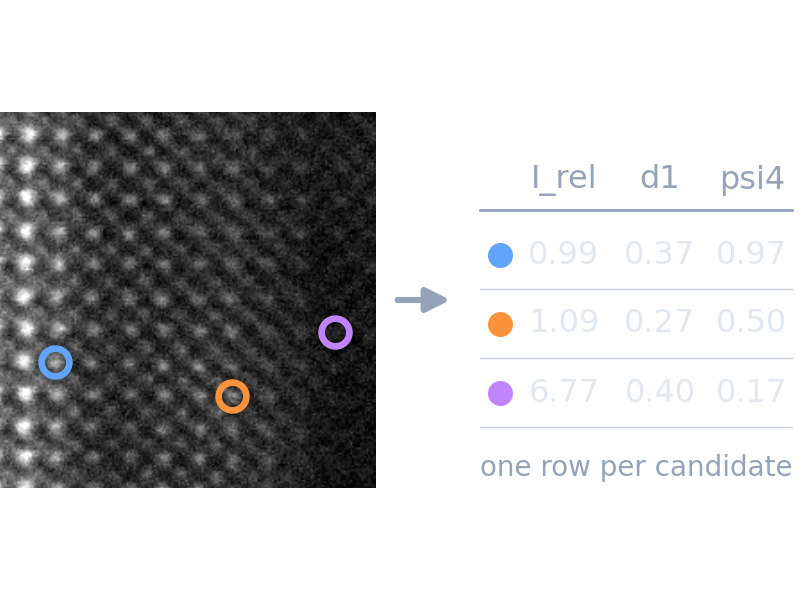{.kpi-img fig-alt="An atomic-resolution image with marked atom columns, and an arrow to a table with one row per column"}

[four images become one table: 1 934 objects, 11 descriptors each]{.lbl}

[→ Acts 1 + 2 · Objects, Descriptors]{.act-tag}
:::
::: {.kpi .fragment}
[94 → 69 %]{.big}

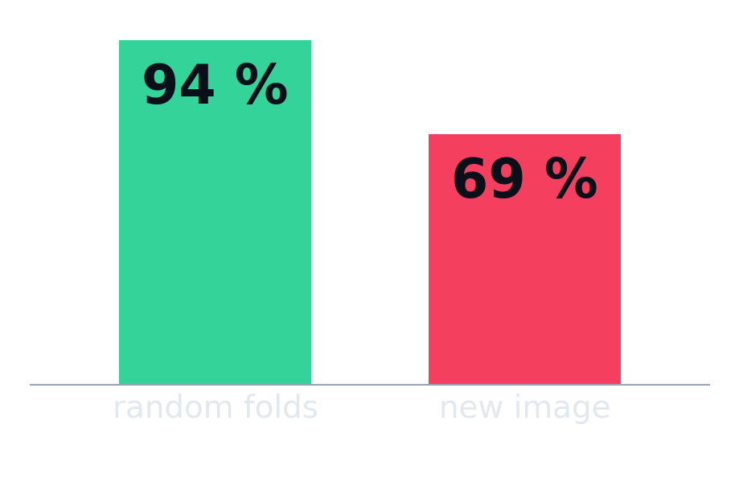{.kpi-img fig-alt="Two bars: 94 percent accuracy on random folds and 69 percent on a new image"}

[accuracy of the same random forest: random folds versus a new image]{.lbl}

[→ Act 5 · Validate]{.act-tag}
:::
::: {.kpi .fragment}
[84 %]{.big}

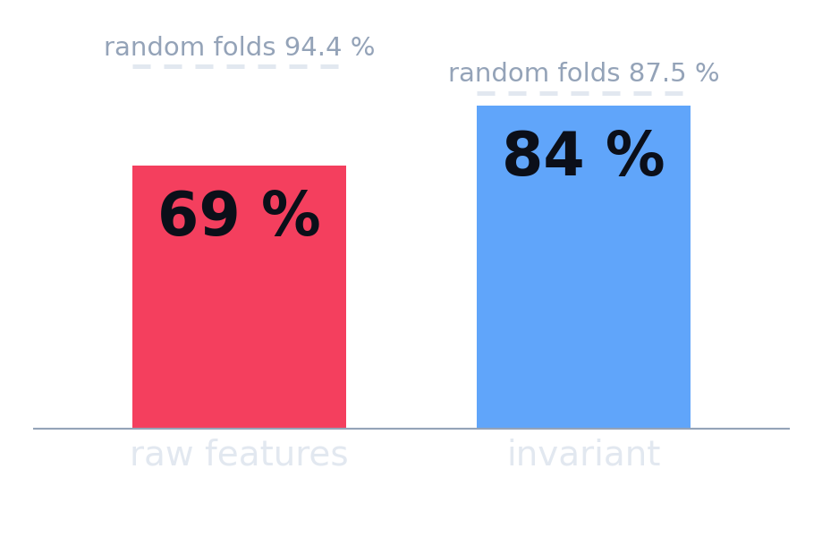{.kpi-img fig-alt="Two bars: 87.5 percent on random folds and 84 percent on a new image with invariant descriptors"}

[on a new image with six descriptors that do not know the image]{.lbl}

[→ Acts 2 + 6 · Descriptors, Explain]{.act-tag}
:::
:::

::: {.notes}
- Open with the link to Week 4. Last week every model started from a finished table: features X, target y. Today asks where the table comes from when the measurement is an image, and which model to use on it.
- Do not explain the numbers now. Say: "By the end you can explain each of them." Come back to them on the summary slide.
- 1 934 × 11: four HAADF-STEM images of one oxide interface. A column finder returns 2 266 intensity maxima; 1 934 of them have a clear label. Each maximum becomes one row with 11 numbers. This is the step from pixels to a feature table.
- 94 % → 69 %: a random forest on three raw intensity features (peak height, background, width). Random 5-fold cross-validation says 94.4 %. When we hold out a whole image, the same model gets 68.6 %. Week 4 gave the reason: the columns of one image share the gain, the thickness and the focus.
- 84 %: six descriptors that are ratios, distances and angles. The random-fold score is lower (87.5 %), and the new-image score is much higher (84.1 %). The gap closes from 26 points to 3. The improvement comes from the descriptors, not from a bigger model.
- The images are made by xp/prep/make_kpi.py from the same data as the explainers.
:::

## Today's red line: from an image to a classifier you can explain

::: {.xp data-xp="redline"}
:::

::: {.notes}
- This is the map of the lecture. Six stations, each one question. The rail at the top right of every slide shows where we are.
- 1 Objects: find the atom columns. Smooth, find local maxima, refine each maximum with a 2-D Gaussian fit. The precision of a position is set by the dose.
- 2 Descriptors: describe each object with a few numbers. One row per object. Good descriptors do not change when the image is shifted, rotated or recorded with a different gain.
- 3 Tree: a decision tree asks yes/no questions about the descriptors. It chooses each question greedily by the decrease of the impurity. A deep tree has a high variance.
- 4 Ensemble: many trees are better than one. Bagging and random forests lower the variance. Boosting lowers the bias.
- 5 Validate: the columns of one image are not independent. Hold out whole images. Start with a baseline.
- 6 Explain: which descriptors does the model use? Impurity importance, permutation importance and SHAP, and what each of them cannot tell you.
- The dashed arrow: when the score on a new image is bad, go back to the descriptors. A bigger model does not repair a descriptor that identifies the image.
- Learning outcomes (one per station): (1) describe a column finder and its hyperparameters, and state what limits the position precision; (2) design descriptors with the correct invariances and explain ACSF/SOAP in one sentence; (3) compute an impurity decrease and explain greedy tree growth; (4) derive the variance of an average of correlated trees, and state the boosting update; (5) choose the group for cross-validation and build a baseline ladder; (6) compare MDI, permutation importance and SHAP, and name their failure modes.
:::

## One specimen, four images, one question

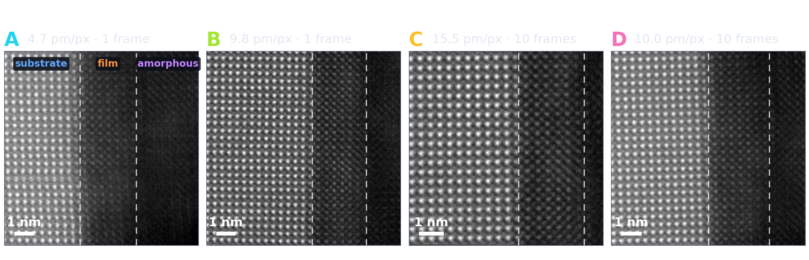{width="100%" fig-alt="Four atomic-resolution images of a substrate, a film and an amorphous layer, with dashed zone boundaries"}

::: {.claim}
The question for every intensity maximum: is it a *substrate column*, a *film column*, or *no column* at all?
:::

::: {.notes}
- Purpose: introduce the one data set of today. Everything in this lecture is computed from these four images.
- The data: STEM-Bank-26 (Hollyer and Stach), folder "haadf_SFO_LAO", licence CC BY 4.0. The file names say SFO on LAO. In HAADF the intensity grows with the atomic number. The bright square lattice on the left is the LaAlO₃ substrate (La, Z = 57). The darker lattice in the middle is the Sr–Fe oxide film. On the right is an amorphous layer. The metadata do not state this; it is my reading of the Z-contrast.
- The four images. A: one frame, 2048², 4.7 pm per pixel. B: one frame, 1024², 9.8 pm per pixel. C: sum of 10 frames, 512², 15.5 pm per pixel. D: sum of 10 frames, 1024², 10 pm per pixel. The fields of view are 8 to 10 nm.
- The images differ in pixel size, dose, gain and position on the specimen. This is the normal situation: you train on the images that you have, and you apply the model to the image of next week.
- The labels come from the position. Left of the first dashed line: substrate column. Between the lines: film column. In the amorphous layer there are no columns, so each maximum there is a false detection: "no column". Candidates near a boundary get no label. This gives 942 substrate columns, 685 film columns and 307 false detections.
- Why this task? It is small, real, and it has the structure of most EM classification tasks: objects in images, a few images, and labels that are cheap in some regions.
- The one point to land: the unit of the measurement is the image. The unit of the table is the column. This difference is the theme of Act 5.
:::

<!-- ===== Act 1. Objects ===== -->

## {.act}

::: {.act-kicker}
Act 1 · Objects
:::
::: {.act-question}
Where are the objects in the image?
:::
::: {.xp data-xp="redline" data-focus="1"}
:::

## From an image to objects: smooth, find maxima, fit {data-station="1"}

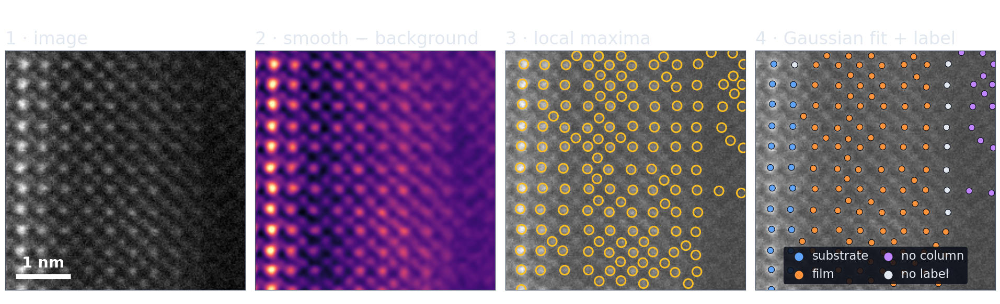{width="100%" fig-alt="Four panels: raw image, filtered image, detected maxima, fitted and labelled column positions"}

::: {.claim}
Three steps, three hyperparameters: the smoothing width, the minimum distance, the threshold. Each of them changes the table.
:::

::: {.notes}
- Purpose: the classical column finder in one picture. This is the workflow of Atomap and of most in-house scripts.
- Step 1, smooth. A Gaussian filter with σ = 0.04 nm, about the size of one column. This is a matched filter (Week 2): the filter with the shape of the signal gives the best signal-to-noise ratio. Then subtract a wide Gaussian (0.8 nm). This removes the slow background from thickness and from the amorphous layer.
- Step 2, local maxima. A pixel is a candidate when it is the largest value in a window of ±0.12 nm, and when it is above a threshold. Here the threshold is 4 % of the brightest values. The window is the minimum distance between two columns.
- Step 3, fit. A 2-D Gaussian plus a constant, fitted by least squares in a window of ±0.11 nm. The fit gives the position with sub-pixel precision, the peak height, the width and the local background.
- Result on the four images: 2 266 candidates. 598, 692, 389 and 587 for images A to D.
- Look at the right panel. In the amorphous layer the finder also returns maxima. A finder does not know what a column is; it returns every maximum above the threshold. These false detections are a class of our problem.
- Misconception: "the finder has no parameters, it only finds the atoms." The next slide shows how much the result depends on the three parameters.
- The one point to land: an object detector is the first model in the chain. Its errors go into every later number.
:::

## Find the columns: dose, smoothing, threshold {data-station="1"}

::: {.xp data-xp="find-columns"}
:::

::: {.notes}
- Purpose: students see that detection is a trade-off, and that the dose decides how hard it is.
- The data: ten aligned frames of image D, a strip of 5.8 nm × 5.1 nm across the interface. The slider "frames summed" adds 1 to 10 frames, so it changes the dose. The circles are the maxima above the threshold, coloured by the zone.
- Demo, step 1: ten frames, default smoothing and threshold. Read the counts: 33 maxima in the substrate, 104 in the film, and 57 in the amorphous layer. The amorphous layer has no columns, so these 57 are false detections.
- Demo, step 2: raise the threshold. Read the chart on the right: it shows the count in each zone against the threshold. The substrate line is flat; these columns are safe. The amorphous curve falls to zero near 21 %. But at 21 % the film curve is at 70: one third of the film columns is gone. No threshold removes the false detections and keeps the film.
- Demo, step 3: go to one frame. The image is noisier. Now 64 false detections, and the amorphous curve reaches zero only near 27 %, where half of the film columns are gone. A lower dose makes the trade-off worse.
- Demo, step 4: set the smoothing to its minimum. The number of maxima rises: noise pixels become maxima. Set it too high: neighbouring columns merge.
- Ask: "Which errors are worse, missed columns or false columns?" It depends on the question. A vacancy count needs no false negatives. A strain map tolerates missed columns.
- Today we keep a low threshold and let a classifier decide what is a column. That is the reason for the class "no column".
- The one point to land: the hyperparameters of the detector decide which rows the table has. Report them together with the result.
- If you are late: do steps 1 and 3 only.
:::

## Refine each maximum: a 2-D Gaussian fit {data-station="1"}

::: {.deriv}
::: {.dstep .fragment}
[1]{.dnum} **Model of one column:** $I(\mathbf r)=A\,\exp\!\big(-\lvert\mathbf r-\mathbf r_0\rvert^2/2\sigma^2\big)+b$ in a small window around the maximum.
:::
::: {.dstep .fragment}
[2]{.dnum} **Least squares:** $\min_{A,\mathbf r_0,\sigma,b}\sum_{\text{pixels}}\big(I_\text{obs}-I(\mathbf r)\big)^2$. Non-linear in $\mathbf r_0$ and $\sigma$: Gauss–Newton, Week 4.
:::
::: {.dstep .fragment}
[3]{.dnum} **Output for each column:** position $\mathbf r_0$, peak height $A$, width $\sigma$, background $b$, residual. The first descriptors.
:::
::: {.dstep .fragment}
[4]{.dnum} **Precision:** $\sigma_{r_0}\approx\sigma/\sqrt{N}$ for $N$ detected electrons in the column. The pixel size does not appear.
:::
:::

```python
from scipy.optimize import least_squares
def model(p, yy, xx):                      # p = (A, y0, x0, sigma, b)
    return p[0] * np.exp(-((yy - p[1])**2 + (xx - p[2])**2) / (2 * p[3]**2)) + p[4]
fit = least_squares(lambda p: (model(p, yy, xx) - window).ravel(), p_start)
```

::: {.notes}
- Write the four lines on the board while the fragments appear.
- Step 1: the Gaussian is a model of the probe-broadened column. It is not exact, but it is good near the maximum. The constant b takes the local background.
- Step 2: this is a non-linear least-squares problem with five parameters. Week 4 gave the tools: Gauss–Newton or Levenberg–Marquardt. `scipy.optimize.least_squares` does it. The start values come from the maximum.
- Least squares implies a Gaussian noise model with one σ (Week 4, Act 1). That is fine for many counts. At a few counts per pixel, use the Poisson likelihood.
- Step 3: the fit turns an image patch into five physical numbers. They are the raw material for the descriptors of Act 2.
- Step 4: the position of a peak of width σ, measured with N electrons, has a standard error of about σ/√N. This is the standard error of a mean. With σ = 50 pm and N = 100 electrons, the precision is 5 pm. The pixel size only needs to sample the peak (two or more pixels across σ).
- When two columns are closer than about 3σ, fit them together with two Gaussians. Otherwise each fit pulls towards the neighbour.
- Misconception: "the precision cannot be better than one pixel." The next slide measures it.
- Forward link: a neural network can replace steps 1 and 2 of the finder (Week 7). The Gaussian fit stays as the last step.
:::

## The dose sets the precision, not the pixel size {data-station="1"}

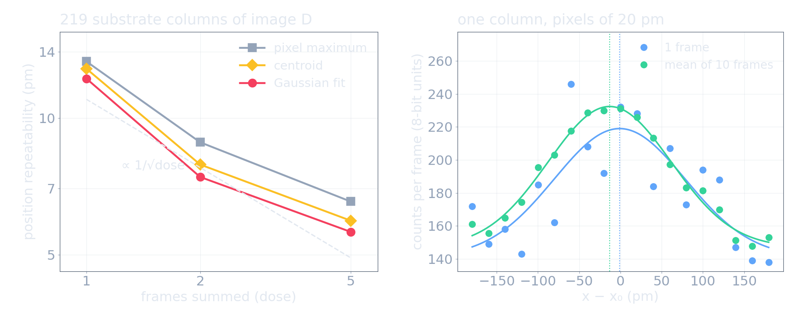{width="96%" fig-alt="Position repeatability in picometres against the number of summed frames for three estimators, with a one over square root guide line; and a cut through one column with a Gaussian fit"}

::: {.claim}
Pixel size 10 pm. Precision with one frame: 12 pm. With five frames: 5.6 pm. Factor $\sqrt5$: the precision follows $1/\sqrt{\text{dose}}$.
:::

::: {.notes}
- Purpose: measure the precision on real data, without a ground truth.
- The method: image D has ten frames. Sum n frames, and sum n other frames. Find the same 219 substrate columns in both sums. The two positions of one column differ only by noise. The standard deviation of the difference, divided by √2, is the precision of one measurement. This is a repeatability test; you can do it with every image stack.
- The numbers, for one coordinate. One frame: pixel maximum 13.3 pm, centroid 12.9 pm, Gaussian fit 12.2 pm. Two frames: 8.8, 7.9, 7.4 pm. Five frames: 6.6, 5.9, 5.6 pm.
- First result: from one frame to five frames the precision improves by a factor of 2.2. √5 = 2.24. The precision is limited by the counts.
- Second result: the three estimators differ by only 10 to 15 %. The pixel maximum is taken after the smoothing, and the smoothing is a matched filter. So the maximum of the smoothed image is already a good estimate. The fit is the best of the three, and it also gives A, σ and b.
- Third result: 5.6 pm is about half a pixel. Sub-pixel precision is normal. Strain maps and polarisation maps in ferroelectrics need 1 to 5 pm; they get it with more dose and with drift correction.
- A limit of this test: it measures the random error only. A scan distortion that is the same in all frames does not show up.
- The one point to land: precision is a property of the dose and of the estimator. Measure it with a split of your own frames.
:::

## The same idea for particles: segment, then measure {data-station="1"}

{width="100%" fig-alt="Pipeline from a noisy particle image through thresholding and watershed to a table of particle properties"}

| Object | Detector | Hyperparameters | Typical descriptors |
|---|---|---|---|
| atom column | smooth → maxima → Gaussian fit | smoothing width, minimum distance, threshold | position, height, width, neighbours |
| particle, grain, pore | smooth → threshold → watershed | smoothing width, threshold rule, marker distance | area, equivalent diameter, eccentricity, solidity |

::: {.notes}
- Purpose: generalise. Atom columns are one kind of object. At lower magnification the objects are particles, grains, pores or precipitates, and the detector is a segmentation.
- This figure is synthetic; it is the only synthetic figure of today. Walk from left to right. Smooth. The Otsu threshold separates two intensity populations. In the binary mask, particles that touch are one region. The distance transform and the watershed split most of them. `skimage.measure.regionprops_table` returns one row per region.
- The descriptors: area, equivalent diameter √(4A/π), eccentricity of the fitted ellipse, solidity (area divided by the area of the convex hull), mean intensity. Convert pixels to nanometres before you model.
- Error propagation. A merge of two particles changes the area, the eccentricity and the solidity at the same time. So the errors of the descriptors are correlated. They are not independent noise on each column of the table. Solidity is a good quality check: merged particles have a low solidity.
- Other pitfalls. Particles at the image border are cut: remove them (`clear_border`). A 2-D projection is not the 3-D shape. Objects smaller than about 3 pixels are dominated by the probe and the noise.
- The one point to land: the table is a designed representation. Each column of the table is a hypothesis about what matters, and each row carries the errors of the detector.
- If you are late: show the table only and say one sentence about correlated errors.
:::

## Checkpoint: the detector {data-station="1"}

::: {.claim}
Two minutes, in pairs. Say what changes in the table.
:::

1. You double the smoothing width. [→ **Fewer false maxima, but close columns merge.** Rows disappear, and the fitted widths grow.]{.fragment}
2. You want 3 pm precision; one frame gives 12 pm. [→ **16 times the dose** ($1/\sqrt N$), for example 16 aligned frames. A smaller pixel does not help.]{.fragment}
3. The specimen is beam-sensitive: 5 electrons per pixel. [→ **Poisson likelihood** in the fit, not least squares (Week 2).]{.fragment}
4. The watershed merges two particles. [→ **Area, eccentricity and solidity are wrong together:** correlated errors in one row.]{.fragment}
5. A colleague reports "412 columns found". What do you ask? [→ **Threshold, minimum distance, smoothing, and the number of false detections** on a region without columns.]{.fragment}

::: {.notes}
- Procedure: show the five cases, give two minutes, then reveal the answers one by one. Ask one pair for each case.
- Case 1: the smoothing width is a trade-off between noise and resolution. Too wide, and two columns at 0.14 nm become one maximum.
- Case 2: the precision goes with 1/√N. A factor of 4 in precision needs a factor of 16 in dose. Students often answer "use a smaller pixel". A smaller pixel at the same dose only divides the same electrons over more pixels.
- Case 3: least squares assumes Gaussian noise. At 5 counts the distribution is skewed. This is the rule of Weeks 2 and 4: the noise model gives the loss.
- Case 4: this is must-know statement 1. Detection errors become correlated descriptor errors.
- Case 5: a count without the detector settings cannot be reproduced. The amorphous region of our images is a free test for false detections.
- Timing: 3 minutes in total. If you are late, do cases 2 and 4 only.
:::

<!-- ===== Act 2. Descriptors ===== -->

## {.act}

::: {.act-kicker}
Act 2 · Descriptors
:::
::: {.act-question}
Which numbers describe one object?
:::
::: {.xp data-xp="redline" data-focus="2"}
:::

## One row per object: the feature table {data-station="2"}

| Descriptor | Meaning | Unit | Kind |
|---|---|---|---|
| `amp`, `bg` | peak height and background of the fit | counts | raw intensity |
| `sigma` | width of the fit | nm | shape |
| `resid` | RMS residual of the fit / peak height | – | shape |
| `contrast` | peak height / background | – | ratio |
| `I_rel` | peak height / median peak height of the 4 nearest | – | ratio |
| `d1`, `d4` | distance to the nearest; mean distance to the 4 nearest | nm | geometry |
| `d_spread` | std / mean of the 4 distances | – | geometry |
| `n_near` | number of candidates within 0.45 nm | – | geometry |
| `psi4` | four-fold order $\big\lvert\tfrac14\sum_{j=1}^{4}e^{4i\theta_j}\big\rvert$ of the 4 nearest | – | geometry |

::: {.claim}
1 934 rows × 11 columns. From here on the image is gone: the model sees only this table.
:::

::: {.notes}
- Purpose: define the table of today. Read it by groups, not by rows.
- Group 1, raw intensity: `amp` and `bg` come directly from the Gaussian fit, in detector counts.
- Group 2, shape: `sigma` is the width of the column in nanometres. `resid` says how well a Gaussian describes the patch. A noise maximum is not a Gaussian, so its residual is large.
- Group 3, ratios: `contrast` divides the peak height by the local background. `I_rel` divides the peak height by the median peak height of the four nearest neighbours. A ratio removes the gain of the detector. Only `I_rel` also removes an offset; the demo on the next slide shows it.
- Group 4, geometry: distances and angles to the neighbours. `d1` is the distance to the nearest candidate. `d4` is the mean distance to the four nearest. `d_spread` is the relative spread of these four distances: zero on a perfect square lattice. `n_near` counts the candidates within 0.45 nm. `psi4` is the four-fold bond order: 1 when the four neighbours sit at 90° to each other, small when they sit at random angles.
- These 11 numbers are a choice. Each one is a hypothesis: "the film has a different lattice spacing", "noise maxima have no order". This is the difference from deep learning, where the network learns the features (Week 7).
- The feature sets of today. "Raw": amp, bg, sigma. "Invariant": I_rel, d1, d4, d_spread, n_near, psi4. "All": the 11 together.
- The one point to land: classical machine learning on images needs a designed table. Rows are objects, columns are descriptors.
:::

## Describe one column {data-station="2"}

::: {.xp data-xp="descriptor"}
:::

::: {.notes}
- Purpose: connect each descriptor to something visible in the image, and test the invariances by hand.
- Demo, step 1: click a substrate column. Read the table: `d4` is the lattice spacing, `psi4` is near 1, `d_spread` is near 0. The lines show the four nearest neighbours.
- Demo, step 2: click a film column, then a maximum in the amorphous layer. Ask before each click: "Which numbers will change?" In the amorphous layer the neighbours are at irregular distances and angles: `psi4` falls and `d_spread` rises.
- Demo, step 3: switch on "gain ×3 + offset". This is a different detector setting. `amp` and `bg` change. `contrast` changes too, from 0.50 to 0.43: it divides by the background, and an offset changes the background. `I_rel`, the widths and all distances show "same".
- Ask: "Why does one ratio survive and the other not?" `I_rel` is a ratio of two peak heights. The fit removes the constant under each peak, so the offset cancels before the division.
- Demo, step 4: switch on "rotate 90°". Nothing changes: all 11 descriptors use distances, or angles between neighbours. An x coordinate would change. That is why the position is not a descriptor.
- The large circle has a radius of 0.9 nm. It is the cutoff of the symmetry functions on a later slide: the local environment of the column.
- Misconception: "the position in the image is a good feature, the film is always in the middle." It is true in these four images, and wrong in the next image. A descriptor must describe the object, not the field of view.
- The one point to land: a good descriptor changes when the physics changes, and does not change when the acquisition changes.
:::

## Raw intensities identify the image {data-station="2"}

{width="94%" fig-alt="Histograms of the raw peak height for four images, which do not overlap, and of the relative intensity, which overlap"}

::: {.claim}
The median peak height differs by a factor of 4.3 between the images. A model that splits on `amp` learns *which image*, not *which column*.
:::

::: {.notes}
- Purpose: show the nuisance in the data before any model sees it.
- Top panel: the peak height of the substrate columns in detector counts. The same lattice, the same atoms. The median is 4.9·10⁵ in image A, 9.8·10⁵ in B, 2.1·10⁶ in C and 1.5·10⁶ in D. The reasons: the number of summed frames, the dwell time, the detector gain, the local thickness. None of them is a property of the column.
- A threshold "amp > 10⁶ means substrate column" is right in one image and wrong in the next one.
- Bottom panel: `I_rel`, the peak height divided by the median of the four nearest neighbours. The four distributions are on top of each other. The division removes every factor that the column shares with its neighbours.
- This is the same idea as the standardisation in Week 4, but local, and inside one image. It needs no information from other images, so it cannot leak.
- What `I_rel` loses: the absolute Z-contrast. Deep in the substrate and deep in the film, `I_rel` is near 1 in both. It only differs near the interface. So the geometry descriptors must do most of the work. This is honest: without a calibrated detector, the absolute intensity cannot be compared between images.
- With a calibrated detector (intensity as a fraction of the incident beam) and a known thickness, the absolute intensity is a valid descriptor. That is quantitative STEM.
- The one point to land: before you train, plot each feature for each image. A feature whose distribution identifies the image will be used to identify the image.
:::

## Build the invariances into the descriptor {data-station="2"}

| The acquisition changes … | The descriptor must be … | How to get it |
|---|---|---|
| the field of view (shift) | translation invariant | use distances to neighbours, not positions |
| the scan direction (rotation) | rotation invariant | use distances and angles *between* neighbours |
| the order of the neighbours | permutation invariant | sum or average over the neighbours |
| gain, offset, dwell time | intensity invariant | use ratios to the local neighbours |
| the pixel size | scale aware | measure in nm, not in pixels |

::: {.claim}
And two more: *continuous* (a small shift of an atom gives a small change) and *sensitive* (different physics gives different numbers).
:::

::: {.notes}
- Purpose: turn the last two slides into a design rule. This is must-know statement 3.
- Read each row as "what can change without a change of the physics", then "what must the descriptor do".
- Row 1: the same column in a shifted image must get the same row. So no absolute positions.
- Row 2: the scan direction is arbitrary. Distances are invariant. Angles between two neighbours are invariant; the angle of one neighbour against the x axis is not. `psi4` uses exp(4iθ) and takes the absolute value of the mean: a rotation of all neighbours changes only the phase.
- Row 3: "neighbour 1" and "neighbour 2" have no fixed order. Sums, means, medians and sorted lists are invariant under a change of the order.
- Row 4: a ratio removes the gain. To remove an offset too, both numbers of the ratio must be free of it: `I_rel` passes, `contrast` fails.
- Row 5: all lengths in nanometres with the calibrated pixel size. Then images with different magnifications share one table. This is not an invariance; the lattice spacing is physics, so the descriptor must keep it.
- Continuity: `n_near` is not continuous. A neighbour at 0.449 nm counts, one at 0.451 nm does not. A smooth cutoff is better; the symmetry functions on the next slides have one.
- Sensitivity is the opposite demand. A constant is invariant under everything and useless. The art is to remove the nuisance and to keep the physics.
- Where the invariance comes from in deep learning: from data augmentation or from the architecture (Weeks 7 and 8). Here it comes from the design.
- The one point to land: decide what must not matter, and make the descriptor blind to it.
:::

## Order and distance separate lattice from noise {data-station="2"}

{width="96%" fig-alt="Two copies of an image with detected maxima coloured by bond order and by neighbour distance"}

::: {.notes}
- Purpose: look at two geometry descriptors on the image, before a model uses them.
- Left, `psi4`. In the substrate and in the film the four nearest neighbours form a square: `psi4` is near 1. In the amorphous layer the maxima are at random places: `psi4` is low. So `psi4` separates "column" from "no column".
- Right, `d1`. In the substrate the nearest neighbour is at 0.37 nm: the finder sees one square sublattice, the heavy La columns, and 0.379 nm is the lattice parameter of LaAlO₃. In the film the median is 0.28 nm, close to 0.38/√2 = 0.27 nm. There the two cation sublattices have a similar atomic number, so the finder sees both. So `d1` separates substrate from film.
- The class medians. `psi4`: substrate 1.00, film 0.90, no column 0.49. The film is lower than the substrate because its four nearest neighbours are not always a clean square. `d1`: 0.37, 0.28 and 0.26 nm. `d_spread`: 0.02, 0.09 and 0.15.
- Each descriptor answers one of the two questions. No single descriptor answers both. This is why we need a model that combines them, and a tree is the simplest one.
- Look at the interface. There the neighbourhood of a column contains both lattices. The descriptors of these columns are between the two classes. Expect the errors of every model there.
- `psi4` is the 2-D relative of the Steinhardt bond-order parameters that are used to find crystalline regions in simulations.
- The one point to land: plot the descriptor on the image. If you can see the classes in this plot, a simple model can find them.
:::

## From hand-made to systematic: symmetry functions {data-station="2"}

:::: {.columns}
::: {.column width="42%"}
**Radial symmetry functions** (ACSF, $G^2$) [@behler2007symmetry]

$$G_i(r_s)=\sum_{j\ne i} e^{-(r_{ij}-r_s)^2/2w^2}\,f_c(r_{ij})$$

- one number for each shell radius $r_s$: "how many neighbours at this distance?"
- a sum over neighbours: translation, rotation and permutation invariant
- a smooth cutoff $f_c$: continuous
- angular functions and **SOAP** [@bartok2013soap] add angles; library: DScribe [@himanen2020dscribe]
:::
::: {.column width="58%"}
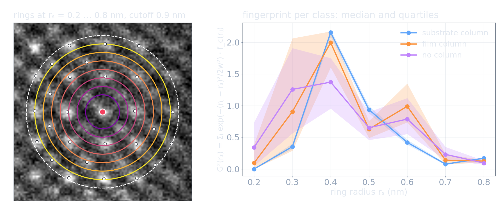{width="100%" fig-alt="Mean radial symmetry function values against shell radius for substrate columns, film columns and noise maxima"}
:::
::::

::: {.notes}
- Purpose: show that the hand-made descriptors have a systematic version. ACSF and SOAP come from machine-learned interatomic potentials. They work for atom columns in an image too.
- The formula: put a Gaussian shell of radius r_s and width w around column i. Count the neighbours in the shell, with a smooth weight. Do this for several radii. The result is a radial fingerprint, like a smoothed radial distribution function of one column.
- Invariances: the function uses only the distances r_ij, and it sums over all neighbours. So it is invariant by construction. The cutoff function goes smoothly to zero at 0.9 nm, so a neighbour that crosses the cutoff causes no jump.
- The figure: the substrate has sharp shells at its lattice distances. The film has other shells. The noise maxima have a flat fingerprint: no preferred distance.
- Result on our task (random forest, new image): I_rel plus the seven radial functions give 84.0 %. The six hand-made descriptors give 84.1 %. No gain here, because the hand-made set already contains the distances.
- When are systematic descriptors better? When you do not know which distances and angles matter: defects, grain boundaries, many phases. Then you take a complete set and let the model select.
- SOAP in one sentence: expand the neighbour density in radial functions and spherical harmonics, and take the power spectrum, which is rotation invariant.
- If you are late: skip this slide. Say that ACSF and SOAP are the systematic version of today's descriptors.
:::

## Checkpoint: is this a good descriptor? {data-station="2"}

::: {.claim}
Two minutes, in pairs. Which invariance does it break, and how do you repair it?
:::

1. The x coordinate of the column in pixels. [→ **Not translation invariant.** Use distances to neighbours.]{.fragment}
2. The angle of the nearest neighbour against the scan direction. [→ **Not rotation invariant.** Use the angle between two neighbours.]{.fragment}
3. The peak height in detector counts. [→ **Not gain invariant.** Divide by the local median, or calibrate the detector.]{.fragment}
4. The distance to the nearest neighbour in pixels. [→ **Depends on the magnification.** Convert to nm.]{.fragment}
5. The intensities of neighbours 1, 2, 3, 4 as four features. [→ **Not permutation invariant.** Sort them, or use mean and spread.]{.fragment}
6. The number of the image. [→ **Invariant under everything in the image, and a pure leak.** Remove it.]{.fragment}

::: {.notes}
- Procedure: give two minutes, then reveal one by one. Ask for the broken invariance first, then for the repair.
- Cases 1 to 5 map to the five rows of the invariance table.
- Case 5 is subtle. The order of the four nearest neighbours changes when two distances are nearly equal. Then the four features swap between two similar columns. A tree sees two different rows.
- Case 6 is the bridge to Act 5. The image number is not physics. With a random split it is a perfect feature for everything that differs between images. `bg` and `amp` are image numbers in disguise.
- Timing: 3 minutes. If you are late, do cases 1, 3 and 6.
:::

<!-- ===== Act 3. Tree ===== -->

## {.act}

::: {.act-kicker}
Act 3 · Tree
:::
::: {.act-question}
How does a tree ask questions?
:::
::: {.xp data-xp="redline" data-focus="3"}
:::

## A decision tree is a sequence of yes/no questions {data-station="3"}

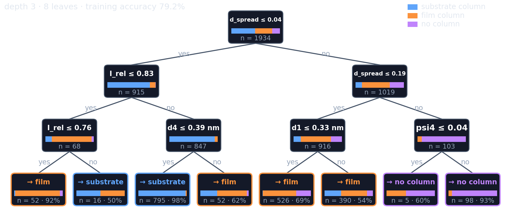{width="100%" fig-alt="A decision tree with three levels of questions about neighbour distances and bond order, and eight leaves coloured by class"}

::: {.notes}
- Purpose: read a real tree before we learn how to build one.
- Read from the top. Each node asks one question about one descriptor: "is the value below a threshold?" Yes goes left, no goes right. A leaf predicts the class that has the most training rows in it.
- The root question: "is `d_spread` at most 0.04?" That means: are the four neighbour distances nearly equal? 915 candidates say yes; most of them are substrate columns.
- Follow a substrate column: regular neighbourhood, yes; `I_rel` above 0.83, so not a dim maximum; `d4` at most 0.39 nm. It lands in a leaf with 795 rows, 98 % substrate.
- Follow a noise maximum: `d_spread` above 0.04, and above 0.19; it lands in a leaf with 98 rows, 93 % "no column".
- The questions are physics that you can check. A perfect square lattice has a spread of zero. The threshold of 0.39 nm is just above the lattice parameter of LaAlO₃, 0.379 nm. The tree found these numbers from the data.
- The weak leaves are the two film leaves on the right, with 69 % and 54 % purity. Three questions are not enough for the film.
- With three levels the tree has at most 8 leaves. Its accuracy is 79 % on the training rows, and a tree of this depth gets 75 % on a new image.
- What a tree is as a function: it cuts the descriptor space into boxes with edges parallel to the axes, and it predicts one constant in each box. A piecewise-constant function.
- Three properties follow from this picture. (1) A tree needs no feature scaling: a threshold on `d1` in nm or in pm gives the same split. (2) A tree finds thresholds and interactions: "if `psi4` is high and `d1` is large". (3) A tree cannot extrapolate: outside the range of the training data the prediction stays constant.
- The one point to land: a small tree is a model that you can read. That is rare, and it is the reason why trees are the first non-linear model to try.
:::

## Which question? The one that makes the children purer {data-station="3"}

::: {.deriv}
::: {.dstep .fragment}
[1]{.dnum} **Impurity of a node** with class fractions $p_k$: Gini $I=1-\sum_k p_k^2$, entropy $I=-\sum_k p_k\log_2 p_k$.
:::
::: {.dstep .fragment}
[2]{.dnum} **A split** (feature $j$, threshold $t$) sends $N_L$ rows left and $N_R$ rows right.
:::
::: {.dstep .fragment}
[3]{.dnum} **Impurity decrease:** $\Delta = I(\text{parent})-\frac{N_L}{N}I(L)-\frac{N_R}{N}I(R)$
:::
::: {.dstep .fragment}
[4]{.dnum} **Choose** the pair $(j,t)$ with the largest $\Delta$. Regression: $I$ = variance of $y$ in the node.
:::
:::

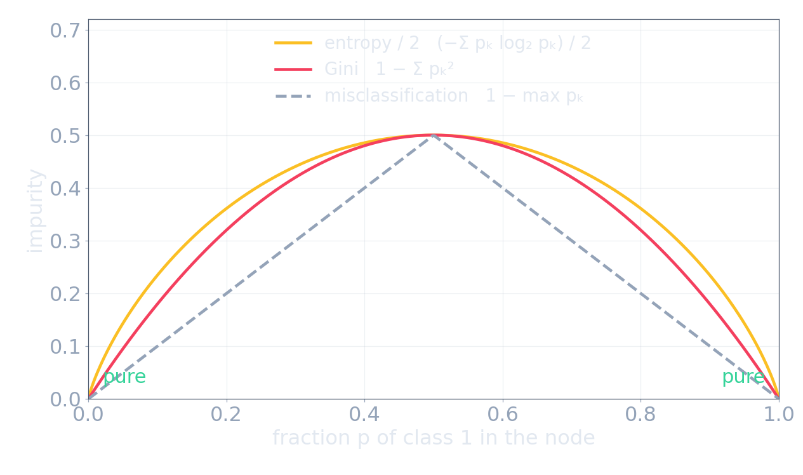{width="52%" fig-alt="Gini impurity, entropy and misclassification error against the class fraction; all are zero for a pure node and largest at one half"}

::: {.notes}
- Write the four lines on the board while the fragments appear. This is must-know statement 4.
- Step 1: the impurity is zero when all rows of a node have one class. It is largest when the classes are mixed equally. Gini: the probability that two rows drawn at random from the node have different classes. Entropy: the mean number of bits needed to state the class.
- Example at the root of our table: 942, 685 and 307 rows. The fractions are 0.49, 0.35, 0.16. Gini = 1 − 0.49² − 0.35² − 0.16² = 0.61.
- Step 3: the impurity of the two children, weighted by their sizes, subtracted from the impurity of the parent. With entropy this is the information gain.
- Step 4: for regression trees, the impurity is the variance of the target in the node. Then the split minimises the sum of squared errors, the loss of Week 4.
- The figure: Gini and entropy have nearly the same shape. In practice they choose nearly the same splits. The misclassification error is a straight line. It is a bad criterion: a split that makes one child purer and the other less pure can leave the error unchanged, and Gini rewards it.
- Misconception: "the tree maximises the accuracy." It maximises the impurity decrease of one split at a time.
:::

## Find the best split of one node {data-station="3"}

::: {.xp data-xp="split"}
:::

::: {.notes}
- Purpose: students do one split by hand and see the computation of Δ.
- The data: all 1 934 labelled candidates. The top chart shows the three classes along one descriptor.
- Demo, step 1: the descriptor `d4`, the mean distance to the four nearest candidates. The substrate is the narrow blue peak at 0.38 nm. Move the threshold slowly from left to right. Watch the three bars: the parent, the left child, the right child. The lower chart draws Δ for each threshold.
- Read the equation with the numbers at 0.360 nm: 0.612 − 554/1934 · 0.472 − 1380/1934 · 0.473 = 0.140.
- Demo, step 2: press "best split". The threshold jumps to 0.370 nm with Δ = 0.159. Look at the Δ curve just right of it: Δ falls to zero, where the threshold cuts the substrate peak in two halves.
- Demo, step 3: change the descriptor to `d_spread`, to ψ₄, then to `amp`. Each descriptor has its own best threshold and its own best Δ. The tree compares these best values and takes the largest one. That is one node.
- Demo, step 4: switch from Gini to entropy. The scale of the curve changes (the parent has 1.46 bits), and the best threshold nearly stays.
- Ask: "How many thresholds must the tree test for one feature?" At most N − 1: only the midpoints between sorted neighbours matter. So one node costs about N log N for each feature.
- Note on `amp`: it gives a large Δ on this table, because the table contains all four images and the classes differ in intensity inside each image. Remember this for Act 5.
- The one point to land: a split is an exhaustive search over features and thresholds for the largest impurity decrease.
:::

## CART: greedy, recursive, cheap {data-station="3"}

:::: {.columns}
::: {.column width="50%"}
**The algorithm**

1. Start with all rows in one node.
2. Find the split $(j,t)$ with the largest $\Delta$.
3. Split the rows. Repeat steps 2 and 3 in each child.
4. Stop: node is pure, depth limit, or fewer than `min_samples_leaf` rows.
5. Each leaf predicts its majority class (or its mean).

```python
from sklearn.tree import DecisionTreeClassifier
tree = DecisionTreeClassifier(max_depth=3)
tree.fit(X_train, y_train)
```
:::
::: {.column width="50%"}
**What follows from it**

- **Greedy:** the best split now, not the best tree. The best tree is NP-hard to find.
- **No scaling needed:** only the order of the values matters.
- **Thresholds and interactions** are natural; smooth linear trends need many steps.
- **No extrapolation:** constant outside the training range.
- **Unstable:** a small change of the data can change the root, and then everything below it.
:::
::::

::: {.notes}
- Purpose: the complete algorithm on one slide. CART = classification and regression trees (Breiman and co-workers, 1984).
- Left column: read the five steps. This is a recursion. Each step uses only the rows of the current node.
- Greedy: the algorithm never revises a split. A split that looks bad now and enables two very good splits below is not found. The XOR pattern is the standard example: no single split helps, two splits solve it.
- No scaling: the split only compares values of one feature with a threshold. Any monotonic transform of a feature (log, scaling) gives the same tree. Compare with Week 4, where gradient descent needed standardised features.
- No extrapolation, with a real example. With all 11 features, the random forest reaches 87 %, 77 % and 83 % on images B, C and D, and only 49 % on image A. Image A has the lowest counts of the four. Its `amp` values are below the range of the other three images, so every threshold on `amp` sends the columns of A to the wrong side.
- Stopping rules are the regularisation of a tree: `max_depth`, `min_samples_leaf`, `max_leaf_nodes`. Cost-complexity pruning (`ccp_alpha`) grows a full tree and cuts it back.
- Cost: about F · N log N for each level, for F features and N rows. A tree on our table trains in milliseconds.
- The one point to land: a tree is a greedy, recursive search for impurity decrease. Its strengths and its weaknesses both come from that.
:::

## Grow a tree: depth against a new image {data-station="3"}

::: {.xp data-xp="grow-tree"}
:::

::: {.notes}
- Purpose: see the partition grow, and see overfitting and instability with real data.
- The setting: two descriptors, `d4` and `I_rel`, so that the boxes are visible. The tree trains on the 1 354 candidates of images A, C and D. The test set is image B, a new image.
- Demo, step 1: depth 1, then 2, then 3. Each step cuts boxes into two. The training accuracy rises: 62 %, 75 %, 78 %. The accuracy on image B does not rise: it is about 80 % from depth 1.
- Why is the test score higher than the training score at depth 1? Image B has another class mixture and less noise than image A. One number for one image has a large uncertainty; do not read too much into it.
- Demo, step 2: go to depth 8 and to depth 12. The boxes become thin strips around single points. The training accuracy goes to 97 %. The accuracy on image B falls to 70 %. This is the picture of Week 4: the training error always falls with the complexity.
- Demo, step 3: set the depth to 4 and press "new bootstrap sample" several times. Each press draws the training rows again with replacement and grows a new tree. The boxes jump. The first split can change, and then the complete tree changes. "all data" goes back.
- Ask: "If each tree is so unstable, how can we use trees at all?" Collect answers. The answer of Act 4: average many of them.
- Misconception: "a deeper tree is a better tree." Deeper is a lower bias and a higher variance.
- The one point to land: depth is the complexity knob of a tree, and a single deep tree has a high variance.
- If you are late: do steps 1 and 3 only; the next slide shows step 2 as a figure.
:::

## Depth: the training score always rises {data-station="3"}

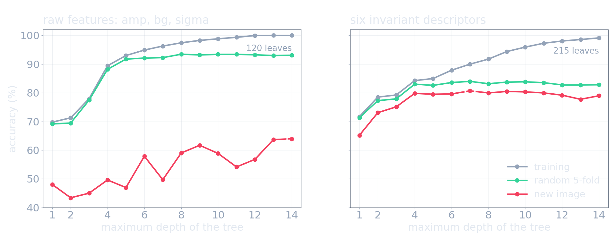{width="96%" fig-alt="Accuracy against tree depth for training data, random folds and a new image, for raw features and for invariant descriptors"}

::: {.claim}
Raw features, full tree: 100 % training, 93 % random folds, 64 % new image. The random folds do *not* show the overfitting.
:::

::: {.notes}
- Purpose: the bias–variance trade-off of Week 4, measured for a tree, with two different test sets.
- Left panel, raw features. The training accuracy reaches 100 % at depth 14 with 120 leaves. The random-fold accuracy rises with it to 93 %. So a random split says: "a deeper tree is better, no overfitting." The new-image accuracy stays between 43 % and 64 %, and it jumps from depth to depth: at this level the curve is noise.
- Why do the random folds rise? The validation columns come from the same images as the training columns. The deep tree learns the intensity levels of each image, and these levels are valid for the validation columns. The tree memorises the images, and the random split rewards it.
- Right panel, invariant descriptors. Training: 99 % at depth 14 with 215 leaves. Random folds: 83 % at depth 4, then flat. New image: 80 % at depth 4, a maximum of 81 % at depth 7, and no gain after that. Now the random folds and the new image tell the same story, 3 to 4 points apart.
- The best depth for a new image is about 4 with 16 leaves or fewer. A tree that you can still read.
- Compare the two test curves on the left: 30 points apart. On the right: 3 points. The descriptors decide whether the validation is honest, not the model.
- The one point to land: choose the depth with a validation score, and choose the validation split that matches the deployment. Week 4, now with trees.
:::

## One tree is unstable {data-station="3"}

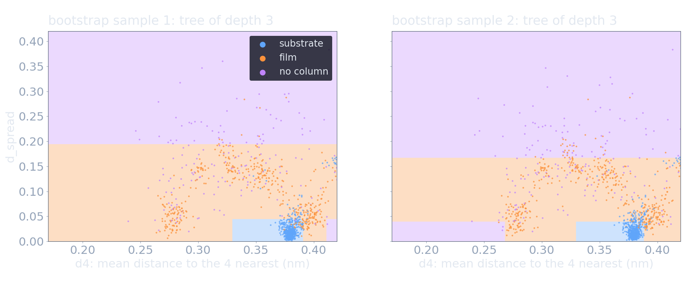{width="96%" fig-alt="Two partitions of the same descriptor plane by two decision trees; the boxes differ"}

::: {.claim}
Same data, same algorithm, a different tree. High variance is the weakness of one tree, and the opportunity for many.
:::

::: {.notes}
- Purpose: fix the instability in one static picture, as the bridge to Act 4.
- A bootstrap sample: draw N rows from the N training rows with replacement. About 63 % of the rows appear at least once; the rest are left out. The two samples differ only by this random draw.
- Compare the two panels. The large boxes agree: the substrate box near 0.38 nm, "no column" at the top. The boundaries differ: the border between film and "no column" is at a spread of 0.19 on the left and 0.17 on the right, and the right tree has an extra "no column" box at the bottom left.
- Be honest about the size: these two trees disagree for 8.5 % of the candidates. This is the worst pair of 20 trees; a typical pair disagrees for 3 %. Deeper trees disagree more.
- The reason is the greedy recursion. Two thresholds with nearly the same Δ compete at the root. A few rows decide which one wins. All later splits depend on that choice.
- In the language of Week 4: the bias of a deep tree is low, because it can fit any boundary. Its variance is high.
- A model with low bias and high variance is the ideal input for averaging. Averaging does not change the bias, and it lowers the variance.
- The one point to land: do not interpret the details of one deep tree. Another sample of the same data gives other details.
:::

## Checkpoint: trees {data-station="3"}

::: {.claim}
Two minutes, in pairs.
:::

1. A node has 40 substrate and 40 film columns. A split gives (40, 10) and (0, 30). Compute $\Delta$ with Gini. [→ parent 0.50; children 0.32 and 0; $\Delta = 0.50-\tfrac{50}{80}\cdot0.32 = \mathbf{0.30}$]{.fragment}
2. You replace `d1` by $\log$ `d1`. What changes in the tree? [→ **Nothing** but the threshold values. Only the order matters.]{.fragment}
3. The training accuracy is 100 %, the accuracy on a new image is 64 %. Two things to do. [→ **Limit the depth** (or `min_samples_leaf`), and **check the features** for image identity.]{.fragment}
4. A regression tree is trained on thicknesses of 10 to 50 nm. What does it predict for 80 nm? [→ **About 50 nm:** the value of the last leaf. No extrapolation.]{.fragment}
5. Two colleagues train a tree on the same data, with 5 % different rows. The roots differ. Who is wrong? [→ **Nobody.** Trees are unstable. Average many.]{.fragment}

::: {.notes}
- Procedure: two minutes, then reveal. Case 1 is a typical exam calculation; do it on the board.
- Case 1 in detail. Parent: p = (0.5, 0.5), Gini = 1 − 0.25 − 0.25 = 0.5. Left child (40, 10): p = (0.8, 0.2), Gini = 1 − 0.64 − 0.04 = 0.32. Right child (0, 30): pure, Gini = 0. Weights 50/80 and 30/80. Δ = 0.5 − 0.625 · 0.32 − 0 = 0.30.
- Case 2: trees are invariant to monotonic transforms of each feature. This is a practical advantage for tables with mixed units.
- Case 3: both answers are needed. The depth limit lowers the variance. The feature check finds the leak. Students often give only the first one.
- Case 4: this is why tree models are a risk for process optimisation outside the tested range.
- Case 5 leads to Act 4.
- Timing: 3 minutes. If you are late, do cases 1 and 4.
:::

<!-- ===== Act 4. Ensemble ===== -->

## {.act}

::: {.act-kicker}
Act 4 · Ensemble
:::
::: {.act-question}
Why are many trees better than one?
:::
::: {.xp data-xp="redline" data-focus="4"}
:::

## Bagging: average many unstable trees {data-station="4"}

::: {.deriv}
::: {.dstep .fragment}
[1]{.dnum} **Bootstrap:** draw $N$ rows with replacement, $B$ times. Train one deep tree on each sample.
:::
::: {.dstep .fragment}
[2]{.dnum} **Aggregate:** average the $B$ predictions (regression) or take the majority vote (classification).
:::
::: {.dstep .fragment}
[3]{.dnum} **Independent trees,** each with variance $\sigma^2$: $\;\mathrm{Var}\big(\tfrac1B\sum_b f_b\big)=\sigma^2/B$. The bias does not change.
:::
::: {.dstep .fragment}
[4]{.dnum} **Correlated trees,** pairwise correlation $\rho$: $\;\mathrm{Var}=\rho\,\sigma^2+\dfrac{1-\rho}{B}\,\sigma^2\;\xrightarrow{B\to\infty}\;\rho\,\sigma^2$
:::
:::

::: {.claim}
More trees remove the second term only. The floor $\rho\sigma^2$ stays: to go lower, make the trees *less alike*.
:::

::: {.notes}
- Write the four lines on the board. This is must-know statement 5. Bagging = bootstrap aggregating (Breiman 1996).
- Steps 1 and 2: each tree sees another bootstrap sample, so each tree makes other errors at the class boundaries. The vote cancels a part of these errors.
- Step 3: the variance of a mean of B independent values is σ²/B. This is the 1/√N law of Act 1 again: there we averaged frames, here we average trees.
- Step 4: the trees are not independent, because all of them come from the same N rows. Derivation for the board: Var(Σf_b) = B σ² + B(B − 1) ρσ². Divide by B². The result is ρσ² + (1 − ρ)σ²/B.
- Read the formula. The second term goes to zero with more trees. The first term does not depend on B. With ρ = 0.6, even an infinite number of trees keeps 60 % of the variance of one tree.
- Consequence 1: more trees never hurt a bagged ensemble; they only cost time. B is not a hyperparameter to tune; use enough.
- Consequence 2: the next improvement must lower ρ. That is the random forest.
- Averaging does not lower the bias. So bagging needs trees with a low bias: deep trees.
:::

## Count the votes on a new image {data-station="4"}

::: {.xp data-xp="bagging"}
:::

::: {.notes}
- Purpose: see the vote of B trees on real columns, and see the floor.
- The setting: 200 trees, trained on images A, C and D with the six invariant descriptors. The map shows the 580 candidates of image B, the new image. Green: the majority vote is right. Red: wrong. A large dot is a clear vote.
- Demo, step 1: B = 1. One tree: about 80 % correct, with red points everywhere. Press "shuffle tree order" several times: another first tree, other red points. This is the instability of Act 3 on the image. The mean of the single trees is 78 %.
- Demo, step 2: raise B slowly to 5, 10, 30, 100. The scattered red points inside the substrate and the film disappear. The curve rises fast and then flattens: 82 % at B = 5, 85 % at B = 10, 86 % at B = 30 and at B = 200. Read the line under the chart: the variance of the average is (0.60 + 0.40/B) σ².
- The curve is not smooth: one point up or down between B = 30 and B = 100 is noise from 580 candidates. Shuffle the order to show it.
- Demo, step 3: look at the red points that stay. They are at the interface, at the border of the amorphous layer, and at the left edge of the image, where the neighbourhood is cut. There all trees are wrong together. More trees cannot repair an error that every tree makes. It is the shared part: correlation, and the bias of the descriptors.
- Demo, step 4: switch between "bagging" and "random forest". On this one image the two curves are nearly equal. The correlation between the trees is 0.60 for bagging and 0.56 for the forest.
- Click one red candidate: the vote bar shows how the 200 trees are divided. A vote of 55 to 45 is an uncertain prediction. The vote share is a first, rough measure of confidence.
- The one point to land: an ensemble removes the errors that the trees do not share. It keeps the errors that they share.
:::

## Random forest: decorrelate the trees {data-station="4"}

:::: {.columns}
::: {.column width="40%"}
**Random forest** [@breiman2001randomforests] = bagging + one more random choice:

- at **each split**, test only a random subset of the features (`max_features`, default $\sqrt F$ for classification)
- a strong feature cannot be the root of every tree: $\rho$ falls
- each tree is a little worse; the average is better
- **out-of-bag score:** each tree tests the 37 % of rows it did not see

```python
from sklearn.ensemble import (
    RandomForestClassifier as RF)
rf = RF(300, oob_score=True)
rf.fit(X_train, y_train)
rf.oob_score_
```
:::
::: {.column width="60%"}
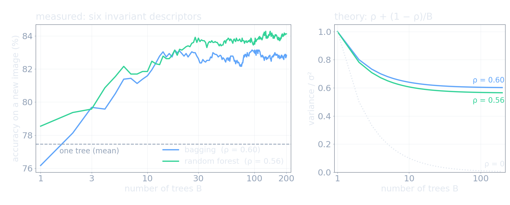{width="100%" fig-alt="Accuracy against the number of trees for bagging and random forest; both curves saturate, the forest higher"}
:::
::::

::: {.notes}
- Purpose: one idea, lower ρ, and its measured effect.
- The idea: in bagging, every tree may use every feature at every split. If one feature is very strong, all trees start with it, and the trees look alike. The random forest lets each split see only a random subset of the features. For 6 features, √6 gives 2 features per split.
- The numbers, left panel: the mean over the four held-out images, six invariant descriptors. One tree alone: 77.5 %. Bagging: 82.6 % with 30 trees, 82.8 % with 200; ρ = 0.60. Random forest: 83.9 % with 30 trees, 84.1 % with 200; ρ = 0.56.
- Right panel: the formula of the last slide for these two values of ρ. The dotted line is ρ = 0, independent trees: that variance would go to zero.
- Be honest about the size of the effect: one point. With only six features, of which three or four are informative, the room for decorrelation is small. With 50 or 500 descriptors the gain of the forest over bagging is larger.
- Both curves saturate after about 30 to 100 trees. More trees do not overfit. Use 300 to 500 and stop thinking about it.
- Out-of-bag score: each bootstrap sample leaves out about 37 % of the rows. Each row is predicted by the trees that did not see it. This is a free validation score. Warning for our data: the out-of-bag rows come from the same images as the training rows. The out-of-bag score is a random-split score. It has the same optimism as the random folds.
- Hyperparameters that matter: `max_features` and `min_samples_leaf`. The forest is robust: the defaults are usually within one or two points of the best setting.
- The one point to land: a random forest lowers the variance twice: by averaging, and by making the trees less alike.
:::

## Boosting: each small tree corrects the last error {data-station="4"}

::: {.deriv}
::: {.dstep .fragment}
[1]{.dnum} **Start** with a constant: $F_0(\mathbf x)=\bar y$. Loss $\mathcal L=\sum_i \ell\big(y_i,F(\mathbf x_i)\big)$.
:::
::: {.dstep .fragment}
[2]{.dnum} **Pseudo-residuals:** $r_i=-\,\partial \ell/\partial F(\mathbf x_i)$. For the squared error: $r_i=y_i-F(\mathbf x_i)$, the residual.
:::
::: {.dstep .fragment}
[3]{.dnum} **Fit a small tree** $h_m$ to the $r_i$ (depth 1 to 6).
:::
::: {.dstep .fragment}
[4]{.dnum} **Update:** $F_m=F_{m-1}+\eta\,h_m$. Repeat steps 2 to 4.
:::
:::

::: {.claim}
Gradient descent of Week 4, $\mathbf w\leftarrow\mathbf w-\eta\nabla\mathcal L$, but in *function space*: each tree is one gradient step.
:::

::: {.notes}
- Write the four lines. This is must-know statement 6 (Friedman 2001).
- Bagging trains the trees in parallel and independently. Boosting trains them in sequence: each tree sees the errors of all trees before it.
- Step 2: for the squared error, the negative gradient is the residual y − F. So "fit the next tree to the residuals" is a gradient step. For other losses the same recipe works with another gradient: log-loss for classification, Poisson deviance for counts, Huber for outliers. The noise model gives the loss, as in Week 4.
- Step 3: the trees are small on purpose, often with 2 to 32 leaves. A small tree has a high bias and a low variance. Boosting lowers the bias step by step.
- Step 4: η is the learning rate, the same η as in Week 4. η = 1 takes the full step. η = 0.1 takes a tenth, and needs about ten times more trees.
- The analogy in one sentence: gradient descent changes the weight vector against the gradient. Boosting changes the function against the gradient, and a tree is the approximation of that gradient that we can store.
- Difference from bagging that matters: a boosted ensemble can overfit when it has too many trees. So the number of trees is a hyperparameter here.
- Misconception: "boosting is a better random forest." It attacks the bias, the forest attacks the variance. Which one wins depends on the data.
:::

## Watch boosting fit the residuals {data-station="4"}

::: {.xp data-xp="boost"}
:::

::: {.notes}
- Purpose: see steps 2 to 4 of the last slide happen, on a real 1-D profile.
- The data: the peak height of each candidate of image B, divided by the median peak height of the substrate, against the distance from the interface. High in the substrate, a step down at the interface, low and noisy in the film and the amorphous layer. This is a regression task. The weak learner is a tree of depth 2.
- Demo, step 1: stage 0. The model is the mean. The lower chart shows the residuals y − F.
- Demo, step 2: stage 1, 2, 3 with η = 0.3. Each stage fits a small tree to the residuals and adds 30 % of it to the model. The first tree finds the step at the interface. The residuals shrink there. The next tree goes to another place.
- Demo, step 3: press play. The model becomes a staircase that follows the profile. The training error on the right falls at every stage. The yellow curve is the error on image D, which the model does not see. It has its minimum at stage 17.
- Demo, step 4: η = 1, 200 stages. The model has spikes: single trees that follow single bright points of image B. The training error is 0.003. The held-out error was lowest at stage 8 and is now 60 % higher. Then η = 0.03: slow, smooth, the minimum comes at stage 186.
- Ask: "Where would you stop?" At the minimum of the held-out curve. This is early stopping.
- A detail for a good question: in the first stages the held-out error is below the training error. Image D has less noise than image B. The level of the two curves is not comparable; the position of the minimum is.
- The held-out data are the candidates of another image. If the held-out points came from the same image, the minimum would come later.
- The one point to land: boosting is a sequence of small corrections. The learning rate and the number of stages together decide how far it goes.
:::

## Learning rate and early stopping {data-station="4"}

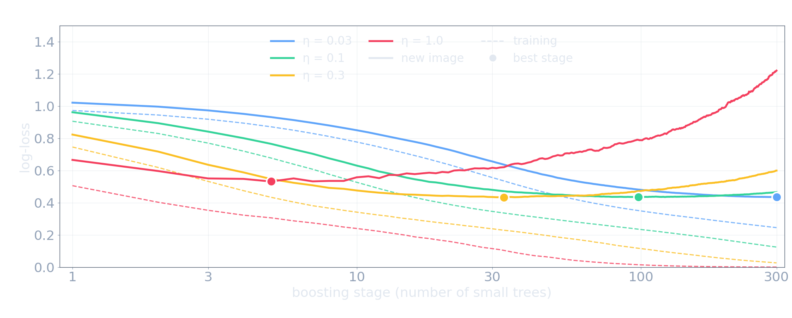{width="94%" fig-alt="Held-out and training log-loss against the boosting stage for four learning rates, with the best stage of each curve marked"}

::: {.claim}
η = 1: best at 5 trees, then worse than the start. η = 0.1: best at 98 trees. The training loss goes to zero in all cases.
:::

::: {.notes}
- Purpose: the two hyperparameters of boosting, measured on the real classification task. Each image is the held-out image in turn; the curves are the mean.
- Read the dashed curves first. The training loss falls at every stage for every η. With η = 1 it reaches 0.0003 after 300 trees. The training loss says nothing about when to stop.
- Solid curves, the loss on a new image. η = 1: the minimum is at 5 trees with a log-loss of 0.53; after 300 trees it is 1.22, worse than a model that predicts the class fractions. η = 0.3: minimum at 33 trees, 0.433; after 300 trees 0.60. η = 0.1: minimum at 98 trees, 0.435. η = 0.03: still falling at 300 trees, 0.435.
- Two results. First: a smaller η reaches the same or a better minimum, and it is flatter, so the exact stopping point matters less. Second: η and the number of trees are coupled. A tenth of the η needs about ten times the trees.
- The recipe: set η to a small value, for example 0.05 to 0.1. Choose the number of trees by early stopping on held-out data. Then tune the tree size.
- The held-out data for early stopping must be other images, not random rows. Random rows from the training images would stop too late.
- In scikit-learn: `HistGradientBoostingClassifier(learning_rate=0.1, early_stopping=True)`. With grouped data, make the validation split yourself. Libraries: XGBoost, LightGBM and CatBoost implement the same idea with more speed and more regularisation.
- The one point to land: boosting can overfit. A small learning rate plus early stopping on grouped data controls it.
:::

## Bagging or boosting? {data-station="4"}

| | Random forest (bagging) | Gradient boosting |
|---|---|---|
| Trees | deep, low bias, high variance | small, high bias, low variance |
| Training | parallel, independent | in sequence, each on the last error |
| Lowers | the variance | the bias |
| More trees | never hurt | overfit: use early stopping |
| Main hyperparameters | `max_features`, `min_samples_leaf` | $\eta$, number of trees, tree size |
| Tuning effort | small | larger; tune inside grouped CV |
| On our task, new image | 84 % | 82 % |

::: {.claim}
Tree ensembles are the default *first* model for a table: mixed units, thresholds, useless columns. The default is a hypothesis: Act 5 tests it.
:::

::: {.notes}
- Purpose: one comparison table for the exam and for practice.
- Read the first four rows as opposites. The forest averages strong, noisy trees. Boosting adds weak, stable trees.
- Our numbers: the forest gets 84.1 % on a new image, boosting 82.1 %, both with default settings and the six invariant descriptors. Two points on four images is not a significant difference. On large tables with careful tuning, boosting is often one or two points better; on small, noisy tables the forest is the safer choice.
- Why trees work well on tables (Grinsztajn and co-workers, 2022, 45 data sets). (1) They ignore uninformative features: a feature that never gives a good split is never used. (2) They fit non-smooth targets: thresholds and steps. (3) The axes of a table have a meaning, and trees split along the axes. A neural network must learn all three.
- The counter-position: when the descriptors are good physical quantities and the relation is smooth, a linear model can be as good, and it extrapolates. Foundation models for tables (TabPFN) are also competitive on small tables.
- So "trees first" is a starting point. The baseline ladder of the next act decides.
- If you are late: skip this slide; show the table for 20 seconds as a summary.
:::

## Checkpoint: ensembles {data-station="4"}

::: {.claim}
Two minutes, in pairs.
:::

1. One tree has variance $\sigma^2$; the trees correlate with $\rho=0.5$. The variance of 100 trees? Of infinitely many? [→ $0.5\sigma^2+0.005\sigma^2\approx\mathbf{0.505\,\sigma^2}$; floor $\mathbf{0.5\,\sigma^2}$]{.fragment}
2. Your forest has 100 trees. A colleague says: "Use 10 000, it will be much better." [→ **No.** The term $(1-\rho)\sigma^2/B$ is already small. Lower $\rho$ or improve the descriptors.]{.fragment}
3. Boosting: training loss 0.001, loss on new images rising. What do you change? [→ **Early stopping,** a **smaller η,** smaller trees.]{.fragment}
4. Why does a random forest use deep trees, and boosting small trees? [→ **Averaging lowers variance, not bias:** it needs low-bias trees. **Boosting lowers bias:** it starts from low-variance trees.]{.fragment}
5. The out-of-bag score of your forest is 93 %. Can you report it for a new image? [→ **No.** Out-of-bag rows come from the training images.]{.fragment}

::: {.notes}
- Procedure: two minutes, then reveal. Case 1 is an exam calculation.
- Case 1: ρσ² + (1 − ρ)σ²/B = 0.5σ² + 0.5σ²/100. The second term is 1 % of the first. So 100 trees are at the floor.
- Case 2 follows from case 1. Students who know the formula can answer it without an experiment.
- Case 3: the picture of the last figure. All three answers are regularisation.
- Case 4 is the core of the act. If students get this one, they understood the bias–variance logic of ensembles.
- Case 5 prepares Act 5: an internal score of the model is only as honest as its split.
- Timing: 3 minutes. If you are late, do cases 1 and 4.
:::

<!-- ===== Act 5. Validate ===== -->

## {.act}

::: {.act-kicker}
Act 5 · Validate
:::
::: {.act-question}
Does it work on a new image?
:::
::: {.xp data-xp="redline" data-focus="5"}
:::

## Two splits, two answers {data-station="5"}

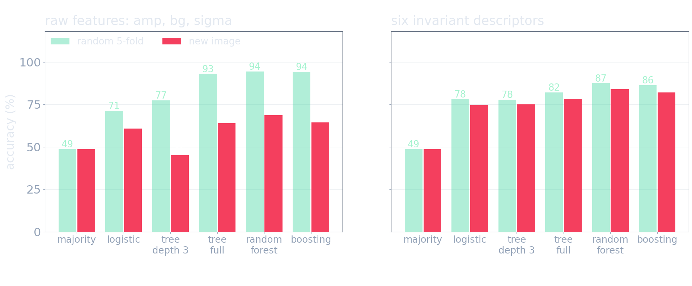{width="96%" fig-alt="Bar chart of accuracy for six models with raw features and with invariant descriptors, each with a random split and a new-image split"}

::: {.claim}
Raw features: 94 % on random folds, 69 % on a new image. Invariant descriptors: 87 % and 84 %. The gap measures the leak.
:::

::: {.notes}
- Purpose: the main result of the lecture. It is Week 4 again, with trees: the split must match the claim.
- The claim that we want to make: "this classifier labels the columns of the next image of this specimen." So the test must be an image that the model never saw. Leave-one-image-out: train on three images, test on the fourth, four times. In scikit-learn: `GroupKFold` or `LeaveOneGroupOut` with `groups = image`.
- Left panel, raw features. The random split says: full tree 93 %, random forest 94 %, boosting 94 %. The new-image split says: 64 %, 69 %, 64 %. A gap of 25 to 30 points. The depth-3 tree gets 45 % on a new image: that is below the 49 % of the majority-class rule.
- Why? In a random split, the neighbours of each validation column are in the training set, from the same image, with the same gain, the same thickness and the same background. The model learns "background 9.4 × 10⁵ counts means image C", and that helps for image C only.
- Right panel, invariant descriptors. The gap shrinks to 3 or 4 points for every model. The new-image accuracy rises from 69 % to 84 % for the forest. On the random split the invariant descriptors look worse: 87 % against 94 %. A random split would tell you to keep the raw features.
- Read the ladder from left to right in the right panel: majority 49 %, logistic 75 %, tree of depth 3 75 %, full tree 78 %, random forest 84 %, boosting 82 %. Each step must earn its place.
- The one point to land: the model decides a few points. The descriptors and the split decide 15 to 30 points.
:::

## See where the errors are {data-station="5"}

::: {.xp data-xp="validate-map"}
:::

::: {.notes}
- Purpose: put the two numbers of the last slide on the four images. The students see which columns fail.
- Start: raw features, random forest, random 5-fold. 94.4 %. A few red points at the interface and in the amorphous layer. Everything looks good.
- Demo, step 1: switch the split to "new image". The same model, the same features: 68.6 %. The red points fill the film of images A and B. Read the bars per image: image A is the worst.
- Ask: "Nothing changed in the model. What changed?" Only the question. Now each image is predicted by a model that never saw it.
- Demo, step 2: switch the descriptors to "invariant (6)". New image: 84.1 %. The red points go back to the interface and to the border of the amorphous layer. Switch the split back to "random": 87.5 %. The two numbers nearly agree.
- Demo, step 3: stay on "invariant" and "new image", and step through the models: logistic 74.5 %, tree of depth 3 75.1 %, full tree 78.1 %, random forest 84.1 %, boosting 82.1 %. Watch the film region: the linear model fails there, because the film class is not one linear region in the descriptor space.
- Demo, step 4: "ACSF (8)". Random forest 84.0 %, logistic 82.2 %. With the systematic descriptors, the linear model is within two points of the forest.
- Read the confusion table once: the rows are the truth. Most errors are between film and "no column".
- Balanced accuracy: the mean of the recalls of the three classes. It is lower than the accuracy, because the smallest class, "no column", is the most difficult.
- The one point to land: always look at where the errors are. A score is one number; the map shows the mechanism.
:::

## Which class fails? The confusion matrix {data-station="5"}

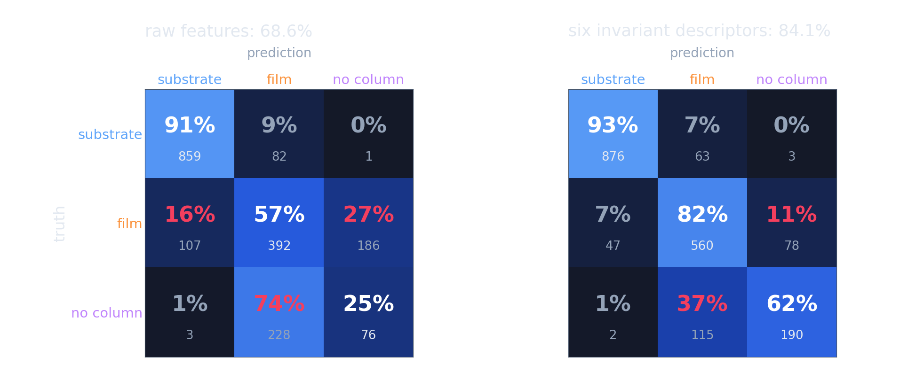{width="92%" fig-alt="Two confusion matrices for substrate, film and no column, with raw features and with invariant descriptors"}

::: {.notes}
- Purpose: one accuracy number hides which class fails.
- How to read: each row is one true class and sums to 100 %. The diagonal is the recall of the class.
- Left, raw features, 68.6 %. Substrate: 91 % found. Film: only 57 %. "No column": 25 %; three of four noise maxima are called film columns. For the task "remove the false detections", this classifier is useless, and the accuracy of 69 % did not say that.
- Right, invariant descriptors, 84.1 %. Substrate 93 %, film 82 %, "no column" 62 %. The remaining error is between film and "no column": 115 noise maxima are called film, 78 film columns are called noise.
- Is this remaining error a failure of the model? Partly it is the labels. Our labels come from three zones with straight borders. At the border of the film and the amorphous layer, a real column and a noise maximum look the same, also to a human.
- Class imbalance: 942 substrate, 685 film, 307 "no column". Accuracy is dominated by the substrate, the easy class. Report the recall per class or the balanced accuracy: 79 % for the invariant forest, 58 % for the raw one.
- Which error is worse depends on the use. For a strain map, a false column is worse than a missing one. Then move the decision threshold, and report precision and recall for the class that matters.
- The one point to land: report the confusion matrix on the grouped split, not only the accuracy.
:::

## The baseline ladder decides {data-station="5"}

:::: {.columns}
::: {.column width="54%"}
| New image, accuracy | all 11 | invariant 6 | ACSF 8 |
|---|---|---|---|
| majority class | 49 % | 49 % | 49 % |
| logistic regression | **80 %** | 75 % | 82 % |
| tree, depth 3 | 57 % | 75 % | 74 % |
| random forest | 74 % | **84 %** | **84 %** |
| boosting | 67 % | 82 % | 84 % |
:::
::: {.column width="46%"}
**The rules**

1. Start with the **majority class** and a **linear model**.
2. Use the **same grouped folds** for every model.
3. A complex model must **beat the baseline by more than the spread** between the folds.
4. If it does not: improve the **descriptors**, not the model.
:::
::::

::: {.claim}
With all 11 features, logistic regression beats the random forest by 6 points. Image A alone: forest 49 %, logistic 63 %.
:::

::: {.notes}
- Purpose: must-know statement 7. "Trees first" is a default; the ladder decides.
- Column 1, all 11 features: the raw features are in the table together with the invariant ones. Logistic regression: 80 %. Random forest: 74 %. Boosting: 67 %. The more flexible the model, the worse it is. Why?
- A flexible model uses every feature that lowers the training loss. The raw intensities lower it very well, so the trees split on them. On a new image these splits are wrong. The linear model has one weight for each feature and cannot build "if amp is in this narrow range" rules, so it suffers less.
- Image A makes it visible. It has the lowest counts. All its `amp` values are below the range of the other images. The forest cannot extrapolate: 49 % on image A. The logistic model: 63 %.
- Column 2, six invariant descriptors: now the forest wins, 84 % against 75 %. The classes are not linearly separable in these six numbers; the tree thresholds help.
- Column 3, the symmetry functions: the linear model reaches 82 %, the forest 84 %. Better descriptors make the simple model nearly as good as the complex one. This is the general pattern.
- Rule 3: the spread between the four folds is large here. The forest with invariant descriptors has 75 %, 87 %, 90 % and 86 % on images A to D. A difference of two points between two models is inside this spread. With four groups you cannot claim it.
- Next week the ladder gets one more step: a neural network. It must beat these numbers on the same folds.
- The one point to land: every model is a rung of one ladder, measured on the same grouped folds. The baseline is the reference for every claim.
:::

## Checkpoint: validation {data-station="5"}

::: {.claim}
Two minutes, in pairs. What is the group?
:::

1. 5 000 nanoparticles from 12 TEM images of 3 specimens. Claim: "works for a new specimen". [→ Group by **specimen:** 3 groups, leave one out.]{.fragment}
2. Your features include the mean background of the image. Random-split accuracy: 97 %. [→ The background **identifies the image.** Group by image, and remove or normalise the feature.]{.fragment}
3. Random forest 84 %, logistic regression 82 %, four folds between 75 % and 90 %. Which do you report? [→ **Both.** The difference is inside the fold spread; prefer the simpler model.]{.fragment}
4. Accuracy 90 % with classes of 900, 80 and 20 objects. Good? [→ **Unknown.** "Always the majority" gives 90 %. Report recall per class.]{.fragment}
5. You tune `max_depth` on the same folds that give your final score. [→ **Optimistic.** Tune inside the training folds (nested CV), or keep one image out of everything.]{.fragment}

::: {.notes}
- Procedure: two minutes, then reveal.
- Case 1: the group is the unit of the claim. 12 images would be the group for "a new image of a known specimen". With 3 specimens the estimate has a large uncertainty; say so in the report.
- Case 2: this is the leak of today. A feature that is constant inside one image and different between images is an image label.
- Case 3: there is no shame in reporting that the simple model is as good. It is a result.
- Case 4: the majority baseline is the first rung for this reason.
- Case 5: Week 4, nested cross-validation. Hyperparameter tuning is a learned step; it goes inside the fold.
- Timing: 3 minutes. If you are late, do cases 1, 2 and 4.
:::

<!-- ===== Act 6. Explain ===== -->

## {.act}

::: {.act-kicker}
Act 6 · Explain
:::
::: {.act-question}
Which descriptors does the model use?
:::
::: {.xp data-xp="redline" data-focus="6"}
:::

## Two importances: impurity and permutation {data-station="6"}

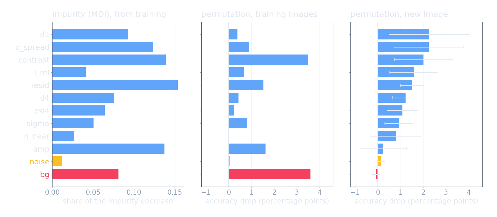{width="100%" fig-alt="Three bar charts of feature importance for twelve features; the background feature is important on training data and not on a new image"}

::: {.notes}
- Purpose: two definitions of "important", and why the data that you compute them on matters.
- Impurity importance (MDI, mean decrease in impurity): add the impurity decrease Δ of every split that uses the feature, over all trees. It is free: `rf.feature_importances_`. It is computed from the training data only.
- Permutation importance: take the trained model. Shuffle one column of the test table, so that it has no relation to the labels. Measure how far the score falls. Repeat for each feature. `sklearn.inspection.permutation_importance`.
- Left panel, MDI. The yellow bar is a column of random numbers. It gets 1.2 % of the impurity decrease. Deep trees split on anything in small nodes, also on noise. The bias is stronger for continuous features with many different values.
- The red bar is `bg`, the background under the peak. MDI: 8 %, a middle rank. Middle panel, permutation on the training images: `bg` is the most important feature, 3.6 points. Right panel, permutation on a new image: −0.1 points. Zero.
- So the model uses `bg` strongly, and `bg` does not help on a new image. Both statements are true. Importance on the training images tells you what the model uses. Importance on held-out groups tells you what generalises.
- The same for `amp`: third in the impurity ranking, nearly zero on a new image. On the right, the top places go to `d1`, `d_spread`, `contrast` and `I_rel`.
- Look at the lines on the right panel: the spread between the four images is as large as many bars. Do not rank features that differ by less than this spread.
- Misconception: "feature importance tells me what matters physically." It tells you what this model uses on this data.
- The one point to land: compute permutation importance on held-out groups, and include a noise column as the zero of the scale.
:::

## Correlated descriptors hide each other {data-station="6"}

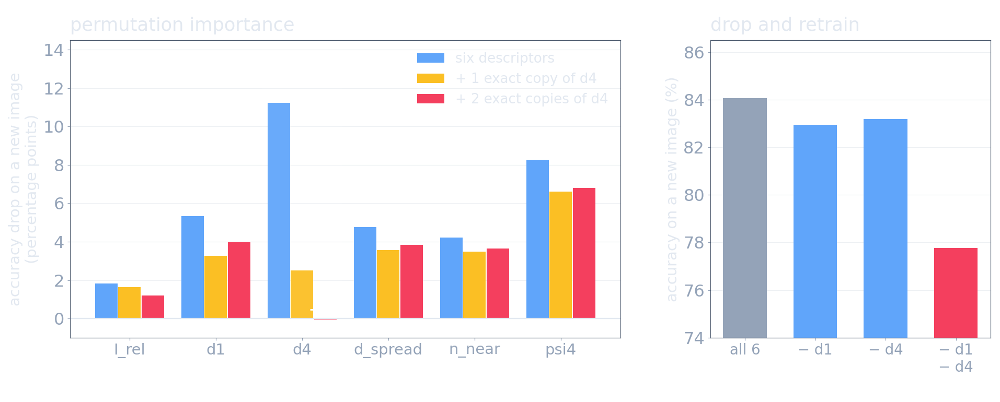{width="96%" fig-alt="Grouped bars of permutation importance with and without copies of one feature, and a bar chart of accuracy after dropping features"}

::: {.claim}
`d4` falls from 11 points to 2.5 to 0 when copies exist. Remove `d1` *or* `d4`: −1 point. Remove both: −6 points.
:::

::: {.notes}
- Purpose: the main trap of permutation importance. This is must-know statement 9.
- The experiment: `d4` is the most important descriptor, 11 points. Add an exact copy of the `d4` column to the table and train again. The importance of `d4` falls to 2.5 points. With two copies it is zero. The information is the same in all three tables.
- Why? The forest spreads its splits over the copies. When you shuffle one copy, the other copies still carry the information, and the score does not fall.
- Real data have no exact copies, but they have correlations. `d1` and `d4` correlate with r = 0.78. Right panel: remove `d1` and train again: 84.1 → 82.9 %. Remove `d4`: 83.2 %. Each one looks nearly useless. Remove both: 77.8 %. Together they carry 6 points.
- A second problem of the shuffle: it makes rows that cannot exist. A column with a nearest-neighbour distance of 0.38 nm and a mean distance of 0.28 nm is not possible; the mean of four distances cannot be below the smallest one. The model has never seen such rows, and its answer there has no meaning. The name is "off-manifold" data.
- The cure: put correlated descriptors into one group, and permute or remove the group together. Find the groups with a correlation matrix or with hierarchical clustering of the features.
- "Drop and retrain" is the honest and expensive version: one new model for each feature group.
- Misconception: "low importance means that I can delete the feature." It can mean that another feature holds the same information.
- The one point to land: importance belongs to groups of correlated features, not to single features.
:::

## SHAP: divide one prediction among the descriptors {data-station="6"}

::: {.deriv}
::: {.dstep .fragment}
[1]{.dnum} **One prediction,** one sum: $f(\mathbf x)=\phi_0+\sum_j\phi_j$
:::
::: {.dstep .fragment}
[2]{.dnum} $\phi_0$ = the mean prediction over the background data.
:::
::: {.dstep .fragment}
[3]{.dnum} $\phi_j$ = the mean change of the prediction when feature $j$ joins, averaged over **all orders** of the features (Shapley value).
:::
::: {.dstep .fragment}
[4]{.dnum} **TreeSHAP:** exact for trees in polynomial time. No sampling.
:::
:::

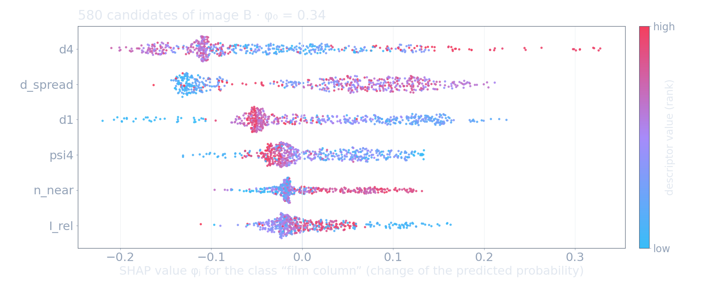{width="60%" fig-alt="SHAP summary plot for the class film column with six descriptors; points coloured by descriptor value"}

::: {.notes}
- Purpose: from "which features matter in general" to "why this prediction". Must-know statement 10.
- Step 1: SHAP writes one prediction as a base value plus one signed number for each feature. The sum is exact. The name of this property is completeness, or local accuracy.
- Step 3, the idea from game theory: the features are players, the prediction is the payout. The contribution of a feature depends on which features are already known. So take the mean over all orders. Lundberg and Lee, 2017.
- Step 4: for a general model this needs a sum over 2^F subsets. For trees, an exact algorithm exists that follows the paths of the trees: TreeSHAP, Lundberg and co-workers, 2020. For our forest and 580 columns it takes seconds.
- The figure, the summary plot: one row per descriptor, one point per column of image B. Horizontal position: φ for the class "film column". Right of zero: this descriptor pushes the probability of "film" up for this column. Colour: the value of the descriptor, red is high.
- Read `d_spread`: blue points, a regular neighbourhood, are on the left: −0.13, against "film". This is the substrate. Red points are on the right. Read `d1`: red points, a large nearest distance, are left of zero: the substrate has 0.37 nm. Blue points split into two groups: a moderately small distance supports "film"; a very small distance is on the far left, against "film": these are noise maxima.
- So a SHAP plot also shows non-monotonic relations. `d4` is the clearest: high values appear on both sides.
- Global importance from SHAP: the mean of |φ| for each descriptor. It is a third importance measure, and it has the same problem with correlated features: the credit is divided among them.
- The one point to land: SHAP is an exact accounting of one prediction of the model.
:::

## Click a column: why this prediction? {data-station="6"}

::: {.xp data-xp="shap-click"}
:::

::: {.notes}
- Purpose: read single explanations on the image, and check the sum rule with numbers.
- The image: image B, which the forest did not see in training. The colour of each point is the predicted class. A white ring marks a wrong prediction.
- Demo, step 1: the selected film column near the interface. Read the waterfall from the top. φ₀ = 0.345: the mean predicted probability of "film". `d_spread` = 0.144 adds 0.115. `d1` = 0.289 nm adds 0.107. `d4` = 0.342 nm takes away 0.097. The bars end at 0.655, the prediction. Check line: 0.345 + 0.311 = 0.655.
- Demo, step 2: click a column deep in the substrate. Switch the class to "substrate". All bars point up: a regular square neighbourhood with the right distances.
- Demo, step 3: click a column with a white ring, a wrong prediction, at the border of the amorphous layer. Look for the descriptor that pushed it to the wrong class. Often `psi4` and `d_spread` say "disordered", and the label says "film". The explanation shows that the model and the label disagree about what a film column is.
- Demo, step 4: click one substrate column at the edge of the image. Its neighbours are cut off by the image border, so its descriptors are wrong. The explanation finds a data problem, not a physics result. This is the most common use of SHAP in practice: debugging.
- Ask: "Does a large φ for `d1` mean that the distance causes the class?" No. Next slide.
- The one point to land: an explanation is a tool to find errors in the data, the labels and the descriptors.
:::

## Explanation is not causation {data-station="6"}

:::: {.columns}
::: {.column width="50%"}
**What SHAP and importance tell you**

- which inputs **this model** uses
- how one prediction divides among the inputs
- where the model uses a nuisance (`bg`, `amp`): a leak detector
- where the labels and the model disagree
:::
::: {.column width="50%"}
**What they do not tell you**

- what causes the property in the specimen
- what happens if you **change** a descriptor in the experiment
- anything stable under correlated features: the credit is divided
- anything independent of the **background data** that defines $\phi_0$
:::
::::

::: {.claim}
A model can be right for the wrong reason. Only an experiment or a physical model tests a cause.
:::

::: {.notes}
- Purpose: set the limit of everything in this act. The second half of must-know statement 10.
- Left column: these are statements about the model. They are useful. The forest with raw features had a high score on random folds, and its explanation said "background". That finding alone would have told us about the leak, without a second split.
- Right column, point 1 and 2: a descriptor can be a proxy. In our data the thickness of the specimen changes the peak height and also the visibility of the film columns. A model that uses the peak height is not a model of the film.
- Point 3: with correlated descriptors, another forest with another random seed can divide the credit differently between `d1` and `d4`. Report the group.
- Point 4: φ₀ is the mean prediction over a background data set. Change the background, for example from "all images" to "substrate columns only", and every φ changes. Always state the background. For our figure: the training images of the forest, with the path-dependent TreeSHAP.
- Good practice, as a list for the report: (1) the model beats the baseline on grouped folds; (2) permutation importance on held-out groups, with a noise column; (3) correlated features in groups; (4) SHAP for single cases, with the background stated; (5) a check against physics: does the sign make sense?
- The one point to land: explain the model to find its errors. Do not sell the explanation as physics.
- If you are late: skip this slide and say its claim in one sentence.
:::

## Checkpoint: explanations {data-station="6"}

::: {.claim}
Two minutes, in pairs. True or false, and why?
:::

1. "The noise column has an impurity importance of 1 %, so it carries a little information." [→ **False.** MDI is biased; on held-out data it is zero.]{.fragment}
2. "`bg` has the highest permutation importance on the training images, so I must keep it." [→ **False.** On a new image it is zero: it identifies the image.]{.fragment}
3. "`d1` has a low permutation importance, so I can delete it." [→ **Not safe.** `d4` holds the same information. Test the group.]{.fragment}
4. φ₀ = 0.35, the φ sum to +0.31. The predicted probability? [→ **0.66.** Completeness: $f=\phi_0+\sum\phi_j$.]{.fragment}
5. "SHAP shows that a small `d1` causes a film column." [→ **False.** It shows what the model uses. Cause needs an experiment.]{.fragment}

::: {.notes}
- Procedure: two minutes, then reveal.
- Case 1: the noise column is the zero of the scale. Every feature near its value is not distinguishable from noise.
- Case 2: the difference between "used by the model" and "useful for the claim".
- Case 3: remember the right panel of the correlation figure: one removed, 1 point; both removed, 6 points.
- Case 4 is an exam calculation.
- Case 5: the sentence to remember from this act.
- Timing: 3 minutes. If you are late, do cases 2, 3 and 4.
:::

<!-- ===== Wrap-up ===== -->

## The red line, complete

::: {.xp data-xp="redline" data-mode="summary"}
:::

::: {.notes}
- Purpose: one picture of the 90 minutes. Each station has its two results.
- Walk along the line. Objects: smooth, find maxima, fit; the dose sets the precision. Descriptors: one row per object, with the invariances built in. Tree: greedy splits on impurity; a deep tree has a high variance. Ensemble: bagging lowers the variance, boosting lowers the bias. Validate: split by image, start with a baseline. Explain: permutation importance on held-out data; SHAP explains the model.
- The arrow back: the score on a new image sent us back to the descriptors, not to a bigger model. From 69 % to 84 % with the same forest.
- The three numbers of the first slide, now with their meaning. 1 934 × 11: the image became a table. 94 % → 69 %: the random split measured the leak. 84 %: invariant descriptors, on an image that the model never saw.
- Connection to Week 4: the same rules, on a new kind of model. Noise model → loss. Complexity → variance. Split → claim.
:::

## Must-know for the exam

::: {.mustknow}
::: {.mk}
[1]{.mk-n} [Classical ML needs a feature table: rows = objects, columns = descriptors. Detection errors propagate into it.]{.mk-t}
:::
::: {.mk}
[2]{.mk-n} [Column finding: smooth → local maxima → 2-D Gaussian fit. Precision ∝ 1/√dose; Poisson likelihood at low dose.]{.mk-t}
:::
::: {.mk}
[3]{.mk-n} [Good descriptors are invariant (translation, rotation, permutation, gain): ratios like $I_\text{rel}$, distances, ACSF/SOAP.]{.mk-t}
:::
::: {.mk}
[4]{.mk-n} [Tree: greedy split with the largest $\Delta = I(\text{parent})-\frac{N_L}{N}I(L)-\frac{N_R}{N}I(R)$. No scaling, no extrapolation, high variance.]{.mk-t}
:::
::: {.mk}
[5]{.mk-n} [Average of $B$ trees: variance $\rho\sigma^2+\frac{1-\rho}{B}\sigma^2$. A random forest lowers $\rho$ with random feature subsets.]{.mk-t}
:::
::: {.mk}
[6]{.mk-n} [Boosting = gradient descent in function space: fit a small tree to $-\partial\mathcal L/\partial F$, add $\eta h$. Early stopping.]{.mk-t}
:::
::: {.mk}
[7]{.mk-n} [Baseline ladder on identical grouped folds: majority → linear → forest/boosting. Good descriptors help the linear model.]{.mk-t}
:::
::: {.mk}
[8]{.mk-n} [Cross-validate by image, session or specimen. Features that identify the image inflate random-split scores.]{.mk-t}
:::
::: {.mk}
[9]{.mk-n} [MDI is biased (noise gets credit). Permutation on held-out groups; permute correlated features together.]{.mk-t}
:::
::: {.mk}
[10]{.mk-n} [SHAP: $f(\mathbf x)=\phi_0+\sum_j\phi_j$, exact for trees. It explains the model, not the cause; it depends on the background.]{.mk-t}
:::
:::

::: {.notes}
- These ten statements are the exam scope of this week. The long version is in the must-know list of the course.
- Each statement has its slide: 1 and 2 in Act 1, 3 in Act 2, 4 in Act 3, 5 and 6 in Act 4, 7 and 8 in Act 5, 9 and 10 in Act 6.
- Typical exam tasks: compute an impurity decrease (checkpoint of Act 3); compute the variance of an ensemble (checkpoint of Act 4); name the group for a validation claim (checkpoint of Act 5); use the SHAP sum rule (checkpoint of Act 6).
:::

## Self-study this week

::: {.columns}
::: {.column width="60%"}
**Notebook (molab):** `notebooks/unit05_features_trees.py`: "From an image to a classifier you can explain, on real HAADF-STEM data"

1. Parts 1–2: find the columns of a real image (smooth, maxima, threshold); compute `I_rel`, `d1` and `psi4` yourself and test their invariance.
2. Parts 3–4: Gini and the best split by hand; grow a tree in NumPy; bagging and the $\rho\sigma^2$ floor; boosting with stumps and early stopping (⭐).
3. Parts 5–6: random versus image-grouped validation and the baseline ladder; permutation importance with a noise column and a copied column.

[Ten exercises with automatic checks; CPU only, NumPy and Matplotlib. Sign in to molab → **Fork** → your own copy.]{.muted}
:::
::: {.column width="40%"}
[{width="420" fig-alt="Open in molab"}](https://molab.marimo.io/github/ECLIPSE-Lab/public_presentations/blob/main/data_science_for_em/notebooks/unit05_features_trees.py)

**Reading:** Breiman, *Random forests* [@breiman2001randomforests]; Grinsztajn et al. on trees and tabular data [@grinsztajn2022treesdl]; Lundberg et al. on TreeSHAP [@lundberg2020treeshap].
:::
:::

::: {.notes}
- The notebook uses the same four images and the same feature table as the lecture. It loads the data from the course repository; no download by hand is necessary.
- Everything is NumPy: the students write the split search, the tree, the bagging loop and the boosting loop themselves. Each is 10 to 20 lines.
- Each exercise has an automatic check and a solution cell. The exercise with the star is optional.
- Time: about 2 to 3 hours.
:::

## Next week: neural networks & backpropagation

::: {.claim}
Today we designed the descriptors by hand. Next week the model learns its own features, and it must beat today's ladder on the same grouped folds.
:::

- Today: image → **hand-made descriptors** → tree ensemble. 84 % on a new image.
- Next week: a network of simple units learns the descriptors **and** the classifier from the data.
- The tools stay: a loss from the noise model, gradient descent (Week 4), validation by image (today).
- New: the chain rule on a computational graph, **backpropagation**.

::: {.notes}
- Bridge: the weak point of today was the descriptor design. We needed physics knowledge to find `I_rel` and `psi4`, and we still made errors at the image border and at the interface.
- A neural network replaces the hand-made descriptors by learned ones. The price: more data, more compute, and a model that is harder to explain.
- The baseline ladder gets a new rung. The network must beat 84 % on the same leave-one-image-out folds. We will see if it does.
- Preparation: repeat the chain rule and the gradient descent slides of Week 4.
:::

<!-- BEGIN prev-next -->

## Continue

- &larr; Previous: [Unit 04 &mdash; Regression, optimisation & honest validation](../04_regression_validation/01_intro.html)
- &rarr; Next: [Unit 06 &mdash; Neural networks & backpropagation](../06_neural_networks/01_intro.html)
- [All courses](../../index.html)

<!-- END prev-next -->

## Backup slides {visibility="uncounted"}

Material outside the 90-minute path, for questions and self-study.

## Gradient boosting in practice {visibility="uncounted"}

| Library | Idea | When to use |
|---|---|---|
| `HistGradientBoosting*` (scikit-learn) | histogram bins, native missing values | default; no extra dependency |
| XGBoost [@chen2016xgboost] | second-order steps, L1/L2 on leaf values | large tables, GPU |
| LightGBM | leaf-wise growth, very fast | very large tables |
| CatBoost [@prokhorenkova2018catboost] | ordered boosting, categorical features | many categorical columns |

**Tuning recipe:** (1) η = 0.05 to 0.1; (2) the number of trees by early stopping on *grouped* validation data; (3) tree size (`max_leaf_nodes` 8 to 64); (4) `min_samples_leaf`, L2; (5) subsampling of rows and columns.

::: {.notes}
- All four libraries implement the algorithm of Act 4. The differences are speed and regularisation.
- The histogram trick: sort each feature once into at most 255 bins. The split search then costs the number of bins, not the number of rows.
- The most common error in practice: early stopping on a random validation split of grouped data. The model stops too late.
:::

## Trees are not rotation invariant {visibility="uncounted"}

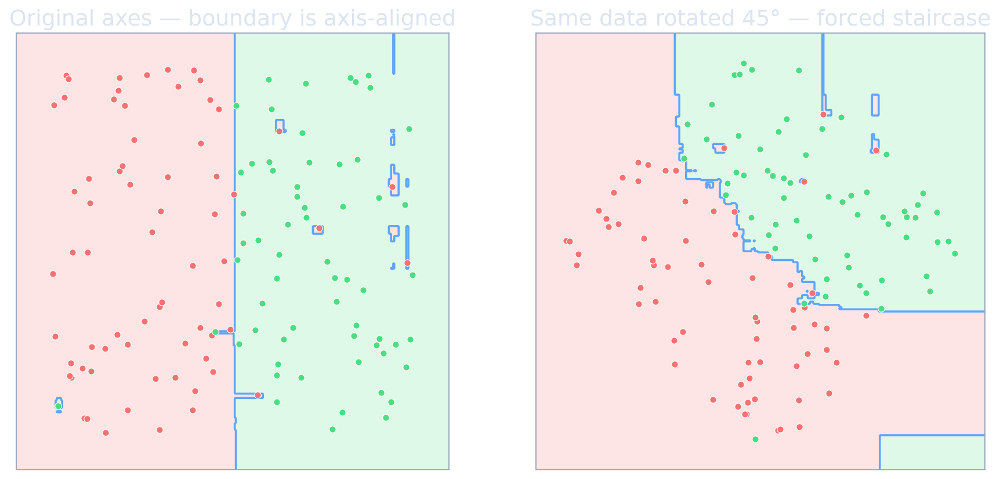{width="80%" fig-alt="Decision boundaries of a tree and of a linear model for an axis-aligned and for a rotated class boundary"}

::: {.notes}
- A tree splits on one feature at a time. A class boundary along a diagonal, for example "d1 − d4 > 0", needs a staircase of many splits.
- For tables this is often an advantage: the columns have a meaning, and physical thresholds apply to single quantities. Grinsztajn and co-workers name this as one reason why trees beat neural networks on tables.
- If you know that a combination matters, for example a ratio or a difference, add it as a descriptor. One good descriptor replaces many splits.
:::

## Out-of-bag error and regression trees {visibility="uncounted"}

:::: {.columns}
::: {.column width="50%"}
**Out-of-bag (OOB)**

- a bootstrap sample omits a row with probability $(1-1/N)^N\to e^{-1}\approx 37\,\%$
- predict each row with the trees that did not see it
- a validation score without a second data set
- **grouped data:** OOB rows share the image with training rows → optimistic, like a random split
:::
::: {.column width="50%"}
**Regression trees**

- impurity = variance of $y$ in the node
- a leaf predicts the mean of its rows
- the split minimises the sum of squared errors
- other losses: absolute error (median leaf), Poisson deviance (counts)
- the prediction is piecewise constant: no extrapolation
:::
::::

::: {.notes}
- OOB is useful for a fast check during the development. For the final claim, use the grouped split.
- Regression trees are the weak learners of gradient boosting, also for classification: the trees fit the pseudo-residuals, which are real numbers.
:::

## When the column finder fails {visibility="uncounted"}

| Failure | Sign | Cure |
|---|---|---|
| threshold too low | maxima in the vacuum and in amorphous regions | raise the threshold; classify the candidates (today) |
| σ too large | close columns merge (dumbbells) | smaller σ; fit two Gaussians |
| σ too small | several maxima for one column at low dose | larger σ; a minimum distance |
| image border | cut neighbourhoods, wrong descriptors | discard a margin of one neighbour distance |
| scan distortion, drift | distances change along the slow scan axis | average fast frames; correct the drift first |
| thickness gradient | intensities change across the image | local normalisation (`I_rel`) |

::: {.notes}
- Every row is an error that goes into the feature table, and from there into the model. This is must-know statement 1: detection errors propagate.
- Tools that implement the complete pipeline: Atomap [@nord2017atomap] for atom columns; scikit-image [@vanderwalt2014scikitimage] for segmentation and region properties of particles.
:::

## Checklist: explaining a tabular EM model {visibility="uncounted"}

1. State the claim and the group (image, session, specimen).
2. Report the baseline ladder on identical grouped folds.
3. Add a noise column. Compute permutation importance on held-out groups.
4. Cluster correlated descriptors. Permute or drop the groups.
5. Use SHAP for single cases. State the background data and the model output (probability or log-odds).
6. Check the sign of each main effect against physics.
7. Look at the wrong predictions on the image.
8. Do not claim a cause.

::: {.notes}
- This list is a template for a methods section and for a thesis chapter.
- Points 1 and 2 come from Week 4 and Act 5. Points 3 to 8 are Act 6.
:::

## References

::: {#refs}
:::
