## Outline

::: {.outline-container}

::: {.outline-box .fragment}
### Formalities
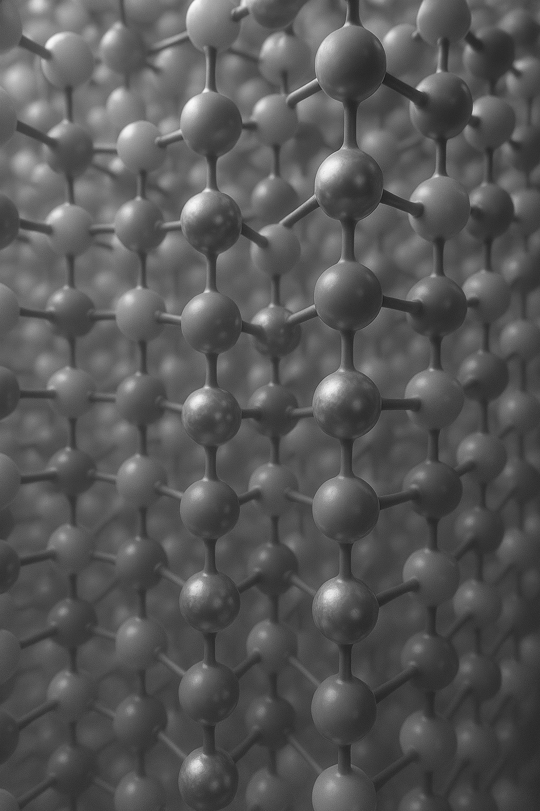
:::

::: {.outline-box .fragment}
### Introduction <br>to<br> Electron<br> Microscopy<br> Data

:::

::: {.outline-box .fragment}
### Basic Pytorch<br> Knowledge

:::

::: {.outline-box .fragment}
### .
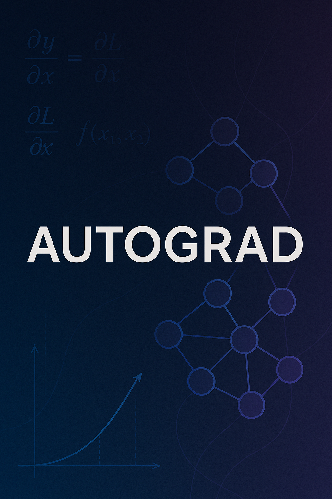
:::


:::


## Formalities

- [Course Website](https://pelzlab.science/DataScienceForElectronMicroscopy/)
- 13 weekly lectures (WS 26/27)
- use of AI tools is allowed:
  - e.g. [Github Copilot](https://github.com/features/copilot) [(free for students)](https://docs.github.com/en/education/about-github-education/github-education-for-students/apply-to-github-education-as-a-student)
  - e.g. [Cursor](https://www.cursor.com/) (paid)
  - e.g. [molab](https://molab.marimo.io) (free hosted GPU notebooks via marimo)
- 1 graded exam

## Book that covers many topics of the course
:::: {.columns}

::: {.column width="40%"}
::: {layout="[[1]]"}
](./images/d2l.jpg){fig-align="center" width="80%"}
:::
:::

::: {.column width="60%"}
- Interactive deep learning book with code, math, and discussions
- Implemented with PyTorch, NumPy/MXNet, JAX, and TensorFlow
- Adopted at 500 universities from 70 countries

- We will use the pytorch framework for our coding

:::

::::


## STEM capabilities

- Imaging (Z–contrast, light-element, phase-contrast)  
- 4D-STEM diffraction & orientation mapping  
- Spectroscopies (EELS/XEDS, plasmonics)  
- Tomography down to every atom  
- Simulation & data-science backbone  

---

## STEM operating modes  

::: columns
::: {.column width="70%"}
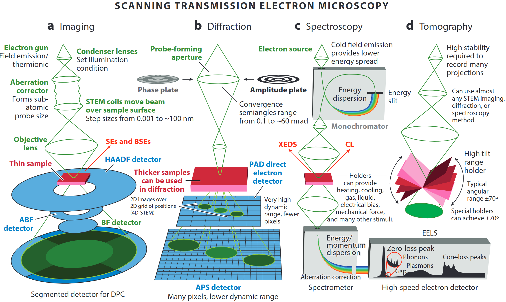
:::
::: {.column width="30%"}
- A modern microscope can switch **on the fly** between  
  - incoherent imaging,  
  - diffraction/4D-STEM,  
  - EELS / XEDS spectroscopy, and  
  - tilt-series tomography   
- “A synchrotron in a microscope”: one tool covers Å-to-µm length-scales and meV-to-keV energy-scales.  
:::
:::

::: aside
@ophus2023quantitative
:::
---

## 4DSTEM - Diffraction from a crystalline sample

::: columns
::: {.column width="70%"}
```{=html}
<iframe
  src="./widgets/stem4d-sim.html"
  title="Interactive 4DSTEM diffraction simulation (C. Ophus Lab)"
  style="width:100%; height:780px; border:0; border-radius:8px; background:#111;"
  loading="lazy"
  allow="fullscreen"
></iframe>
```
:::
::: {.column width="30%"}
- Drag the probe across the polycrystalline sample — each position yields a CBED pattern.
- Ideally, the diffracted signal is a 2D Fourier transform of the projected potential × probe intensity.
- Bragg-disk positions/intensities fingerprint local structure and orientation.
- Sliders: convergence semiangle (nanobeam ↔ ptychographic) and defocus.
- Interpretation is complicated by dynamical scattering, overlapping grains, background.
:::
:::

::: aside
Interactive app from [C. Ophus Lab, Stanford](https://colab.stanford.edu/interactive)
:::

## 4DSTEM - Diffraction from an amorphous sample

::: columns
::: {.column width="70%"}
```{=html}
<iframe
  src="./widgets/amorphous-si.html"
  title="Interactive disordered silicon simulation (C. Ophus Lab)"
  style="width:100%; height:780px; border:0; border-radius:8px; background:#111;"
  loading="lazy"
  allow="fullscreen"
></iframe>
```
:::
::: {.column width="30%"}
- Disorder slider rotates random Si sub-volumes — destroys medium-/long-range order while keeping short-range tetrahedral bonding.
- Diffraction evolves from sharp Bragg spots → amorphous rings / structure-factor halos.
- Rotate the 3D structure; watch nearest-neighbour angular correlation update live.
- Interpretation is harder than crystal diffraction (dynamical scattering, overlapping grains).
:::
:::

::: aside
Interactive app from [C. Ophus Lab, Stanford](https://colab.stanford.edu/interactive)
:::

## 4DSTEM - Design of experiments

::: {layout="[[1]]"}
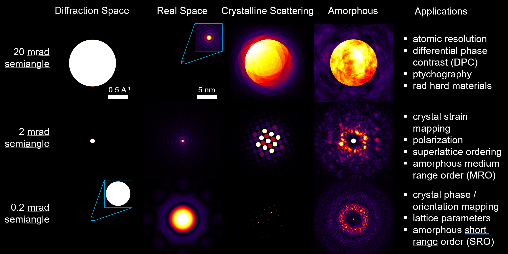{fig-align="center" width="100%"}
:::

## Single-atom Z-contrast  

::: columns
::: {.column width="60%"}

:::
::: {.column width="40%"}
- **HAADF** collects high-angle incoherent scattering → intensity ∝ Z^1.6 – Z^1.9 
- Detects & counts **individual heavy atoms**, even inside a nanowire.  
- Sub-picometre column-position metrology enables strain & segregation studies.  
:::
:::

::: aside
@ophus2023quantitative
:::
---

## Calibrated composition imaging 

::: columns
::: {.column width="60%"}
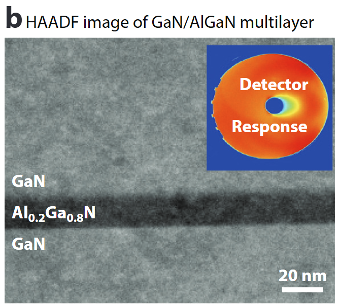
:::
::: {.column width="40%"}
- Absolute detector-response calibration converts HAADF signal to **atomic areal density** .  
- Enables **nm-scale composition profiles** (here Al₀.₂Ga₀.₈N) & local thickness determination to ≈1 nm.  
:::
:::

::: aside
@ophus2023quantitative
:::
---

## Seeing light elements – ABF/BF 

::: columns
::: {.column width="60%"}
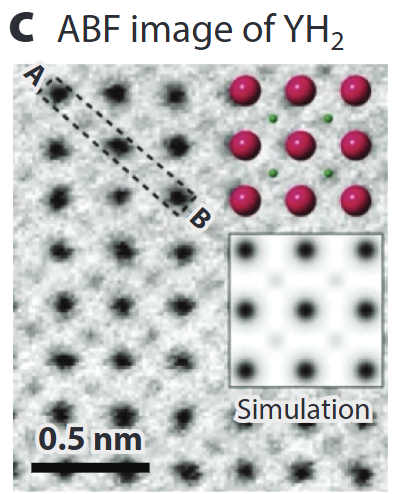
:::
::: {.column width="40%"}
- **Annular Bright-Field (ABF)** records low-angle transmitted beam: simultaneously heavy & **very light atoms (H, Li, O)**  .  
- Quantitative contrast modelling (multislice + frozen phonon) allows **thickness & defocus refinement**.  
:::
:::

::: aside
@ophus2023quantitative
:::
---

## Mapping internal fields – DPC  

::: columns
::: {.column width="60%"}
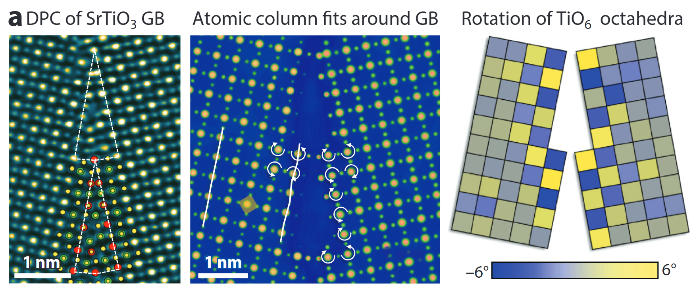
:::
::: {.column width="40%"}
- Segmented / pixelated detectors yield **differential phase-contrast (DPC)** images.  
- Linear to projected **electric-field**; with sample flip or advanced analysis → **magnetic induction** too .  
- Here: TiO₆ octahedra rotations and GB polarity resolved at the picometre level.  
:::
:::

::: aside
@ophus2023quantitative
:::
---

## 4D-STEM diffraction & orientation mapping  

::: columns
::: {.column width="60%"}
{fig-align="center" width="40%"}
:::
::: {.column width="40%"}
- Pixelated cameras record a **CBED pattern at every probe position** → 4D data cube.  
- From disks, extract local strain, orientation, thickness, even (via ptychography) phases beyond the probe NA.  
- Matching experiment to simulation (thermal + inelastic) achieves **quantitative thickness/chemistry**  
:::
:::

::: aside
@ophus2023quantitative
:::
---

## Spectroscopy – EELS/XEDS  

::: columns
::: {.column width="60%"}
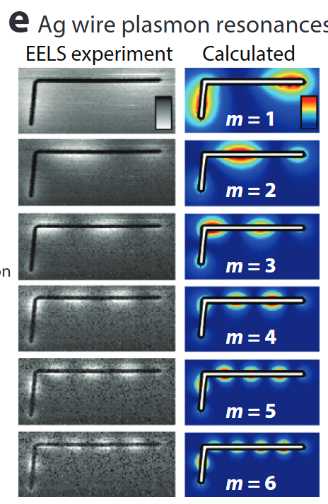
:::
::: {.column width="40%"}
- **STEM-EELS** resolves plasmons (few eV), phonons (meV) & core-loss fine structure (bonding, oxidation).  
- Combined with modelling (BEM, DFT, multiplet) for **nanophotonic mode mapping** .  
- Parallel XEDS gives simultaneous **3-D elemental maps**.  
:::
:::

::: aside
@ophus2023quantitative
:::
---

## Atomic electron tomography  

::: columns
::: {.column width="60%"}
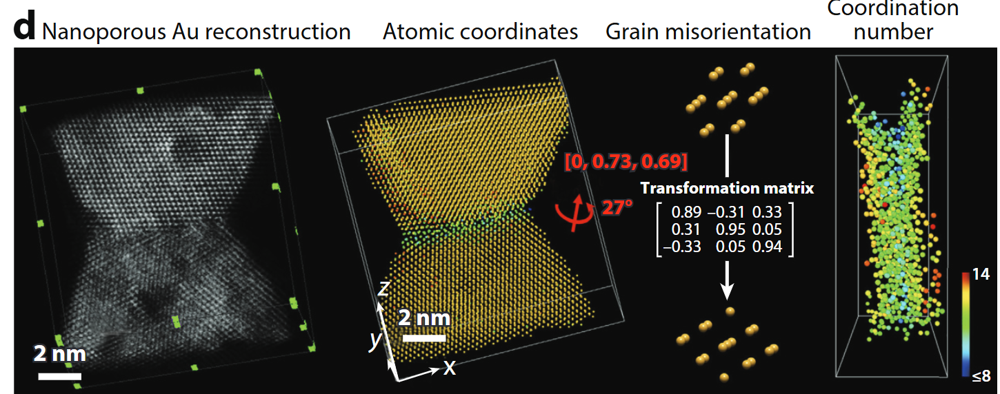
:::
::: {.column width="40%"}
- Tilt-series HAADF/ptychography + iterative reconstruction → **3-D coordinates of every atom** in ≤20 nm objects .  
- Enables full **strain tensors**, defect cores, compositional ordering.  
:::
:::

::: aside
@ophus2023quantitative
:::
---

## Simulation accelerators – PRISM  

::: columns
::: {.column width="60%"}
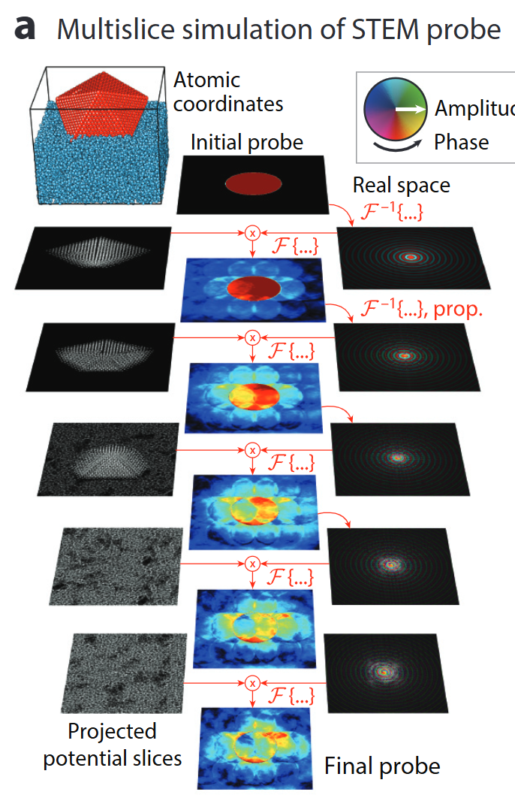{fig-align="center" width="40%"}
:::
::: {.column width="40%"}
- Quantitative STEM hinges on **ab-initio accurate multislice simulations**.  
- **PRISM** re-uses plane-wave slices → orders-of-magnitude faster with <1 % error .  
- Powers real-time experiment steering & big-data 4D-STEM analysis.  
:::
:::

::: aside
@ophus2023quantitative
:::
---

## Take-aways

- Modern aberration-corrected STEM delivers **Å-resolution imaging, diffraction, spectroscopy & tomography** within one instrument.  
- **Quantification** (composition, fields, 3-D structure) now matches the resolution.  
- Open-source **simulation & Python toolchains** are key enablers for truly **quantitative materials science**.  

## The data-driven TEM framework (*Figure 1*)

::: columns
::: {.column width="50%"}

:::
::: {.column width="50%"}
- Three nested layers turn unknown samples → **quantifiable descriptors**  
  1. **Experiment design**  
  2. **Feature extraction**  
  3. **Knowledge discovery**  
- Open, interoperable control + AI links all layers into a virtuous cycle.  
:::
:::

::: aside
@Spurgeon_2020
:::
---

## ① Experiment design (*Fig 1 top*)

::: columns
::: {.column width="48%"}

:::
::: {.column width="52%"}
- GPU-accelerated simulations predict **detection limits & dose budgets** before the first electron hits the sample.  
- ML mines prior-work databases (future) to recommend **optimal imaging / spectroscopy modes** in real time.  
- Outcome: fewer trial-and-error sessions; **cost & time savings**.  
:::
:::

::: aside
@Spurgeon_2020
:::
---

## ② Feature extraction (*Fig 1 middle*)

::: columns
::: {.column width="48%"}

:::
::: {.column width="52%"}
- Records complete data streams (e.g. **4D-STEM diffraction cubes**) for flexible post-processing  
- Combines complementary modalities to overcome projection & damage artefacts.  
- Requires **automation** and low-level access for batch surveys & *in-situ* studies.  
:::
:::

::: aside
@Spurgeon_2020
:::
---

## ③ Knowledge discovery (*Fig 1 bottom*)

::: columns
::: {.column width="48%"}

:::
::: {.column width="52%"}
- AI/ML trained on physical models classifies **multidimensional signals** → structure, bonding, dynamics.  
- FAIR data standards and open repositories enable **meta-analysis & reproducibility**.  
- Vision: adaptive microscopy where data choose the next experiment step on-the-fly.  
:::
:::

::: aside
@Spurgeon_2020
:::
---

## Detectors drive the data deluge (*Figure 2 a*)

::: columns
::: {.column width="48%"}
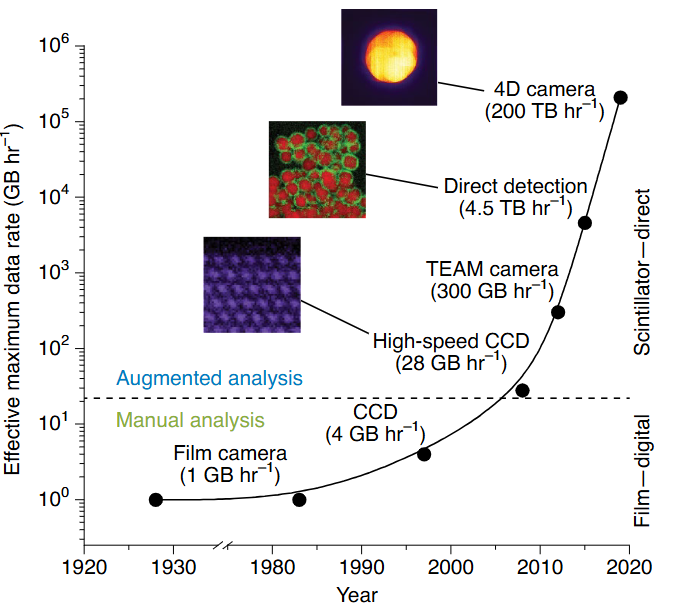
:::
::: {.column width="52%"}
- From film (1 GB h⁻¹) to **4D pixelated cameras (200 TB h⁻¹)** – a 10⁸× leap in two decades.  
- Computing & storage must scale in lock-step; edge processing at the microscope becomes essential.  
:::
:::

::: aside
@Spurgeon_2020
:::
---

## Workflow evolution (*Figure 2 b*)

::: columns
::: {.column width="48%"}
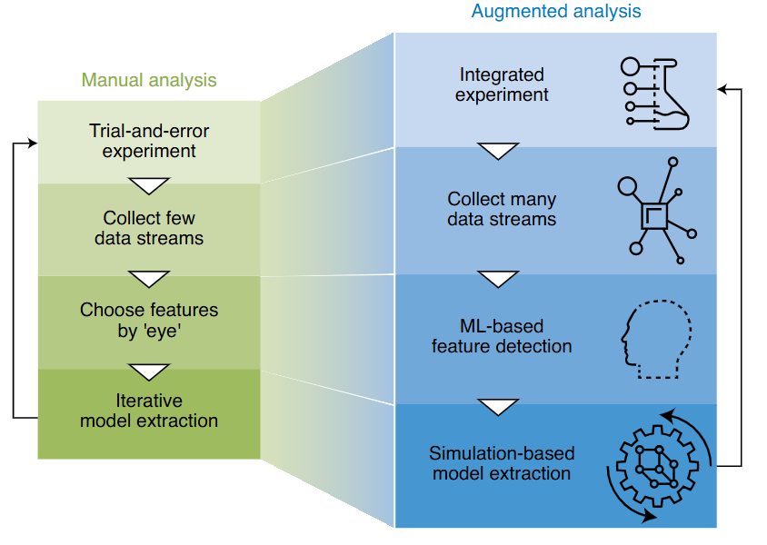
:::
::: {.column width="52%"}
- **Manual**: choose features “by eye”, serial data, iterative models.  
- **Augmented**: collect **many data streams**, ML finds features, simulation-based model extraction.  
- Integrated experiment control enables **closed-loop, crowd-sourced** materials discovery.  
:::
:::

::: aside
@Spurgeon_2020
:::
---

## Take-aways

- Modern STEM now spans **Å-scale resolution & petabyte-scale data**.  
- A three-layer, open architecture (design → extraction → discovery) lets AI and simulation turn data into insight.  
- Detector advances + FAIR data infrastructure set the stage for **truly adaptive, autonomous microscopy**.  

## Course outline

Source: [pelzlab.science/DataScienceForElectronMicroscopy](https://pelzlab.science/DataScienceForElectronMicroscopy/)

::: {style="font-size: 0.62em;"}
| Wk | Date | Topic | Wk | Date | Topic |
|---|---|---|---|---|---|
| 1 | 23.10.2026 | Python crash course & the EM data deluge | 8 | 11.12.2026 | Small data: augmentation, transfer & self-supervision |
| 2 | 30.10.2026 | Learning from EM data: signal formation, noise & loss | 9 | 18.12.2026 | Unsupervised learning, autoencoders & latent spaces |
| 3 | 06.11.2026 | Linear algebra, PCA & spectral unmixing | 10 | 08.01.2027 | Attention, transformers & graph networks for EM |
| 4 | 13.11.2026 | Regression, optimisation & honest validation | 11 | 15.01.2027 | Uncertainty, Gaussian processes & autonomous EM |
| 5 | 20.11.2026 | From images to features: descriptors & tree ensembles | 12 | 22.01.2027 | Inverse problems I: regularisation, tomography & sensor fusion |
| 6 | 27.11.2026 | Neural networks & backpropagation | 13 | 29.01.2027 | Inverse problems II: ptychography, generative priors & synthesis |
| 7 | 04.12.2026 | CNNs & U-Nets for microscopy | — | 05.02.2027 | Exam revision |
:::






<!-- BEGIN prev-next -->

## Continue

- &rarr; Next: [Unit 02 &mdash; Learning from EM data: signal formation, noise \& loss](../02_em_data_formation/01_intro.html)
- [All courses](../../index.html)

<!-- END prev-next -->

## References
::: {#refs}
:::


<script>
document.getElementById("marimo-frame").onload = function() {
    try {
        let iframeDoc = document.getElementById("marimo-frame").contentWindow.document;
        let marimoBadge = iframeDoc.querySelector("div.fixed.bottom-0.right-0.z-50");
        if (marimoBadge) {
            marimoBadge.style.display = "none";
            console.log("Marimo badge hidden successfully.");
        } else {
            console.log("Badge not found.");
        }
    } catch (error) {
        console.warn("Unable to modify iframe content due to CORS restrictions.");
    }
};
</script>
</div>